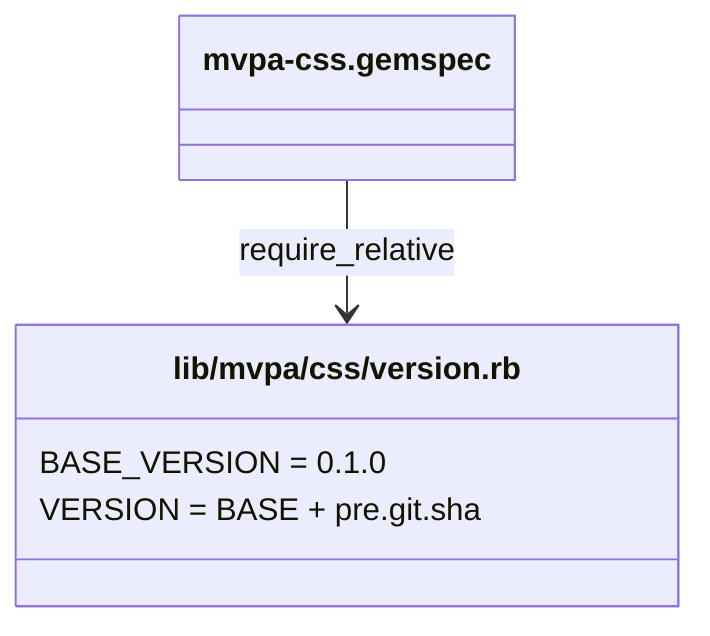
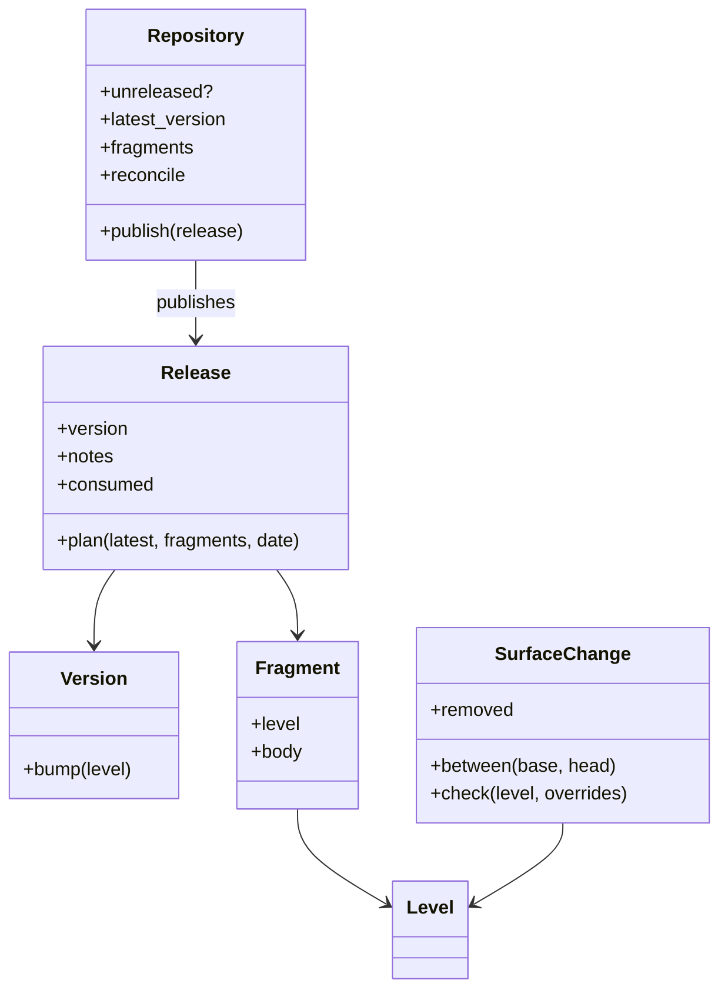
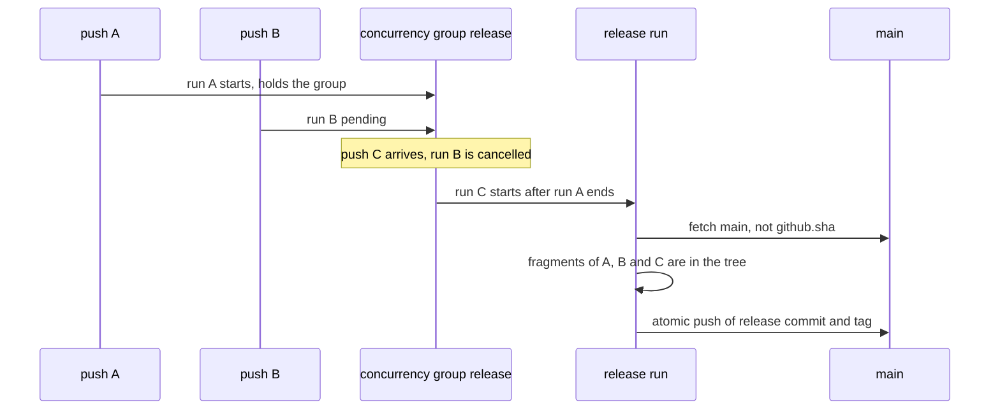
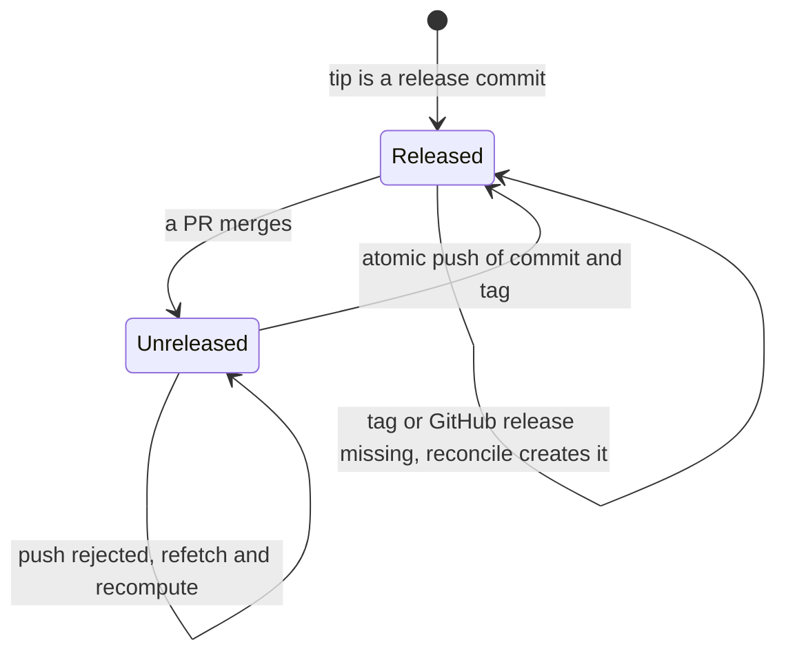

# Plan: Adopt semantic versioning with release on merge

Author: Etienne van Delden. Status: accepted (2026-11-25). Type: feature. Delivery: autonomous. Codex review: no.

## Problem

Apps pin mvpa.css to a git SHA. A SHA does not say whether an upgrade is a breaking change, so an app owner cannot tell a safe bump from one that needs markup changes. Nothing tells an agent to record or flag a breaking change, and nothing in CI notices when one slips through. Several branches are open at once and merge in any order, so a version number chosen inside a branch can collide or be wrong.

## Proposed outcome

Every release has a semver version: major for a breaking change, minor for an opt-in feature, patch for a fix and for anything else that merges. The version is assigned when a change merges to `main`, from the changes that merged, never inside a branch. Agents have written rules on when a change is breaking and what to record. CI fails a pull request that removes public surface without recording a breaking change. The history gets versions once, retroactively, so apps can pin any past state.

## Affected users and systems

- Apps that pin mvpa.css by `ref:` SHA, and their agents.
- Agents and people who write changes in this repository.
- `lib/mvpa/css/version.rb`, `CHANGELOG.md`, `README.md`, `AGENTS.md` (`CLAUDE.md` is a symlink to it), `.github/workflows/`, `test/`.
- Git tags and GitHub releases.
- The sibling repository appkit (session `appkit-ec`), which makes the same change and shares the design.

## Constraints

- Bump rule: major when apps must change markup, classes, configuration or code (the fragment then has Upgrading steps); minor for an opt-in feature; patch for a fix and for anything else. A fragment states its level in an explicit `level` field.
- A merge to `main` always releases at least a patch, including a docs, test or CI-only merge with no fragment. This differs from appkit, which has a `none` level and releases nothing for it.
- Branches merge in any order, so no branch holds a version number.
- No merged change is lost. Merges that land while a release run is still going may share one release at the highest level; a merge that lands after the release push but before the release run ends gets the next release. Two merges that land after a release finished produce two releases.
- `main` has no branch protection, and only merge commits are allowed, so the release workflow may push to `main` with `GITHUB_TOKEN`.
- Rule 13: Etienne's acceptance of this plan approves new `.github/workflows/release.yml` and `.github/workflows/surface.yml`. No other workflow, deploy file or `production.rb` changes. `ci.yml` stays unchanged.
- Rule 11: no new gem, package or GitHub Action beyond `actions/checkout` and the `spinel-coop/setup-rv` action `ci.yml` already uses. Release code is stdlib Ruby.
- Rule 9 and rule 8: no migration, no system tool change.
- Retroactive tags are pushed only after Etienne approves the entry-to-commit-to-version table (stop-and-ask).
- Apps already pinned to a SHA keep working: SHAs stay valid. The four SHA-named tags and releases stay as they are.
- Share one design with appkit: same fragment format, level names and workflow shape. Each repository keeps its own copy of the script and of the CI check. No shared gem or action.

## In scope

- Retroactive versions for every dated changelog entry, starting at 0.1.0 for the first entry, each entry with `### Upgrading` raising the major, and git tags `vX.Y.Z` on the matching commits, after Etienne approves the table.
- One fragment file per pull request, `changelog.d/<branch-slug>.md`, with front matter `level: major|minor|patch` and an optional `overrides: {rule_id: reason}`, the Added/Changed/Fixed text and optional Upgrading steps. A pull request never edits `CHANGELOG.md`.
- `release.yml`: on push to `main`, one run at a time, it reads state from the tip of `main`, stamps `version.rb` and a `## X.Y.Z - YYYY-MM-DD` heading in `CHANGELOG.md`, deletes the consumed fragments, tests, commits, tags `vX.Y.Z` and creates the GitHub release.
- `surface.yml`: on a pull request, fails when the diff from the merge base removes or renames public surface while the fragment level is below major. Public surface is `--token` names in `0_base/0_variables.css`, stylesheet and JS files, class selectors, `data-` attribute selectors, importmap pins and files in `app/javascript`. Element-structure contracts such as `nav.rail` have no automatic check; `AGENTS.md` says changing one needs `level: major`.
- Agent rules in `AGENTS.md` on versioning and breaking changes. README and CHANGELOG header change from "git SHAs" to semver pins.
- `version.rb` stops reading the git SHA.

## Out of scope

- Publishing to rubygems.org.
- Changing the CSS itself.
- Updating consuming apps' pins; the rollout of the new version to apps is separate.
- Rewriting or deleting the four existing SHA-named tags and releases.
- A permanent retroactive-tagging command: the table and tags are a one-off.

## Acceptance criteria

- A merge whose fragment says `level: major` raises the major version and resets minor and patch to zero.
- A merge whose fragment says `level: minor` raises the minor version and resets patch to zero.
- A merge whose fragment says `level: patch`, or a merge with no fragment, raises the patch version.
- Two fragments in one release, minor and major, release one major version.
- Two branches merged one after the other, each after the previous release finished, give two releases with distinct versions.
- Two branches merged while a release run is going, or seconds apart, lose no fragment: every fragment ends up in exactly one release, and releases that share fragments use the highest level.
- Rerunning the release workflow on a tip that is a release commit releases nothing.
- A release whose tests fail pushes no commit and no tag, and its fragments stay for the next run.
- A release whose commit and tag cannot both be pushed pushes neither.
- A pull request that removes a public CSS custom property with `level: minor` fails CI; the same pull request with `level: major` passes.
- A pull request that removes a public CSS custom property with `level: minor` and `overrides: {token: "reason"}` passes, and the check prints the override and its reason.
- A fragment whose `overrides` names an unknown rule id, or gives an empty reason, is invalid.
- A pull request that renames a class selector, deletes a stylesheet, removes a `data-` attribute selector or removes an importmap pin, with a level below major, fails CI.
- A pull request that removes something that `main` already lost, including a token that both branches removed independently, is not blamed for it.
- A fragment with a missing or unknown level, a `major` fragment without numbered `### Upgrading` steps, or a fragment below major that has an `### Upgrading` section is invalid, and CI fails the pull request that adds it.
- `Mvpa::Css::VERSION` returns the released `X.Y.Z`, not a SHA, and `gem build` produces `mvpa-css-X.Y.Z.gem`.
- The changelog shows a version in the heading of each of the 15 dated entries, each Upgrading entry as a major, after Etienne approves the table.
- An app can pin `tag: "vX.Y.Z"` for any entry, and the README says how.
- `AGENTS.md` tells an agent when a change is breaking, where its fragment goes and that it never writes a version number.

## Decisions

- One plan covers adopting semver, release automation and breaking-change detection — Etienne chose to keep them together.
- Major when apps must act, minor for an opt-in feature, patch otherwise — reuses the convention in the changelog rules.
- Version every changelog entry retroactively — apps can pin any past state.
- A PR declares its bump in an explicit `level` field in its fragment, not a label or a version number — merge order must not matter, and CI can cross-check the level against the diff.
- Every merge to `main` releases a patch at least — Etienne's choice, no reason given.
- Fragment files, one per PR, as appkit designs them — Etienne wants the two repositories aligned.
- Share one design with appkit, copy the script per repo — avoids a new shared dependency.
- Public surface for CI is custom properties, files, class and data selectors, importmap pins and controllers; markup contracts stay a manual agent rule — Etienne selected all four.
- Changelog headings read `## X.Y.Z - YYYY-MM-DD` with a hyphen — Etienne wants appkit and mvpa.css to use the same format; this replaces the earlier em dash.
- A fragment may carry an optional `overrides: {rule_id: reason}` front-matter key; a rule id must name a known rule and the reason must be a non-empty string; the PR check prints each override; fragments without the key stay valid — Etienne asked for the same fragment format as appkit, overriding his earlier pick to leave it out.
- Repo-specific code lives in two files, `rules.rb` (the public-surface rules) and `stamp.rb` (the stamped files), and the rest of `script/semver/` is generic and identical in both repositories — Etienne asked for the same layout as appkit so the copies stay diffable.
- Start retroactive numbering at 0.1.0 like appkit — Etienne chose it to match appkit.
- Deliver autonomously, no Codex implementation review — Etienne chose it; the plan critique is the second-model read.
- Record the tip-derived robust design — it survives the cancellation of a pending run; Etienne agreed it, accepting that a burst of merges can share one release.

## Open questions

None.

## Design

### Domain terms

- **Fragment**: one `changelog.d/<slug>.md` file with a Level in front matter and `### Added|Changed|Fixed|Upgrading` sections.
- **Level**: patch, minor or major, ordered; the highest wins. Avoid: bump type, label.
- **Release**: the plan for one version: the next Version, the changelog text and the fragments it consumes.
- **Release commit**: a commit on `main` with subject `Release vX.Y.Z`. It changes only `version.rb`, `CHANGELOG.md` and `changelog.d/`.
- **Unreleased**: `main` has a commit after the latest release commit. It is the only trigger for a release.
- **Public surface**: the names an app can depend on, as listed in scope.

New terms go into `GLOSSARY.md` on acceptance: Fragment, Level, Release commit, Public surface.

### Diagrams

Before: `lib/mvpa/css/version.rb` asks git for a SHA at load time and the gemspec reads it. Nothing else knows about versions.



After:



Two merges seconds apart; run B is cancelled by push C, and run C still releases all three fragments.



State derived from git, stored nowhere:



### Signatures

All code is stdlib Ruby in `script/semver/`, module `Semver`. Generic files, identical in appkit: `level.rb`, `version.rb`, `fragment.rb`, `release.rb`, `repository.rb`, `surface_change.rb` and the two executables. Repo-specific files: `rules.rb` (the public-surface rules, with the extraction rules below) and `stamp.rb` (the stamped files and how each is rewritten). It sits outside `lib/`, so `spec.files` does not ship it. Each executable is about six lines: build the objects, send one message, print.

```ruby
module Semver
  # One of patch, minor or major. Ranked, so max works.
  class Level
    include Comparable

    #: (String) -> Level   raises Fragment::Invalid on an unknown name
    def self.parse(name); end

    #: (Level) -> Integer
    def <=>(other); end

    #: () -> bool
    def major?; end

    #: () -> String
    def to_s; end
  end

  # A semantic version that knows how to bump itself.
  class Version
    include Comparable

    #: (String) -> Version   raises ArgumentError when not X.Y.Z
    def self.parse(text); end

    #: (Level) -> Version   major resets minor and patch; minor resets patch
    def bump(level); end

    #: (Version) -> Integer
    def <=>(other); end

    #: () -> String
    def to_s; end
  end

  # One PR's changelog entry. Validates itself on read.
  class Fragment
    class Invalid < StandardError; end

    #: (String) -> Fragment   raises Invalid on front matter that is not a mapping, text before the first ### heading, a repeated or unknown heading, no section at all, a missing or unknown level, a major without non-empty numbered ### Upgrading steps, an ### Upgrading section below major, an override naming a rule id that Rules lacks, or an override with an empty reason
    def self.read(path); end

    #: () -> Hash[String, String]   rule id => reason; empty when the fragment has no overrides key; raises Invalid when the value is not a mapping
    def overrides; end

    #: () -> Array[String]   each numbered Upgrading step with its indented continuation lines; raises Invalid on any other line
    def upgrading_steps; end

    #: () -> void   checks the level, the Upgrading rule and the overrides
    def validate; end

    #: () -> Level
    def level; end

    #: () -> Hash[String, String]   heading => body
    def sections; end

    #: () -> String
    def path; end
  end

  # The next version and its notes. Pure: no git, no clock.
  class Release
    #: (latest: Version, fragments: Array[Fragment], date: Date) -> Release   no fragments means a patch
    def self.plan(latest:, fragments:, date:); end

    #: () -> Version
    def version; end

    #: () -> String   "## X.Y.Z - YYYY-MM-DD" plus merged sections in the order Added, Changed, Fixed, Upgrading; an empty section is omitted; Upgrading steps of all fragments form one continuous numbered list, in the order the fragments were added
    def notes; end

    #: () -> Array[String]   fragment paths to delete
    def consumed; end
  end

  # The checkout the run works in. Owns every git and gh call.
  class Repository
    #: (runner: ^(Array[String]) -> String) -> void
    def initialize(runner: Shell.new); end

    #: () -> bool   true when commits exist after the latest "Release v" commit
    def unreleased?; end

    #: () -> Version   max of version.rb and the highest vX.Y.Z tag
    def latest_version; end

    #: () -> Array[Fragment]
    def fragments; end

    #: () -> Version?   the released version, or nil when nothing needed a release; up to 3 attempts; each attempt fetches, plans a fresh Release from the tip's fragments, stamps, tests, commits and pushes atomically; then gh release
    def publish; end

    #: () -> void   for every release commit newer than the newest GitHub release, creates a missing tag and release; checks the remote tag points at that commit; fails closed on API errors
    def reconcile; end
  end

  # A read-only view of the tree at one git ref: the generic input of every rule.
  class Snapshot
    #: (String) -> Snapshot   the tree at the git ref
    def self.at(ref); end

    #: () -> Array[String]   all tracked paths
    def paths; end

    #: (String) -> String   file content, or an empty string when the path is absent
    def read(path); end
  end

  # What a PR removed from the public surface. Generic: it only asks each rule in `Rules.all` to extract names from a Snapshot.
  class SurfaceChange
    #: (base: String, head: String) -> SurfaceChange   base is the base branch tip
    def self.between(base:, head:); end

    #: () -> Array[String]   (surface at `git merge-base base head` minus surface at head) intersected with surface at base, so a removal that main already made is not blamed
    def removed; end

    #: (Level, overrides: Hash[String, String]) -> Verdict   fails when a removed item is neither covered by an override for its rule id nor allowed by a major level; the verdict also lists every override used
    def check(level, overrides: {}); end
  end

  # What a pull request declares: the fragments it adds, read from the merge base, and the verdict that follows.
  class PullRequest
    #: (base: String, head: String, ?root: String) -> void
    def initialize(base:, head:, root: Dir.pwd); end

    #: () -> Verdict   fails on a fragment the PR edits or deletes, on an invalid fragment, and on removed surface below its highest added level
    def verdict; end
  end

  # The outcome of the check: whether it passed and the lines to print, failures first, then each override with its rule id and reason.
  class Verdict
    #: () -> bool
    def passed?; end

    #: () -> Array[String]
    def lines; end
  end

  # Repo-specific, in rules.rb: the public-surface rules for this repository.
  module Rules
    Rule = Data.define(:id, :extract)   # extract: ^(Snapshot) -> Set[String]

    #: () -> Array[Rule]   ids: token, file, class, data_attribute, importmap_pin; each rule owns the paths and patterns it reads
    def self.all; end

    #: () -> Array[String]
    def self.ids; end
  end

  # Repo-specific, in stamp.rb: the files a release stamps and how.
  module Stamp
    PATHS = %w[lib/mvpa/css/version.rb CHANGELOG.md].freeze
    CHECKS = [ %w[bundle exec rake test], %w[gem build mvpa-css.gemspec --output /dev/null] ].freeze   # run on the stamped tree before the push

    #: (String) -> String   reads the VERSION literal of version.rb
    def self.version_in(source); end

    #: (String, Version) -> String   rewrites the VERSION literal in version.rb
    def self.version_source(source, version); end

    #: (String, Release) -> String   inserts the release notes above the first release heading; raises if the heading exists
    def self.changelog_text(text, release); end
  end
end
```

`lib/mvpa/css/version.rb` becomes a plain `VERSION = "X.Y.Z"` literal, which Bundler git sources and `gem build` both load.

The extraction rules below live in `rules.rb`, one `Rule` per kind, each reading a `Snapshot` (built from `git show <ref>:<path>` and `git ls-tree -r --name-only <ref>`); `SurfaceChange` holds no path or pattern. Files: every path listed under `app/` and `config/importmap.rb`. Tokens: declarations `--name:` at the start of a line in `0_base/0_variables.css` only, so a `var(--name)` reference is not a token. Classes and `data-` attribute selectors: taken from selector preludes, the text before each `{` in every stylesheet under `app/assets/stylesheets/`, with `/* */` comments removed and at-rule preludes skipped, so a class in a comment or a declaration value does not count. Importmap pins: the logical name of each `pin "name"` and each `pin_all_from "dir", under: "name"`, found by scanning the whole file, so a formatting change or a multi-line call is not a removal. The flattened `mvpa.css` repeats partial selectors; items are a Set, so repeats collapse. A rename is the removal of the old name. The extraction is heuristic: the fixtures pin its known cases, and a missed case is a bug to fix, not a reason to raise a level.

Not checked: the repository has no Steepfile.

`release.yml` checks out `ref: main` with `fetch-depth: 0` and `fetch-tags: true`, never `github.sha`.

### Complexity

- Release run: O(F + T) git reads (F fragments, T tags), one checkout, at most 3 push attempts, one `gh` call. Runs are serial.
- Reconcile: O(1), latest tag only.
- Surface check: 4 git calls (two `ls-tree`, two `grep`), O(S) set difference in surface size.
- No database queries.

### Invariants

1. At most one release run executes at once. Enforced by `concurrency: release` with `cancel-in-progress: false`. Test: `release_workflow_test.rb`.
2. A release consumes every fragment in the tree at its own commit, and a fragment is deleted only in the commit that releases it. Enforced by `Release#consumed` and `git rm` in one commit. Test: `repository_test.rb` with a real temporary repository.
3. The released version is strictly greater than every `vX.Y.Z` tag and the `version.rb` value. Enforced by `Repository#latest_version` and `Version#bump`. Test: `version_test.rb`, `repository_test.rb`.
4. Branch tip and tag move together or not at all. Enforced by `git push --atomic`. Test: `repository_test.rb` with a rejecting remote.
5. A tag is never moved, deleted or forced. Enforced by `Repository#publish`, which fails when the tag exists on another commit. Test: `repository_test.rb`.
6. A tip that is a release commit starts no release. Enforced by `Repository#unreleased?`. Test: `repository_test.rb`.
7. The release level is the highest fragment level, patch with none. Enforced by `Release.plan`. Test: `release_test.rb`.
8. A fragment with a missing or unknown level, a major without numbered `### Upgrading` steps, or an Upgrading section below major is invalid. Enforced by `Fragment.read`. Test: `fragment_test.rb`.
9. A PR with removed public surface and a level below major fails, unless a valid override covers the removed item's rule id; an override covers only its own rule id. Enforced by `SurfaceChange#check`. Test: `surface_change_test.rb`.
10. A release commit holds only `version.rb`, `CHANGELOG.md` and `changelog.d/`. Enforced by `Repository#publish`. Test: `repository_test.rb`.
11. No workflow step uses a token other than `GITHUB_TOKEN`. Enforced and tested by `release_workflow_test.rb`.
12. `Mvpa::Css::VERSION` is a plain literal equal to the gemspec version. Enforced by `version.rb`. Test: `version_file_test.rb`.
13. An override names a known rule id and carries a non-empty reason, and the PR check prints each override it used. Enforced by `Fragment.read` and `SurfaceChange#check`. Test: `fragment_test.rb`, `surface_change_test.rb`.

### Alternatives

- **One `Release` class with `git grep` surface and a step in the `test` job.** Fewest files, but it reads fragments from the push diff: a run that GitHub cancels while pending loses its fragments. Rejected.
- **Ten small classes with a `Tree` test double.** Very testable, but it also reads the push diff, keeps git, tag and release lines in untested YAML and adds many shallow classes. Rejected.
- **Release PR (release-please style).** Robust to races, but needs a human merge for every release and another permission. Rejected.
- **`cancel-in-progress: true`.** It can interrupt a run after the push and before the tag. Rejected.
- **PAT or GitHub App to trigger CI on the release commit.** Reopens the loop risk and adds a secret; the release job tests the stamped tree itself. Rejected.

## Design decisions

- A PR's level is the highest level among the fragments that PR adds relative to the merge base (`git diff --diff-filter=A`), patch when it adds none; fragments already on `main` never mask it. The release run reads every fragment in the tree except `changelog.d/README.md`. `surface.yml` also fails a PR that edits or deletes a fragment it did not add.
- The surface check is its own workflow file, because `test/continuous_integration_test.rb` fixes the `ci.yml` job names. It stays a required-looking check in the PR list.
- The release job runs the test suite and `gem build` on the stamped tree before pushing, because a `GITHUB_TOKEN` push starts no CI on the release commit.
- A malformed fragment on `main` fails the run closed: a silent patch could hide a major. The `surface.yml` job validates the PR's fragment first.
- The release commit message carries `[skip ci]` as a second loop guard; the structural guard is `Repository#unreleased?`.
- A burst of merges can share one release, and one that lands mid-run gets the next. The README and `AGENTS.md` say so. The guarantee is "no lost change", not "one release per merge".
- The retroactive table is a one-off throwaway script kept in the scratchpad, not in the repository. Its rule: an entry with `### Upgrading` is a major; an entry with `### Added` and no Upgrading is a minor; otherwise a patch. Provisional result: 0.1.0 (02-13), 0.2.0 (03-04), 0.2.1 (07-14), 0.3.0 (07-15), 0.4.0 (08-14), 0.5.0 (09-04), 1.0.0 (10-13), 2.0.0 (10-19), 3.0.0 (10-25), 4.0.0 (10-26), 4.0.1 (10-29), 4.0.2 (10-30), 5.0.0 (11-03), 5.0.1 (11-06), 6.0.0 (11-11). Current version: 6.0.0. The commit for each entry is found at implement time and shown with the table for approval.
- Historical tags are aliases that pin old code, not stamped gem versions. A Gemfile pins code with `tag:`, so `tag: "v3.0.0"` resolves the old commit; `Mvpa::Css::VERSION` inside it still reports the old value. Stamped versions start at the first release after the adoption. The README says so. No consumer test uses a historical tag.
- This change's own fragment is `level: major`, chosen by Etienne over the plan's `minor` default: apps must change their pin from a SHA to a tag and stop expecting a `.pre.git.` suffix in `Mvpa::Css::VERSION`. The first real release is therefore 7.0.0.
- The release job gives `GH_TOKEN` only to the step that runs the release script, and pins `spinel-coop/setup-rv` to a commit SHA in the two new workflows, so a change to that action's `main` branch cannot run with write access. `ci.yml` is not touched.
- A fragment's Upgrading steps may continue on indented lines; any other line in the section is refused, because a dropped line would remove upgrade instructions without a warning.
- `AGENTS.md` carries the agent rules. `CLAUDE.md` is a symlink to it, so there is one edit.

## Integration points

- GitHub Actions: `release.yml` (`push` to `main`, `workflow_dispatch`) and `surface.yml` (`pull_request`). `GITHUB_TOKEN` with `contents: write` for the release job, `contents: read` for the surface job.
- `gh` CLI on the runner for `gh release create` and `gh release view`.
- Consuming apps pin `tag: "vX.Y.Z"` in their Gemfile; appkit runs the same design.
- Dependabot already watches `github-actions`; no change.

## Files that change

- `script/semver/level.rb`, `version.rb`, `fragment.rb`, `release.rb`, `repository.rb`, `surface_change.rb` — new, the generic logic.
- `script/semver/rules.rb`, `script/semver/stamp.rb` — new, the repo-specific rules and stamped files.
- `script/semver/release`, `script/semver/surface` — new executables, each about six lines.
- `.github/workflows/release.yml`, `.github/workflows/surface.yml` — new.
- `changelog.d/README.md` — new, how to write a fragment; `changelog.d/adopt-semver.md` — this change's fragment.
- `lib/mvpa/css/version.rb` — plain literal.
- `CHANGELOG.md` — new header text; every dated heading becomes `## X.Y.Z - YYYY-MM-DD` after Etienne approves the table.
- `README.md` — pin by `tag:`, semver explanation, burst behaviour.
- `AGENTS.md` — versioning and fragment rules replace the SHA changelog rules.
- `test/changelog_upgrading_test.rb` — the `entry(date)` pattern starts at `## X.Y.Z - date` and ends at the next `## X.Y.Z - ` heading, both boundaries changed; a new test asserts each extracted entry holds exactly one release heading.
- `test/agents_md_test.rb` and `test/readme_test.rb` — follow the new rules and README text.
- `test/semver/*_test.rb`, `test/semver/release_workflow_test.rb` — new.
- `GLOSSARY.md` — four terms, on acceptance.

## Order of work

1. Write the acceptance test for the first criterion (two fragments, one major release): `test/semver/release_acceptance_test.rb`, run it, watch it fail.
2. `Level`, `Version`, `Rules`, `Fragment` with their unit tests, then `Release.plan` and `Stamp` until the acceptance test passes.
3. `SurfaceChange` with a temporary git repository per case.
4. `Repository` against real temporary repositories, including a rejecting remote and a stale tip.
5. The two executables, then `lib/mvpa/css/version.rb` as a literal with its test.
6. `release.yml`, `surface.yml` and `release_workflow_test.rb`.
7. Docs: `changelog.d/README.md`, this change's fragment, `AGENTS.md`, `README.md`, the CHANGELOG header, and the three existing tests that read them.
8. Retroactive table: build it, run `delivery-evidence` checks, then stop and ask Etienne to approve the table. After approval rewrite the CHANGELOG headings and update `version.rb` to 6.0.0. Push the tags only after the PR is delivered, and only on that approval.
9. Run the full suite, rubocop, stylelint, yamllint and `gem build`.

## Risks

- The surface regexes are heuristic: a false major (a removed class nobody used) or a miss (a changed token value). A level can be raised to override a false flag.
- A hand-made tag collision stops the release run and needs a human.
- A malformed fragment on `main` blocks releases until fixed.
- The first run after merge is the first real test of `release.yml`; `workflow_dispatch` allows a manual repair.
- Pushing to `main` from the workflow stops working if branch protection is added later; `AGENTS.md` records that the bot then needs a bypass.
- A release job that re-runs tests is slower than a plain stamp-and-push.

## Proof

- Two fragments, one major release → `test/semver/release_acceptance_test.rb` `test_two_fragments_release_one_major_version`
- Major raises the major and resets the rest → `test/semver/version_test.rb` `test_major_resets_minor_and_patch`
- Minor raises the minor and resets patch → `test/semver/version_test.rb` `test_minor_resets_patch`
- Patch fragment or no fragment raises the patch → `test/semver/release_test.rb` `test_a_patch_fragment_releases_a_patch`, `test_no_fragment_releases_a_patch`
- Two releases when merged after a finished release → `test/semver/repository_test.rb` `test_a_second_merge_after_a_release_makes_a_second_release`
- A burst shares one release, no fragment lost → `test/semver/repository_test.rb` `test_fragments_from_several_merges_share_one_release`
- Rerun on a release commit releases nothing → `test/semver/repository_test.rb` `test_a_release_commit_tip_releases_nothing`
- Failing tests push nothing → `test/semver/repository_test.rb` `test_failing_tests_push_no_commit_and_no_tag`
- Commit and tag go together or not at all, and a retry replans → `test/semver/repository_test.rb` `test_a_rejected_push_leaves_the_branch_and_the_tag_unchanged`, `test_a_major_fragment_arriving_mid_run_is_in_the_retried_release`, `test_the_push_command_is_atomic`
- Removed token at minor fails, at major passes → `test/semver/surface_change_test.rb` `test_a_removed_token_fails_below_major`, `test_a_removed_token_passes_at_major`, `test_a_token_override_does_not_hide_a_class_removal`
- Renamed class, deleted stylesheet, removed data attribute and removed importmap pin fail below major → `test/semver/surface_change_test.rb` `test_each_kind_of_removed_surface_fails_below_major`, `test_a_class_in_a_comment_is_not_surface`, `test_a_token_reference_is_not_a_token`, `test_an_importmap_reformat_is_not_a_removal`, `test_a_selector_repeated_in_the_manifest_counts_once`
- A removal already on main is not blamed → `test/semver/surface_change_test.rb` `test_removals_merged_to_main_are_not_blamed`, `test_a_token_removed_on_both_branches_is_not_blamed`
- An override passes the check and is printed; an invalid override is refused → `test/semver/surface_change_test.rb` `test_an_override_passes_and_is_listed`, `test_an_override_does_not_cover_another_rule`, `test/semver/surface_executable_test.rb` `test_the_check_exits_zero_and_prints_the_rule_id_and_reason`, `test/semver/fragment_test.rb` `test_an_unknown_rule_id_is_invalid`, `test_an_empty_reason_is_invalid`
- Invalid fragments → `test/semver/fragment_test.rb` `test_a_missing_level_is_invalid`, `test_an_unknown_level_is_invalid`, `test_a_major_without_upgrading_is_invalid`, `test_upgrading_below_major_is_invalid`, `test_the_readme_in_changelog_d_is_not_a_fragment`
- `VERSION` is a literal and matches the gem → `test/semver/version_file_test.rb` `test_the_gem_version_is_the_plain_version_literal`
- Every changelog entry has a version → `test/changelog_upgrading_test.rb` `test_every_entry_heading_starts_with_a_version`, `test_each_entry_holds_exactly_one_release_heading`
- README says how to pin a tag → `test/readme_test.rb` `test_the_readme_pins_by_tag`
- `AGENTS.md` says when a change is breaking → `test/agents_md_test.rb` `test_the_changelog_rule_says_a_fragment_states_the_level`
- Invariant: at most one release run, minimal permissions, `--atomic`, `ref: main`, no PAT, enforced by `release.yml` → `test/semver/release_workflow_test.rb` `test_the_release_runs_one_at_a_time`, `test_the_release_pushes_atomically_from_main`, `test_the_release_uses_only_the_github_token`
- Invariant: generic files hold nothing repository-specific → `test/semver/generic_files_test.rb` `test_generic_files_name_no_repository_paths`
- The walking skeleton: two fragments end as one release on the remote → `test/semver/release_acceptance_test.rb` `test_two_fragments_release_one_major_version`
- Upgrading steps keep their continuation lines → `test/semver/release_test.rb` `test_notes_keep_the_continuation_lines_of_a_step`, `test/semver/fragment_test.rb` `test_an_indented_continuation_belongs_to_its_step`, `test_an_upgrading_line_that_is_not_a_step_is_invalid`
- Malformed fragments are refused with a reason → `test/semver/fragment_test.rb` `test_an_overrides_value_that_is_not_a_mapping_is_invalid`, `test_front_matter_that_is_a_list_is_invalid`, `test_text_before_the_first_heading_is_invalid`, `test_a_repeated_heading_is_invalid`, `test_a_fragment_without_a_section_is_invalid`
- A no-op rerun says so → `test/semver/repository_test.rb` `test_publish_returns_the_released_version_and_nil_when_nothing_is_released`
- The write token reaches one step, and third-party actions are pinned → `test/semver/release_workflow_test.rb` `test_the_token_reaches_only_the_release_step`, `test_every_third_party_action_is_pinned_to_a_commit`
- Invariant: tag never moved → `test/semver/repository_test.rb` `test_a_tag_on_another_commit_stops_the_release`
- A release whose GitHub release failed after the push is repaired before a later merge advances the version → `test/semver/repository_test.rb` `test_a_missing_release_is_repaired_before_the_next_release`
- Invariant: release commit holds only three paths → `test/semver/repository_test.rb` `test_the_release_commit_holds_only_the_stamped_paths`
- Query count: not applicable, the change has no database.
- Retroactive table approved by Etienne → check: Etienne approves the printed table before `delivery-evidence record --kind check --name retroactive-table`
- First real release → check: after merge, read the computed version from the release commit subject, then `git ls-remote --tags origin vX.Y.Z` shows it on that commit, `gh release view vX.Y.Z` shows its notes, `changelog.d/` holds only `README.md` and `lib/mvpa/css/version.rb` reports `X.Y.Z`

Per changed file, the unit tests expected, named as behaviour:
- `script/semver/level.rb`: `Level.parse names the three levels`, `Level.parse refuses an unknown name`, `Level orders patch below minor below major`
- `script/semver/version.rb`: `Version.parse reads X.Y.Z`, `Version.parse refuses text that is not X.Y.Z`, `Version#bump resets lower parts`
- `script/semver/fragment.rb`: `Fragment.read reads the level and the sections`, `Fragment.read refuses a missing level`, `Fragment.read reads overrides`, `Fragment.read refuses an unknown rule id`, `Fragment.read refuses an empty reason`
- `script/semver/rules.rb`: `Rules.ids names token, file, class, data_attribute and importmap_pin`
- `script/semver/stamp.rb`: `Stamp.version_source rewrites the literal`, `Stamp.changelog_text inserts above the first release heading`, `Stamp.changelog_text refuses a heading that exists`
- `script/semver/release.rb`: `Release.plan takes the highest level`, `Release#notes numbers the Upgrading steps continuously`
- `script/semver/repository.rb`: `Repository#unreleased? is false at a release commit`, `Repository#latest_version is the max of version.rb and tags`, `Repository#publish replans from scratch after a rejected push`, `Repository#reconcile repairs every release commit without a tag or release, oldest first`, `Repository#reconcile fails closed on a gh error`
- `script/semver/surface_change.rb`: `SurfaceChange#removed lists removed tokens, files, classes, data attributes and pins`, `SurfaceChange#check passes at major`, `SurfaceChange#check passes when an override covers the removed rule and lists it`, `SurfaceChange#check fails for a removal that no override covers`, `Verdict#lines puts failures first and then each override`

Test setup: Minitest. Each `Repository` and `SurfaceChange` case builds a temporary git repository with a bare repository as `origin`; `Release`, `Version`, `Level` and `Fragment` tests use strings and temporary files. The runner for `gh` is a recording fake. No network.

---
Domain skills applied: software-design, glossary, diagrams, object-oriented-design, ruby-style.

## Critique

### Round 1 (Codex)

- The batching guarantee exceeds the agreed decision → fixed (the promise is now "no lost change"; a merge landing mid-run gets the next release)
- The retry contract cannot safely reuse its supplied Release → fixed (`Repository#publish` takes no Release and replans on every attempt; a mid-run major has a test)
- Reconciliation can strand a missing GitHub release → fixed (reconcile repairs every release commit newer than the newest GitHub release before advancing, fails closed, checks the remote tag target; a test covers it)
- Merge-base comparison does not satisfy the "already removed on main" criterion → fixed (removed items are intersected with the base tip surface; a both-branches-removed test)
- The surface extraction rules are too vague → fixed (rules per kind written into Signatures; fixtures for comment, reference, importmap reformat and duplicate manifest)
- Fragment validation does not enforce the declared policy → fixed (Upgrading below major is invalid, major needs numbered steps, the README is excluded, a PR's level comes from its own added fragments)
- Historical tags do not retroactively change gem versions → dismissed: a tag pins old code and the Gemfile `tag:` resolves it; stamped versions start at the first release after adoption, and the README says so
- The changelog helper needs both regex boundaries changed → fixed (both boundaries change; a new exactly-one-heading test)
- The Proof lines do not prove several stated outcomes → fixed (explicit patch-fragment test, both-refs-unchanged test, push-command test through the recording runner)
- The final release check can pass without verifying the release → fixed (the check reads the computed tag from the remote, the release notes, the consumed fragments and the reported version, and the checkout settings are stated)
  - The consumer-installation test the critique also asked for is not added: it needs the network and adds nothing the remote checks do not show.

### Round 2 (Codex)

- Successful overrides have no defined reporting path → fixed (`SurfaceChange#check` returns a `Verdict` with `passed?` and `lines`, which lists the overrides used; a new executable test checks exit status zero and stdout with the rule id and reason)
- The generic-file promise does not match the design → fixed (path and pattern knowledge moves into `rules.rb`; `SurfaceChange` asks each `Rule` to extract from a generic `Snapshot`; a test checks that generic files name no repository path)
  - A file-by-file comparison with appkit's copy is not a test in this repository: the two repositories' interfaces (`Rule` and `Snapshot` here, appkit's own names) are agreed between the two sessions, and Etienne decides any difference.
- Invariant 9 still prohibits the newly accepted override behavior → fixed (invariant 9 now says "unless a valid override covers the removed item's rule id"; a mixed-removal test proves an override does not hide another rule)
