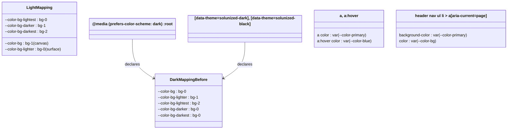
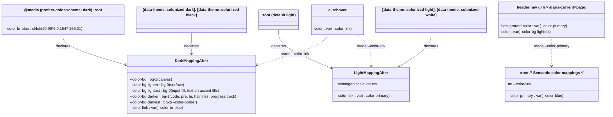
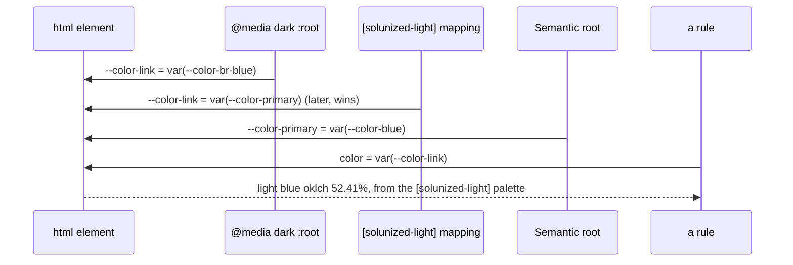

# Plan: Dark-mode surfaces darker than the canvas

From `intent.md` (2026-11-06, revised the same day). Status: accepted.

## Design

### Domain terms

From the glossary: **Sidebar card**, **Period navigation**, **Segmented control**.

New terms, written into `GLOSSARY.md` by this change:

- **Canvas** — the page background behind every surface, the `--color-bg` token. Avoid: page colour, base.
- **Surface** — an element painted on the canvas: the sidebar card, an article, a table head, a dialog, an open details, the period navigation. It uses the `--color-bg-lighter` token. Avoid: panel, card (except the sidebar card).
- **Link colour** — the text colour of a plain link, the `--color-link` token. Each theme mapping sets it: the primary blue in light themes, the brighter blue (`--color-br-blue`) in dark themes. Avoid: primary (for links).

Plan-only aids, not for the glossary:

- **Palette step** — one of `--color-bg-0`, `--color-bg-1`, `--color-bg-2` in a theme. In light themes `bg-0` is the lightest step; in dark themes `bg-0` is the darkest step.
- **Mapping block** — a rule in `4_theme/0_colors.css` that maps a theme's palette steps to the scale tokens. There are four: the default light `:root`, the system-dark `@media (prefers-color-scheme: dark) :root`, the `[data-theme="solunized-dark"], [data-theme="solunized-black"]` mapping and the `[data-theme="solunized-light"], [data-theme="solunized-white"]` mapping.
- **Semantic root** — the last `:root` rule in `0_colors.css`, under `/* Semantic color mappings */`. It loads after every mapping block at equal specificity, so a token declared there overrides every theme.

The scale tokens `--color-bg-lighter`, `--color-bg-lightest`, `--color-bg-darker` and `--color-bg-darkest` keep their names. In dark themes they name a role, not a lightness. `eink-dark` already uses them this way.

### Diagrams

Before: the dark mapping differs from the light mapping, and every link reads `--color-primary`.

After: both dark blocks declare the same five scale values as the light mapping, and each mapping block declares the link colour.

How the cascade resolves the hardest combination, system dark with `data-theme="solunized-light"`. All blocks match `<html>` at specificity (0,1,0), so the later one wins.

### Signatures

Not affected: the change sets CSS custom property values and edits two declarations in existing rules. It adds Minitest tests. There is no Ruby library API.

The public CSS interface gains one custom property: `--color-link`, the text colour of a plain link. Each mapping block declares it; the semantic root never does.

Not checked: mvpa.css has no Steepfile and no RBS setup, and this change adds no Ruby library code.

### Complexity

Not affected: no runtime path and no query. Two custom properties are new per rendering: `--color-link`, and `--color-br-blue` in the system-dark block. One `var()` hop is added to the link colour.

### Invariants

- In every dark rendering (system dark default, `solunized-dark`, `solunized-black`), the surface step is darker than the canvas step. Enforced by the two dark mapping blocks in `4_theme/0_colors.css` and their copies in `mvpa.css`.
- In those three renderings, body text (`--color-fg-0`) reaches WCAG AA (4.5:1) on the canvas, a surface, an input fill and a code block, and text on the four accent fills reaches 4.5:1. Enforced by the palette values and the mapping.
- The border step (`--color-bg-darkest`) is lighter than the canvas step and the surface step in every dark rendering, so `--color-border` shows on both. Enforced by the mapping.
- The hairline step (`--color-bg-darker`) differs from the surface step in every dark rendering, so hairlines show on surfaces. Enforced by the mapping.
- The page paints the canvas, and the sidebar card and articles paint the surface. Enforced by `0_base/1_reset.css`, `1_layout/0_header.css` and `2_modules/8_article.css`.
- In the three dark renderings, an unvisited link, hovered or not, resolves to `--color-br-blue` and scores at least 4.49:1 on the canvas. Enforced by `--color-link: var(--color-br-blue);` in both dark mapping blocks and by `a` and `a:hover` reading `var(--color-link)`.
- The system-dark block declares `--color-br-blue` with the same value as `[data-theme="solunized-dark"]`, so the link never resolves to an undefined token. Enforced by the hand-copied value; a test compares the two strings.
- In every light rendering, including `solunized-light` and `solunized-white` under system dark, a link resolves to `--color-primary`. Enforced by `--color-link: var(--color-primary);` in the default light `:root` and the light/white mapping, which comes after the system-dark block.
- The semantic root never declares `--color-link`. A declaration there would override every theme.
- The current-page sidebar link text is `--color-bg-lightest` on the `--color-primary` fill and scores at least 4.5:1 in solunized-dark. Enforced by `2_modules/10_navigation.css`.
- E-ink link colour stays ink. Both e-ink blocks in `2_eink.css` declare `--color-primary` and `--color-br-blue` with the same ink value and load after `0_colors.css`, so `--color-link` resolves to ink from either mapping block.
- The light, white and e-ink scale mappings do not change. `2_eink.css` declares its own scale tokens.
- `0_colors.css` and `mvpa.css` declare the same mappings, the same link colour and the same `--color-br-blue`.

Contrast after the change (WCAG, computed from the palette with the luminance formula in `test/solunized_light_cream_test.rb`):

| Pair | solunized-dark | solunized-black |
|---|---|---|
| Body text on a surface (fg-0 on bg-0) | 9.14 | 8.82 |
| Body text on the canvas and in code (fg-0 on bg-1) | 7.37 | 7.65 |
| Input text (fg-0 on bg-0; before: bg-2) | 9.14 (before 4.44) | 8.82 (before 5.55) |
| Red button and flash text (bg-0 on red; before: bg-2) | 4.56 (before 2.21) | 5.77 (before 3.63) |
| Unvisited link, hovered or not (br-blue), on the canvas (bg-1) | 4.495 (before: blue on bg-0, 4.69) | 6.11 (before 5.93) |
| Unvisited link, hovered or not (br-blue), on a surface (bg-0) | 5.58 | 7.06 |
| Visited link (violet) on the canvas (bg-1) | 4.18 (before: on bg-0, 5.18) | 5.68 |
| Current-page link text (bg-lightest = bg-0 on blue; before: bg = bg-1) | 4.69 (before 4.69) | 5.93 |
| Muted text (dim-0) on the canvas | 3.25 (before 4.04) | 3.20 (before 3.69) |
| Border (bg-2) against surface / canvas | 2.06 / 1.66 | 1.59 / 1.38 |

Current-page link text in the light themes: light 5.09 (before 4.48), white 5.49 (before 4.85), e-ink 21 (before about 14).

### Alternatives

Layering:

1. **Mirror the light mapping in both dark blocks** (chosen). Five value changes per block. It gives surfaces below the canvas, borders that show, and better input and accent-button contrast. `eink-dark` already uses this structure.
2. **Swap only `--color-bg` and `--color-bg-lighter`** and keep `lightest = bg-2`, `darker = bg-0`, `darkest = bg-0`. Rejected: code blocks (`darker = bg-0`) and `--color-border` (`bg-0`) vanish on every surface (`bg-0`). This fails the readability criterion.
3. **Collapse all four Solunized mapping blocks into one `:root` mapping**, because the scale values become equal. Rejected: a larger diff with no change in behaviour. It deletes the per-theme blocks that tests find by selector, and the link colour still differs per theme.
4. **Rename the scale tokens to roles** (`--color-surface`, `--color-canvas`). Rejected: consuming apps reference the current names, so a rename needs an `### Upgrading` section. The intent asks for a colour fix with no app action.

Link colour (two architects, one with the goal "smallest diff", one with "clearest token model"):

1. **A `--color-link` token in every mapping block** (chosen). Four declarations in `0_colors.css`, one `--color-br-blue` copy in the system-dark block, and `a`/`a:hover` read it. Every existing link override (`header nav a`, `a[role="button"]`, `main > header nav a`, segmented-control links, e-ink nav rules) stays in force, because only the token value changes. An explicit light default reads more clearly than a `var()` fallback, and a test guards it.
2. **`a { color: var(--color-link, var(--color-primary)); }` with no light default** (the smallest-diff architect). One line less. Rejected: the fallback hides where the light value comes from, and a later reader may move the default into the semantic root, which silently overrides the dark values.
3. **Override `--color-primary` in the dark blocks.** Rejected: the current-page fill, buttons, progress, focus rings and count badges would turn `--color-br-blue`, and the intent keeps the fill on `--color-blue`. It also cannot work from the mapping blocks, because the semantic root comes later and overrides them.
4. **Dark-only `a` rules** (`[data-theme="solunized-dark"] a`, a media twin). Rejected: `[data-theme=…] a` (0,1,1) beats `header nav a` (0,0,3), so sidebar links turn blue. Avoiding that needs `:where()` on every selector and puts theme names into base typography.
5. **Declare `--color-link` in the two e-ink blocks too** (the clearest-model architect). Rejected for this change: e-ink already resolves to ink through its own `--color-primary` and `--color-br-blue`, and the intent keeps e-ink out of scope unless it depends on the dark scale. A test guards the e-ink resolution instead.

## Design decisions

- The dark scale mapping equals the light mapping, value for value. The intent left the exact mapping open.
- `--color-link` lives in the four mapping blocks, never in the semantic root. A one-line comment beside the default light declaration says why, so nobody moves it.
- `a:hover` also reads `var(--color-link)`. Before this change a hovered link kept its colour in every built-in theme (`--color-primary` equals `--color-blue`). Leaving hover on `--color-blue` would make a dark link darken to 3.78:1 on the canvas while the pointer is on it. With the token, an unvisited link keeps its colour on hover, as before, and light and e-ink output do not change. A visited link stays violet on hover, as today, because `a:visited` follows `a:hover` at equal specificity. No consuming app found in `~/Developer` overrides `--color-primary` or `--color-blue`.
- `a:visited` stays `--color-violet`. On the solunized-dark canvas it reads 4.18:1 (5.18 before, on `bg-0`). The intent names only link text and `--color-br-blue`; a visited colour is a separate choice. See Decision needed in the report.
- The system-dark block gains `--color-br-blue: oklch(69.99% 0.1547 255.01);`, a copy of the existing solunized-dark value. It is not a new colour and does not change the Solunized palette; it completes the system-dark copy of solunized-dark for the one token the link needs. The other seven `br-*` tokens stay out, because nothing in the system-dark rendering reads them.
- The current-page sidebar link text switches to `var(--color-bg-lightest)`, as the intent decides. Its light and e-ink output change with it.
- Hairlines on `--color-bg-darker` (fieldset, hr, footer rule, article and input borders) equal the canvas step, so they do not show on the canvas and show on a surface. That was already so in dark mode before this change (`darker = bg-0 = canvas`), and it is so in light mode. The plan keeps that relationship and tests it.
- The contrast helpers in `test/solunized_light_cream_test.rb` (`oklch`, `declared`, `contrast`, `luminance`) move into a shared test module, so the new tests do not copy them.
- `test/elevation_depth_system_test.rb#test_dark_and_black_themes_are_unchanged` pins the old dark canvas (`--color-bg: var(--color-bg-0);`). The intent changes that behaviour on purpose, so the test changes with it. This is not a test weakened to pass.
- The CHANGELOG entry names the muted-text ratios (4.04:1 to 3.25:1) and the exact link ratio, as the intent's flagged concerns ask.
- The intent quotes the dark link ratio as 4.496:1. The project luminance helper gives 4.4948:1, so the plan and the CHANGELOG write 4.495:1. The test threshold stays 4.49.
- No conflict with intent's `## Decisions`: the fix is in mvpa.css only, it covers the dark default and both dark Solunized themes, the link colour comes from the existing palette, the current-page link text uses `var(--color-bg-lightest)`, and it needs no per-app wiring.

## Integration points

- Sticker-app and other apps that pin mvpa.css by `ref:` get the new layering and link colour when they bump the pin. They need no code change. None of the local consumers (appkit, clocky, ddicompendium, happiness, journal_administration, sticker-app) declares `--color-link`, `--color-primary` or `--color-blue`.
- Apps that link the partials directly (standalone pages, `demo.html`) get it from `4_theme/0_colors.css`, `0_base/2_typography.css` and `2_modules/10_navigation.css`.
- Module rules that read the scale tokens change appearance in dark mode only through the tokens: `1_layout/0_header.css`, `1_layout/1_main.css`, `0_base/2_typography.css`, `2_modules/0_tables.css`, `1_forms.css`, `2_details.css`, `3_flash.css`, `5_buttons.css`, `6_progress.css`, `8_article.css`, `10_navigation.css`, `12_dialog.css`, `13_segmented_control.css`, `15_period_navigation.css`, and the skeleton shimmer in `0_base/3_animations.css` and `11_turbo-transitions.css`.
- The e-ink themes (`4_theme/2_eink.css`) declare their own scale tokens and their own `--color-primary` and `--color-br-blue`, so their output does not change except the current-page link text. The file does not change.

## Files that change

- `test/color_contrast_helper.rb` — new. Module `ColorContrastHelper` with `declared(body, token)`, `oklch(body, token)`, `contrast(first, second)` and `luminance(lightness, chroma, hue)`, moved unchanged from `SolunizedLightCreamTest`. The module declares them `private`, as the test did.
- `test/solunized_light_cream_test.rb` — add `require_relative "color_contrast_helper"`, include `ColorContrastHelper`, and delete the four private methods it now gets from the module. No test changes.
- `test/dark_surface_layering_test.rb` — new, with `require_relative "css_source_helper"` and `require_relative "color_contrast_helper"`. The layering regression tests listed in `## Proof`.
- `test/link_colour_test.rb` — new, same requires. The link and current-page regression tests listed in `## Proof`.
- `test/elevation_depth_system_test.rb` — rename `test_dark_and_black_themes_are_unchanged` to `test_dark_and_black_themes_put_the_canvas_on_bg_1`; assert `--color-bg: var(--color-bg-1);` and `--color-bg-lighter: var(--color-bg-0);` in the dark/black mapping block.
- `test/changelog_upgrading_test.rb` — add `DARK_SURFACES = "2026-11-06".freeze` and a test that the entry has only `### Fixed`, like the `CREAM` test.
- `app/assets/stylesheets/mvpa/4_theme/0_colors.css`:
  - Default light `:root`: after `--color-fg-lightest: var(--color-dim-0);`, add a blank line, the comment `/* link: set per mapping block, never in the semantic block below, which would override every theme */` and `--color-link: var(--color-primary);`.
  - System-dark `@media (prefers-color-scheme: dark) { :root { … } }`: after `--color-violet: …;`, add a blank line and `--color-br-blue: oklch(69.99% 0.1547 255.01);`. Set the five bg-scale lines to `bg-1`, `bg-0`, `bg-0`, `bg-1`, `bg-2` (for `--color-bg`, `--color-bg-lighter`, `--color-bg-lightest`, `--color-bg-darker`, `--color-bg-darkest`). Replace the comment `/* bg scale: bg_0=darkest, bg_1=lighter panel, bg_2=lightest border */` with `/* bg scale: bg_0=darkest surface (sidebar/card), bg_1=canvas (page background), bg_2=lightest border */`. After `--color-fg-lightest: var(--color-dim-0);`, add a blank line and `--color-link: var(--color-br-blue);`.
  - `[data-theme="solunized-dark"], [data-theme="solunized-black"]` mapping: the same five bg-scale values, and after `--color-fg-lightest: var(--color-dim-0);` a blank line and `--color-link: var(--color-br-blue);`.
  - `[data-theme="solunized-light"], [data-theme="solunized-white"]` mapping: after `--color-fg-lightest: var(--color-dim-0);`, a blank line and `--color-link: var(--color-primary);`.
  - The semantic root does not change.
- `app/assets/stylesheets/mvpa/0_base/2_typography.css` — `a { color: var(--color-link); }` and `a:hover { color: var(--color-link); }`. `a:visited` does not change.
- `app/assets/stylesheets/mvpa/2_modules/10_navigation.css` — in `header nav ul li > a[aria-current="page"]`, `color: var(--color-bg-lightest);`. `background-color: var(--color-primary);` stays.
- `app/assets/stylesheets/mvpa/mvpa.css` — the same edits in its copies: the `a` and `a:hover` rules (near line 180), the current-page rule (near line 1690), the default light `:root` (near line 2320), the system-dark block that declares `--color-bg-0:` (near line 2354), and both mapping blocks (near lines 2511–2539).
- `README.md` — under **Semantic colors**, change `` `--color-primary` – Blue for links and focus`` to `` `--color-primary` – Blue for focus, buttons and the current-page fill`` and add `` `--color-link` – Link text: the primary blue in light themes, the brighter blue in dark themes`` after it.
- `CHANGELOG.md` — a new `## 2026-11-06` entry above `## 2026-11-03`, with one `### Fixed` item and no `### Upgrading`: "**Dark surfaces sit below the page** — in dark mode, `solunized-dark` and `solunized-black`, the sidebar card, articles, tables, dialogs, details and a period navigation outside an article are darker than the page behind them, as in Herdr and Nova. Borders show on both, inputs are darker with brighter text, and text on accent buttons and flashes is dark. Links in the dark themes use the brighter blue (`--color-br-blue`, 4.495:1 on the solunized-dark page) through a new `--color-link` token. The current-page sidebar link text uses `--color-bg-lightest` in every theme, so it reads on the blue fill. Muted text on the solunized-dark page drops from 4.04:1 to 3.25:1, by design. Light, white and e-ink page and surface colours are unchanged."
- `GLOSSARY.md` — add **Canvas**, **Link colour** and **Surface** in alphabetical order, as worded in `### Domain terms`.

## Order of work

1. Extract `ColorContrastHelper` into `test/color_contrast_helper.rb` and include it in `SolunizedLightCreamTest`. Run `bundle exec ruby -Itest test/solunized_light_cream_test.rb`; it stays green.
2. Write `test/dark_surface_layering_test.rb`. Run it; watch the mapping, layering, input and accent tests fail for the right reason (dark canvas is `bg-0`, surface is `bg-1`), not on a parse or nil error. `test_hairlines_show_on_surfaces` and the painting test pass already; they guard behaviour the fix must keep.
3. Write `test/link_colour_test.rb`. Run it; watch the token, br-blue, contrast and current-page tests fail for the right reason (no `--color-link`, `a` reads `--color-primary`, current-page text is `--color-bg`). The semantic-root and e-ink tests pass already; they guard behaviour the fix must keep.
4. Change the dark/black test in `test/elevation_depth_system_test.rb`. Run it; watch it fail.
5. Edit the four mapping blocks in `4_theme/0_colors.css`, then `0_base/2_typography.css` and `2_modules/10_navigation.css`. Run the new and changed test files; the partial assertions pass, the `mvpa.css` assertions still fail.
6. Make the same edits in `mvpa.css`. Run the new and changed files again, then `test/mvpa_manifest_sync_test.rb`, `test/solunized_light_cream_test.rb`, `test/eink_theme_test.rb` and `test/readme_test.rb`; all green.
7. Add the changelog test, watch it fail, add the `CHANGELOG.md` entry, watch it pass.
8. Update the README semantic colours and add **Canvas**, **Link colour** and **Surface** to `GLOSSARY.md`.
9. Run the full suite with `bundle exec rake test`, then `bundle exec rubocop`, `npm run lint:css`, `npm run lint:browsers` and `yamllint --strict .`.
10. Open `demo.html` in a browser with the system in dark mode, then with `data-theme="solunized-dark"` and `data-theme="solunized-black"` on `<html>`. Confirm the sidebar card and an article are darker than the page, that borders, inputs and code blocks read, that unvisited links are the brighter blue and keep it on hover, and that the current-page sidebar link text reads on its blue fill. Switch to light mode and to `solunized-light` under system dark, and confirm the page and links look as on `main` except the current-page link text. Record what was seen in the review evidence.

## Risks

- Muted text placed directly on the canvas loses contrast in solunized-dark (4.04 to 3.25), as the canvas moves to the lighter step. Accepted by the intent; the CHANGELOG names the ratios.
- The dark link reaches 4.495:1, a hair under 4.5:1. Accepted by the intent as the best same-hue palette colour.
- Visited links in solunized-dark read 4.18:1 on the canvas (5.18 before). Not covered by the intent; raised as a decision.
- An app that overrides `--color-primary` to recolour its links keeps that in light themes only; in dark themes its links use `--color-br-blue`. No local consumer does this today.
- `--color-link` works only while no rule after the mapping blocks declares it on `:root` or `html`. A test pins that the semantic root and the module partials never declare it.
- The system-dark `--color-br-blue` is a hand copy of the solunized-dark value. A palette update that changes one and not the other would drift; a test compares them.
- Hairlines that use `--color-bg-darker` (hr, fieldset, article and input borders, footer rule, progress track) equal the canvas, so they do not show on the canvas. They show on surfaces. Dark mode before this change and light mode behave the same.
- A table head inside an article loses its tint, because both use the surface step. Light mode has the same behaviour.
- A period navigation inside an article uses `--color-bg` (`15_period_navigation.css`), the canvas step, as an inset. In dark mode it becomes lighter than its article (`bg-1` on `bg-0`); in light mode it is darker than its article. No darker step than `bg-0` exists. It reads as the canvas showing through, which matches light mode's token relationship. The plan keeps it.
- `mvpa.css` holds several `@media (prefers-color-scheme: dark)` blocks. Editing the wrong one breaks the module twins; the palette edit belongs only in the block that declares `--color-bg-0:`.
- The dark-theme hairline borders in `1_layout/0_header.css` and `1_forms.css` (`color-mix(in oklch, var(--color-fg) 14%, transparent)`) stay. On a darker surface they read slightly stronger. No change needed.

Out of scope: light, white and e-ink page and surface values; the Solunized `themes.yml` values; the visited link colour; renaming scale tokens; collapsing the mapping blocks; `--color-link` declarations in the e-ink blocks; any change in Sticker-app, Herdr or Nova.

## Proof

- In dark mode, the sidebar card and an article are darker than the page behind them → `test/dark_surface_layering_test.rb` `test_the_page_paints_the_canvas_and_the_sidebar_card_and_articles_paint_the_surface` and `test_surfaces_are_darker_than_the_canvas_in_every_dark_rendering` (system dark default block)
- The same holds under `data-theme="solunized-dark"` and `data-theme="solunized-black"` → `test/dark_surface_layering_test.rb` `test_surfaces_are_darker_than_the_canvas_in_every_dark_rendering` (solunized-dark and solunized-black)
- In dark mode, text, borders, inputs and code blocks stay readable on their new backgrounds → `test/dark_surface_layering_test.rb` `test_body_text_meets_wcag_aa_on_the_canvas_surfaces_inputs_and_code`, `test_text_on_accent_fills_meets_wcag_aa`, `test_borders_differ_from_the_canvas_and_surfaces`, `test_hairlines_show_on_surfaces`; then check: step 10 in a browser
- In light mode, the page and surface colours are unchanged → `test/solunized_light_cream_test.rb` `test_light_mapping_puts_cards_on_bg_0_and_borders_on_bg_2` and `test/elevation_depth_system_test.rb` `test_light_and_white_themes_remap_canvas_one_step_darker` (unchanged, still green), and `test/link_colour_test.rb` `test_light_mappings_follow_primary`; then check: `git diff main -- app/assets/stylesheets/mvpa/4_theme/0_colors.css` changes no bg-scale line outside the system-dark `:root` block and the dark/black mapping block
- In solunized-dark, a link on the canvas scores at least 4.49:1, and the current-page sidebar link text scores at least 4.5:1 → `test/link_colour_test.rb` `test_links_on_the_dark_canvas_reach_4_49` and `test_the_current_page_link_text_reads_on_the_primary_fill`
- Invariant: both dark blocks declare the light scale values, enforced by `4_theme/0_colors.css` and `mvpa.css` → `test/dark_surface_layering_test.rb` `test_dark_mappings_put_the_canvas_on_bg_1_and_surfaces_on_bg_0`
- Invariant: dark mappings set the link colour to `--color-br-blue`, enforced by the two dark mapping blocks → `test/link_colour_test.rb` `test_dark_mappings_use_br_blue_for_links`
- Invariant: unvisited links, hovered or not, read the link colour, enforced by `0_base/2_typography.css` → `test/link_colour_test.rb` `test_links_and_hovered_links_read_the_link_colour`
- Invariant: the system-dark `--color-br-blue` equals the solunized-dark value, enforced by the system-dark block → `test/link_colour_test.rb` `test_the_system_dark_palette_declares_the_solunized_dark_br_blue`
- Invariant: nothing after the mapping blocks declares the link colour, enforced by the semantic root and the module partials → `test/link_colour_test.rb` `test_only_mapping_blocks_declare_the_link_colour`
- Invariant: e-ink links stay ink, enforced by `2_eink.css` → `test/link_colour_test.rb` `test_eink_themes_resolve_the_link_colour_to_ink` and `test/eink_theme_test.rb` (unchanged, still green)
- Invariant: the partial and the manifest declare the same mappings → every new test runs through `each_source`, and `test/mvpa_manifest_sync_test.rb`
- Changelog entry has no `### Upgrading` → `test/changelog_upgrading_test.rb` `test_the_dark_surfaces_entry_only_lists_a_fix`

Per changed file, the unit tests expected, named as behaviour:

- `test/dark_surface_layering_test.rb` (class `DarkSurfaceLayeringTest`, includes `CssSourceHelper` and `ColorContrastHelper`, each test loops `each_source("4_theme/0_colors.css")`):
  - `test_dark_mappings_put_the_canvas_on_bg_1_and_surfaces_on_bg_0` — the system-dark block and the dark/black mapping block each hold `--color-bg: var(--color-bg-1);`, `--color-bg-lighter: var(--color-bg-0);`, `--color-bg-lightest: var(--color-bg-0);`, `--color-bg-darker: var(--color-bg-1);`, `--color-bg-darkest: var(--color-bg-2);`.
  - `test_surfaces_are_darker_than_the_canvas_in_every_dark_rendering` — for each of the three renderings, resolve `--color-bg` and `--color-bg-lighter` to their palette step and assert the surface OKLCH lightness is below the canvas lightness.
  - `test_body_text_meets_wcag_aa_on_the_canvas_surfaces_inputs_and_code` — `fg-0` against the resolved `--color-bg`, `--color-bg-lighter`, `--color-bg-lightest` and `--color-bg-darker` is at least 4.5.
  - `test_text_on_accent_fills_meets_wcag_aa` — resolved `--color-bg-lightest` against `red`, `green`, `yellow` and `blue` is at least 4.5.
  - `test_borders_differ_from_the_canvas_and_surfaces` — the resolved `--color-bg-darkest` step is lighter than both the canvas and the surface step.
  - `test_hairlines_show_on_surfaces` — the resolved `--color-bg-darker` step differs from the surface step.
  - `test_the_page_paints_the_canvas_and_the_sidebar_card_and_articles_paint_the_surface` — in `0_base/1_reset.css` and `mvpa.css`, the `body` rule holds `background-color: var(--color-bg);`; in `1_layout/0_header.css` and `mvpa.css`, the `body > header` rule and the desktop `body > header > nav:only-child` rule hold `background-color: var(--color-bg-lighter);`; in `2_modules/8_article.css` and `mvpa.css`, the `article` rule holds `background-color: var(--color-bg-lighter);`. Use `each_source` per partial and `rule_bodies` to find each rule.
- `test/link_colour_test.rb` (class `LinkColourTest`, includes `CssSourceHelper` and `ColorContrastHelper`, each test loops `each_source` over the partial it reads):
  - `test_links_and_hovered_links_read_the_link_colour` — in `0_base/2_typography.css`, the `a` and `a:hover` rules hold `color: var(--color-link);`; `a:visited` holds `color: var(--color-violet);`.
  - `test_dark_mappings_use_br_blue_for_links` — the system-dark block and the dark/black mapping block hold `--color-link: var(--color-br-blue);`.
  - `test_light_mappings_follow_primary` — the default light `:root` (the `:root` body with `--color-bg-0:` and no media wrapper) and the light/white mapping hold `--color-link: var(--color-primary);`; the semantic root holds `--color-primary: var(--color-blue);`.
  - `test_the_system_dark_palette_declares_the_solunized_dark_br_blue` — `declared(system_dark, "br-blue")` equals `declared(rule_body(css, '[data-theme="solunized-dark"]'), "br-blue")` and is not nil.
  - `test_only_mapping_blocks_declare_the_link_colour` — the semantic root holds no `--color-link`; `0_colors.css` holds exactly four `--color-link:` declarations, `mvpa.css` holds exactly four, and no other partial under `app/assets/stylesheets/mvpa/` declares one.
  - `test_links_on_the_dark_canvas_reach_4_49` — for the three dark renderings, the resolved `--color-link` palette colour against the resolved `--color-bg` scores at least 4.49.
  - `test_the_current_page_link_text_reads_on_the_primary_fill` — in `2_modules/10_navigation.css`, the `header nav ul li > a[aria-current="page"]` rule holds `background-color: var(--color-primary);` and `color: var(--color-bg-lightest);`; resolved `--color-bg-lightest` against `blue` scores at least 4.5 in the three dark renderings and in the default light palette.
  - `test_eink_themes_resolve_the_link_colour_to_ink` — in `4_theme/2_eink.css`, both `[data-theme="eink-light"]` and `[data-theme="eink-dark"]` declare `--color-primary` and `--color-br-blue` with the same value as each other.
- `test/elevation_depth_system_test.rb`: `test_dark_and_black_themes_put_the_canvas_on_bg_1`.
- `test/changelog_upgrading_test.rb`: `test_the_dark_surfaces_entry_only_lists_a_fix`.
- `test/color_contrast_helper.rb`: no tests of its own; `SolunizedLightCreamTest#test_body_text_on_the_cream_page_meets_wcag_aa` and the new tests exercise it.

Test setup: no fixtures. The renderings come from the CSS source. The system-dark palette and mapping are the body of the `@media (prefers-color-scheme: dark)` block that contains `--color-bg-0:` (find it with `CssSourceHelper#balanced_block`; `mvpa.css` holds several such blocks). The solunized-dark and solunized-black palettes are the first `rule_body` for their selector; the mapping is the `rule_bodies` entry that contains `--color-bg:`. A token resolves by reading `var(--color-x)` from the mapping, then the `oklch(...)` value of `--color-x` from the palette. `--color-link` resolves in two hops (`var(--color-br-blue)`, then the palette value).

---
Domain skills applied: software-design, glossary, diagrams, rails-ui (CSS and accessibility).

## Critique

### Round 1 (codex exec -p terra)

- Links and the current sidebar link fall to 3.78:1 on the dark canvas, below AA; define dark-only link colours → fixed (the intent was revised: dark links use `--color-br-blue` through a new `--color-link` token, and the current-page link text uses `--color-bg-lightest`)
- The border proof tests `--color-bg-darkest` only, while fieldset, hr and footer hairlines use `--color-bg-darker`, which equals the canvas → fixed (plan states that these hairlines already matched the dark canvas before the change and match the light canvas, keeps that relationship, and adds `test_hairlines_show_on_surfaces`)
- The sidebar and article criterion tests only token aliases, not that `body`, the header card and `article` paint them → fixed (added `test_the_page_paints_the_canvas_and_the_sidebar_card_and_articles_paint_the_surface` across partials and manifest)
- The risk about a period navigation inside an article is wrong: it uses `--color-bg` and becomes lighter than its article → fixed (risk rewritten as an intentional canvas inset, with the reason no darker step exists)
- The helper extraction omits `require_relative` in both tests → fixed (both tests require `color_contrast_helper`, and the module keeps the methods private)

### Round 2 (codex exec -p terra)

- `a:hover` does not make every hovered link use `--color-link`, because `a:visited` follows it at equal specificity, so a hovered visited link stays violet at 4.18:1 → fixed (the plan limits the hover claim to unvisited links in the invariants, the contrast table, the design decision, the Proof line and the browser check, and keeps the visited colour as an open decision)
- The exact dark link ratio is 4.4948:1 under the project helper, which rounds to 4.495:1, not 4.496:1 → fixed (plan and CHANGELOG text use 4.495:1; a design decision records the difference from the intent's figure; the test threshold stays 4.49)
- The CHANGELOG text says every period navigation becomes darker than the page, but one inside an article uses `--color-bg` and is the lighter canvas inset → fixed (the CHANGELOG text now names a period navigation outside an article)
