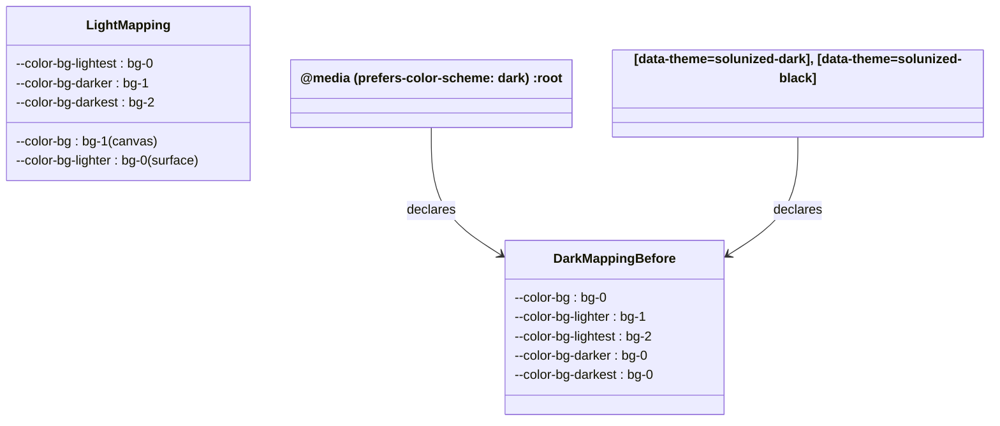
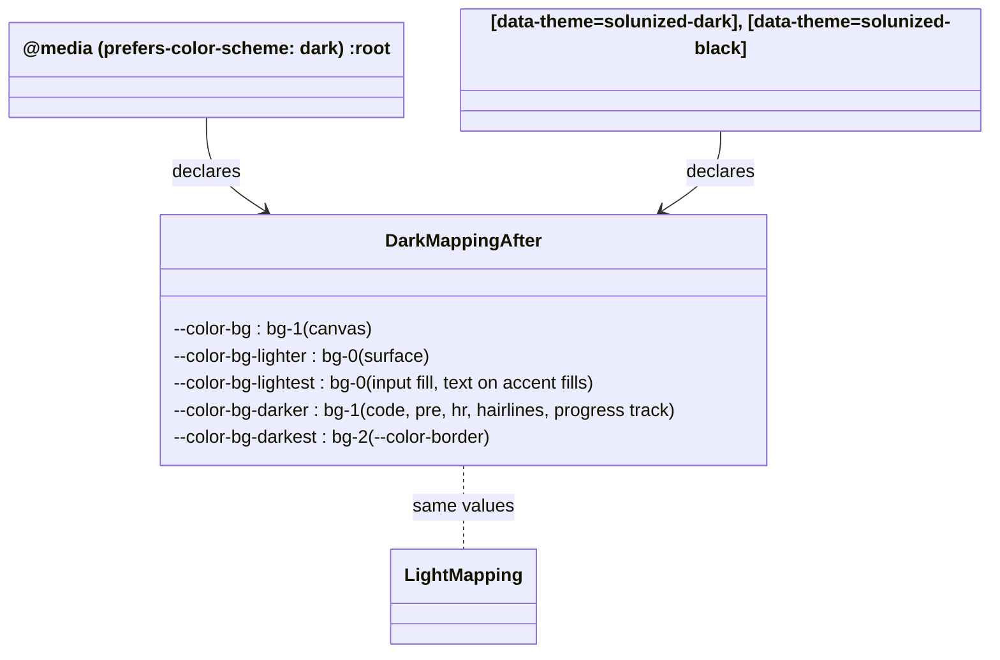

# Plan: Dark-mode surfaces darker than the canvas

From `intent.md` (2026-11-06). Status: accepted.

## Design

### Domain terms

From the glossary: **Sidebar card**, **Period navigation**, **Segmented control**.

New terms, written into `GLOSSARY.md` by this change:

- **Canvas** — the page background behind every surface, the `--color-bg` token. Avoid: page colour, base.
- **Surface** — an element painted on the canvas: the sidebar card, an article, a table head, a dialog, an open details, the period navigation. It uses the `--color-bg-lighter` token. Avoid: panel, card (except the sidebar card).
- **Palette step** — one of `--color-bg-0`, `--color-bg-1`, `--color-bg-2` in a theme. In light themes `bg-0` is the lightest step; in dark themes `bg-0` is the darkest step.

The scale tokens `--color-bg-lighter`, `--color-bg-lightest`, `--color-bg-darker` and `--color-bg-darkest` keep their names. In dark themes they name a role, not a lightness. `eink-dark` already uses them this way.

### Diagrams

Before: the dark mapping differs from the light mapping.

After: both dark blocks declare the same five values as the light mapping.

### Signatures

Not affected: the change sets CSS custom property values only, and adds Minitest tests. There is no Ruby library API.

Not checked: mvpa.css has no Steepfile and no RBS setup, and this change adds no Ruby library code.

### Complexity

Not affected: no runtime path and no query. The number of custom properties stays the same.

### Invariants

- In every dark rendering (system dark default, `solunized-dark`, `solunized-black`), the surface step is darker than the canvas step. Enforced by the two dark mapping blocks in `4_theme/0_colors.css` and their copies in `mvpa.css`.
- In those three renderings, body text (`--color-fg-0`) reaches WCAG AA (4.5:1) on the canvas, a surface, an input fill and a code block, and text on the four accent fills reaches 4.5:1. Enforced by the palette values and the mapping.
- The border step (`--color-bg-darkest`) differs from the canvas step and the surface step in every dark rendering, so `--color-border` shows on both. Enforced by the mapping.
- The hairline step (`--color-bg-darker`) differs from the surface step in every dark rendering, so hairlines show on surfaces. Enforced by the mapping.
- The page paints the canvas, and the sidebar card and articles paint the surface. Enforced by `0_base/1_reset.css`, `1_layout/0_header.css` and `2_modules/8_article.css`.
- The light, white and e-ink mappings do not change. `2_eink.css` declares its own scale tokens.
- `0_colors.css` and `mvpa.css` declare the same mappings.

Contrast after the change (WCAG, computed from the palette with the luminance formula in `test/solunized_light_cream_test.rb`):

| Pair | solunized-dark | solunized-black |
|---|---|---|
| Body text on a surface (fg-0 on bg-0) | 9.14 | 8.82 |
| Body text on the canvas and in code (fg-0 on bg-1) | 7.37 | 7.65 |
| Input text (fg-0 on bg-0; before: bg-2) | 9.14 (before 4.44) | 8.82 (before 5.55) |
| Red button and flash text (bg-0 on red; before: bg-2) | 4.56 (before 2.21) | 5.77 (before 3.63) |
| Blue text on bg-0 | 4.69 | 5.93 |
| Link (blue) on the canvas (bg-1; before: bg-0) | 3.78 (before 4.69) | 5.14 (before 5.93) |
| Muted text (dim-0) on the canvas | 3.25 (before 4.04) | 3.20 (before 3.69) |
| Border (bg-2) against surface / canvas | 2.06 / 1.66 | 1.59 / 1.38 |

### Alternatives

1. **Mirror the light mapping in both dark blocks** (chosen). Five value changes per block. It gives surfaces below the canvas, borders that show, and better input and accent-button contrast. `eink-dark` already uses this structure. Both architects proposed it.
2. **Swap only `--color-bg` and `--color-bg-lighter`** and keep `lightest = bg-2`, `darker = bg-0`, `darkest = bg-0`. Rejected: code blocks (`darker = bg-0`) vanish on every surface (`bg-0`), and `--color-border` (`bg-0`) vanishes on every surface. This fails the readability criterion.
3. **Collapse all four Solunized mapping blocks into one `:root` mapping**, because the values become equal. Rejected: a larger diff with no change in behaviour. It deletes the per-theme blocks that `test/solunized_light_cream_test.rb` and `test/elevation_depth_system_test.rb` find by selector, and removes the seam a future theme-specific mapping needs. Propose it separately if wanted.
4. **Rename the scale tokens to roles** (`--color-surface`, `--color-canvas`). Rejected: consuming apps reference the current names, so a rename needs an `### Upgrading` section. The intent asks for a colour fix with no app action.

## Design decisions

- The dark mapping equals the light mapping, value for value. The intent left the exact mapping open.
- The current-page sidebar link (`header nav ul li > a[aria-current="page"]` in `2_modules/10_navigation.css`) keeps `color: var(--color-bg)`. In solunized-dark its text on the blue fill drops from 4.69 to 3.78. Switching it to `var(--color-bg-lightest)` gives 4.69 in dark, but it also changes the light themes (4.48 to 5.09) and the e-ink themes. That conflicts with the intent's "Light and white themes stay as they are". This plan does not make that change; it is a decision for Etienne.
- Links and muted text placed directly on the canvas lose contrast in solunized-dark (3.78 and 3.25), as the canvas moves to the lighter step. No palette blue fixes it: even `--color-br-blue` reaches only 4.49 on the dark `bg-1`. The palette values are out of scope, so this plan accepts it and leaves the link colour to Etienne. Light mode has the same pattern (links 4.48 on its canvas). Text inside a surface gains contrast.
- Hairlines on `--color-bg-darker` (fieldset, hr, footer rule, article and input borders) equal the canvas step, so they do not show on the canvas and show on a surface. That was already so in dark mode before this change (`darker = bg-0 = canvas`), and it is so in light mode. The plan keeps that relationship and tests it.
- The contrast helpers in `test/solunized_light_cream_test.rb` (`oklch`, `declared`, `contrast`, `luminance`) move into a shared test module, so the new dark test does not copy them.
- `test/elevation_depth_system_test.rb#test_dark_and_black_themes_are_unchanged` pins the old dark canvas (`--color-bg: var(--color-bg-0);`). The intent changes that behaviour on purpose, so the test changes with it. This is not a test weakened to pass.
- No conflict with intent's `## Decisions`: the fix is in mvpa.css only, it covers the dark default and both dark Solunized themes, and it needs no per-app wiring.

## Integration points

- Sticker-app and other apps that pin mvpa.css by `ref:` get the new layering when they bump the pin. They need no code change.
- Apps that link the partials directly (standalone pages, `demo.html`) get it from `4_theme/0_colors.css`.
- Module rules that read the scale tokens change appearance in dark mode only through the tokens: `1_layout/0_header.css`, `1_layout/1_main.css`, `0_base/2_typography.css`, `2_modules/0_tables.css`, `1_forms.css`, `2_details.css`, `3_flash.css`, `5_buttons.css`, `6_progress.css`, `8_article.css`, `10_navigation.css`, `12_dialog.css`, `13_segmented_control.css`, `15_period_navigation.css`, and the skeleton shimmer in `0_base/3_animations.css` and `11_turbo-transitions.css`. None of these files changes.
- The e-ink themes (`4_theme/2_eink.css`) declare their own scale tokens on `[data-theme="eink-*"]`, so they do not depend on the dark mapping. They do not change.

## Files that change

- `test/color_contrast_helper.rb` — new. Module `ColorContrastHelper` with `declared(body, token)`, `oklch(body, token)`, `contrast(first, second)` and `luminance(lightness, chroma, hue)`, moved unchanged from `SolunizedLightCreamTest`.
- `test/solunized_light_cream_test.rb` — add `require_relative "color_contrast_helper"`, include `ColorContrastHelper`, and delete the four private methods it now gets from the module. The module declares its methods `private`, as the test did. No test changes.
- `test/dark_surface_layering_test.rb` — new, with `require_relative "css_source_helper"` and `require_relative "color_contrast_helper"`. The regression tests listed in `## Proof`.
- `test/elevation_depth_system_test.rb` — rename `test_dark_and_black_themes_are_unchanged` to `test_dark_and_black_themes_put_the_canvas_on_bg_1`; assert `--color-bg: var(--color-bg-1);` and `--color-bg-lighter: var(--color-bg-0);` in the dark/black mapping block.
- `test/changelog_upgrading_test.rb` — add `DARK_SURFACES = "2026-11-06".freeze` and a test that the entry has only `### Fixed`, like the `CREAM` test.
- `app/assets/stylesheets/mvpa/4_theme/0_colors.css` — in the `@media (prefers-color-scheme: dark) { :root { … } }` block and in the `[data-theme="solunized-dark"], [data-theme="solunized-black"]` mapping block, set the five bg-scale lines to `bg-1`, `bg-0`, `bg-0`, `bg-1`, `bg-2` (for `--color-bg`, `--color-bg-lighter`, `--color-bg-lightest`, `--color-bg-darker`, `--color-bg-darkest`). Replace the comment `/* bg scale: bg_0=darkest, bg_1=lighter panel, bg_2=lightest border */` with `/* bg scale: bg_0=darkest surface (sidebar/card), bg_1=canvas (page background), bg_2=lightest border */`.
- `app/assets/stylesheets/mvpa/mvpa.css` — the same edits in its copies of both blocks (near lines 2373–2378 and 2511–2517).
- `CHANGELOG.md` — a new `## 2026-11-06` entry above `## 2026-11-03`, with one `### Fixed` item and no `### Upgrading`: "**Dark surfaces sit below the page** — in dark mode, `solunized-dark` and `solunized-black`, the sidebar card, articles, tables, dialogs, details and the period navigation are darker than the page behind them, as in Herdr and Nova. Borders show on both, inputs are darker with brighter text, and text on accent buttons and flashes is dark. Light, white and e-ink themes are unchanged."
- `GLOSSARY.md` — add **Canvas** and **Surface** in alphabetical order, as worded in `### Domain terms`. Leave **Palette step** out of the glossary; it is a plan-only aid.

## Order of work

1. Extract `ColorContrastHelper` into `test/color_contrast_helper.rb` and include it in `SolunizedLightCreamTest`. Run `bundle exec ruby -Itest test/solunized_light_cream_test.rb`; it stays green.
2. Write `test/dark_surface_layering_test.rb`. Run it; watch the mapping, layering, input and accent tests fail for the right reason (dark canvas is `bg-0`, surface is `bg-1`), not on a parse or nil error. `test_hairlines_show_on_surfaces` and the painting test pass already; they guard behaviour the fix must keep.
3. Change the dark/black test in `test/elevation_depth_system_test.rb`. Run it; watch it fail.
4. Edit both dark blocks and the comment in `4_theme/0_colors.css`. Run the two new/changed test files; the partial assertions pass, the `mvpa.css` assertions still fail.
5. Make the same edits in `mvpa.css`. Run both files again, then `test/mvpa_manifest_sync_test.rb`, `test/solunized_light_cream_test.rb` and `test/eink_theme_test.rb`; all green.
6. Add the changelog test, watch it fail, add the `CHANGELOG.md` entry, watch it pass.
7. Add **Canvas** and **Surface** to `GLOSSARY.md`.
8. Run the full suite with `bundle exec rake test`, then `bundle exec rubocop`, `npm run lint:css`, `npm run lint:browsers` and `yamllint --strict .`.
9. Open `demo.html` in a browser with the system in dark mode, then with `data-theme="solunized-dark"` and `data-theme="solunized-black"` on `<html>`. Confirm the sidebar card and an article are darker than the page, and that borders, inputs and code blocks read. Switch to light mode and confirm the page looks as on `main`. Record what was seen in the review evidence.

## Risks

- Text, links and muted text placed directly on the canvas lose contrast in solunized-dark (see the table). Links fall below 4.5:1 there. Accepted, because the palette is out of scope; Decision needed below covers the one element where a fix is cheap.
- The current-page sidebar link in solunized-dark drops to 3.78:1 (500 weight, normal size). It still passes the 3:1 limit for UI components but not 4.5:1 for text.
- Hairlines that use `--color-bg-darker` (hr, fieldset, article and input borders, footer rule, progress track) equal the canvas, so they do not show on the canvas. They show on surfaces. Dark mode before this change and light mode behave the same.
- A table head inside an article loses its tint, because both use the surface step. Light mode has the same behaviour.
- A period navigation inside an article uses `--color-bg` (`15_period_navigation.css`), the canvas step, as an inset. In dark mode it becomes lighter than its article (`bg-1` on `bg-0`); in light mode it is darker than its article. No darker step than `bg-0` exists, so it cannot sit below the article. It reads as the canvas showing through, which matches light mode's token relationship. The plan keeps it.
- `mvpa.css` holds several `@media (prefers-color-scheme: dark)` blocks. Editing the wrong one breaks the module twins; the edit belongs only in the block that declares `--color-bg-0:`.
- The dark-theme hairline borders in `1_layout/0_header.css` and `1_forms.css` (`color-mix(in oklch, var(--color-fg) 14%, transparent)`) stay. On a darker surface they read slightly stronger. No change needed.

Out of scope: light, white and e-ink theme values; the Solunized `themes.yml` values; renaming scale tokens; collapsing the mapping blocks; the current-page link colour (see Decision needed); any change in Sticker-app, Herdr or Nova.

## Proof

- In dark mode, the sidebar card and an article are darker than the page behind them → `test/dark_surface_layering_test.rb` `test_the_page_paints_the_canvas_and_the_sidebar_card_and_articles_paint_the_surface` and `test_surfaces_are_darker_than_the_canvas_in_every_dark_rendering` (system dark default block)
- The same holds under `data-theme="solunized-dark"` and `data-theme="solunized-black"` → `test/dark_surface_layering_test.rb` `test_surfaces_are_darker_than_the_canvas_in_every_dark_rendering` (solunized-dark and solunized-black)
- In dark mode, text, borders, inputs and code blocks stay readable on their new backgrounds → `test/dark_surface_layering_test.rb` `test_body_text_meets_wcag_aa_on_the_canvas_surfaces_inputs_and_code`, `test_text_on_accent_fills_meets_wcag_aa`, `test_borders_differ_from_the_canvas_and_surfaces`, `test_hairlines_show_on_surfaces`; then check: step 9 in a browser
- In light mode, the page and surface colours are unchanged → `test/solunized_light_cream_test.rb` `test_light_mapping_puts_cards_on_bg_0_and_borders_on_bg_2` and `test/elevation_depth_system_test.rb` `test_light_and_white_themes_remap_canvas_one_step_darker` (unchanged, still green); then check: `git diff main -- app/assets/stylesheets/mvpa/4_theme/0_colors.css` touches only the system-dark `:root` block and the dark/black mapping block
- Invariant: both dark blocks declare the light mapping values, enforced by `4_theme/0_colors.css` and `mvpa.css` → `test/dark_surface_layering_test.rb` `test_dark_mappings_put_the_canvas_on_bg_1_and_surfaces_on_bg_0`
- Invariant: the partial and the manifest declare the same mappings → `test/dark_surface_layering_test.rb` (every test runs through `each_source`) and `test/mvpa_manifest_sync_test.rb`
- Invariant: e-ink themes keep their own mapping → `test/eink_theme_test.rb` (unchanged, still green)
- Changelog entry has no `### Upgrading` → `test/changelog_upgrading_test.rb` `test_the_dark_surfaces_entry_only_lists_a_fix`

Per changed file, the unit tests expected, named as behaviour:

- `test/dark_surface_layering_test.rb` (class `DarkSurfaceLayeringTest`, includes `CssSourceHelper` and `ColorContrastHelper`, each test loops `each_source("4_theme/0_colors.css")`):
  - `test_dark_mappings_put_the_canvas_on_bg_1_and_surfaces_on_bg_0` — the system-dark block and the dark/black mapping block each hold `--color-bg: var(--color-bg-1);`, `--color-bg-lighter: var(--color-bg-0);`, `--color-bg-lightest: var(--color-bg-0);`, `--color-bg-darker: var(--color-bg-1);`, `--color-bg-darkest: var(--color-bg-2);`.
  - `test_surfaces_are_darker_than_the_canvas_in_every_dark_rendering` — for each of the three renderings, resolve `--color-bg` and `--color-bg-lighter` to their palette step and assert the surface OKLCH lightness is below the canvas lightness.
  - `test_body_text_meets_wcag_aa_on_the_canvas_surfaces_inputs_and_code` — `fg-0` against the resolved `--color-bg`, `--color-bg-lighter`, `--color-bg-lightest` and `--color-bg-darker` is at least 4.5.
  - `test_text_on_accent_fills_meets_wcag_aa` — resolved `--color-bg-lightest` against `red`, `green`, `yellow` and `blue` is at least 4.5.
  - `test_borders_differ_from_the_canvas_and_surfaces` — the resolved `--color-bg-darkest` step is lighter than both the canvas and the surface step.
  - `test_hairlines_show_on_surfaces` — the resolved `--color-bg-darker` step differs from the surface step.
  - `test_the_page_paints_the_canvas_and_the_sidebar_card_and_articles_paint_the_surface` — in `0_base/1_reset.css` and `mvpa.css`, the `body` rule holds `background-color: var(--color-bg);`; in `1_layout/0_header.css` and `mvpa.css`, the `body > header` rule and the desktop `body > header > nav:only-child` rule hold `background-color: var(--color-bg-lighter);`; in `2_modules/8_article.css` and `mvpa.css`, the `article` rule holds `background-color: var(--color-bg-lighter);`. Use `each_source` per partial and `rule_bodies` to find each rule.
- `test/elevation_depth_system_test.rb`: `test_dark_and_black_themes_put_the_canvas_on_bg_1`.
- `test/changelog_upgrading_test.rb`: `test_the_dark_surfaces_entry_only_lists_a_fix`.
- `test/color_contrast_helper.rb`: no tests of its own; `SolunizedLightCreamTest#test_body_text_on_the_cream_page_meets_wcag_aa` and the new dark tests exercise it.

Test setup: no fixtures. The three renderings come from the CSS source. The system-dark palette and mapping are the body of the `@media (prefers-color-scheme: dark)` block that contains `--color-bg-0:` (find it with `CssSourceHelper#balanced_block`; `mvpa.css` holds several such blocks). The solunized-dark and solunized-black palettes are the first `rule_body` for their selector; the mapping is the `rule_bodies` entry that contains `--color-bg:`. A token resolves by reading `var(--color-bg-N)` from the mapping, then the `oklch(...)` value of `--color-bg-N` from the palette.

---
Domain skills applied: software-design, glossary, diagrams, rails-ui (CSS and accessibility).

## Critique

### Round 1 (codex exec -p terra)

- Links and the current sidebar link fall to 3.78:1 on the dark canvas, below AA; define dark-only link colours → dismissed: no palette blue reaches 4.5:1 on the dark `bg-1` (`--color-br-blue` gives 4.49), so a fix needs a new colour or a palette change, both outside the intent's scope; the link colour and the current-link text are raised to Etienne as decisions
- The border proof tests `--color-bg-darkest` only, while fieldset, hr and footer hairlines use `--color-bg-darker`, which equals the canvas → fixed (plan states that these hairlines already matched the dark canvas before the change and match the light canvas, keeps that relationship, and adds `test_hairlines_show_on_surfaces`)
- The sidebar and article criterion tests only token aliases, not that `body`, the header card and `article` paint them → fixed (added `test_the_page_paints_the_canvas_and_the_sidebar_card_and_articles_paint_the_surface` across partials and manifest)
- The risk about a period navigation inside an article is wrong: it uses `--color-bg` and becomes lighter than its article → fixed (risk rewritten as an intentional canvas inset, with the reason no darker step exists)
- The helper extraction omits `require_relative` in both tests → fixed (both tests require `color_contrast_helper`, and the module keeps the methods private)

