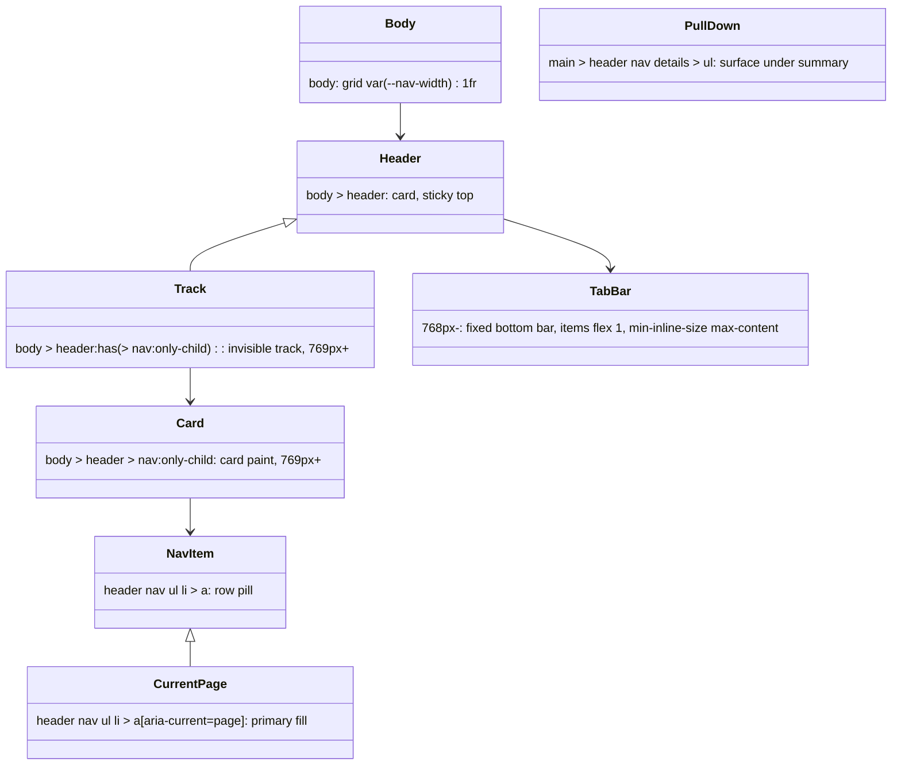
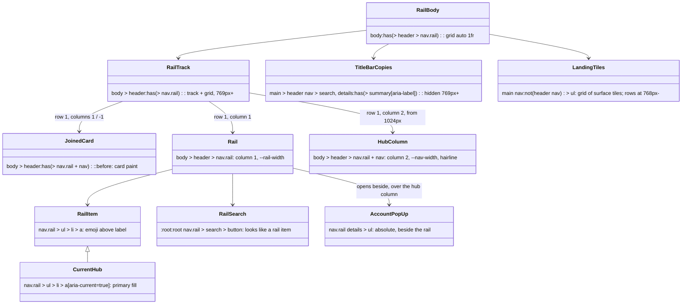

# Plan: Rail, hub column and landing tiles

From `intent.md` (2026-11-06). Status: accepted.

## Design

### Domain terms

From `GLOSSARY.md`: **Rail**, **Hub column**, **Landing tile**, **Sidebar card**, **Sidebar track**, **Nav-only header**, **Surface**, **Count badge**. No avoided word is used.

No new term. "A page with a rail" means a page whose `body > header` holds `nav.rail`; the plan writes it out in full and adds no glossary entry.

One new design token: `--rail-width` in `0_base/0_variables.css`, beside `--nav-width`.

### Diagrams

Before: the shell today.

After: every new rule lives in `2_modules/16_rail.css` (e-ink twins in `4_theme/2_eink.css`) and is keyed on `nav.rail`.

On Overzicht (rail only) the header also matches the existing nav-only track, and the existing `body > header > nav:only-child` rule paints the rail's card. `JoinedCard` needs `nav.rail + nav`, so the card is painted exactly once on every page.

### Signatures

The change has no Ruby production code. Its public surface is the selectors below; the number in brackets is the specificity, and "vs" names the existing rule each one must beat.

`app/assets/stylesheets/mvpa/2_modules/16_rail.css` — the rail shell: rail, hub column, account pop-up, title-bar copies and landing tiles on a page with a rail.

Every width:

- `nav.rail > ul > li > a`, `nav.rail > ul > li > details > summary` (0,1,4)/(0,1,5) vs `header nav ul li > a` (0,0,5) and `header nav ul li > details > summary` (0,0,6): `flex-direction: column`, centred, `gap: 2px`, `font-size: var(--text-x-small)`, `text-align: center`, `hyphens: auto` (plus `-webkit-hyphens: auto` for Safari 16.4), `overflow-wrap: anywhere`, `padding-inline: var(--inline-space-half)`. The `aria-hidden` emoji span gets `font-size: var(--text-large)`. The existing hover (0,1,5)/(0,1,6) still applies its lift on top, as intended.
- `nav.rail > ul > li > a[aria-current="true"]` (0,2,4) vs the hover (0,1,5) and the phone tab item `header nav > ul > li > a` (0,0,5): the same two declarations as `header nav ul li > a[aria-current="page"]` (`background-color: var(--color-primary); color: var(--color-bg-lightest)`). The e-ink look follows from its tokens, as the current page's does.
- `:root:root nav.rail > search > button` (0,3,3) and its `:hover` (0,4,3) vs theme button rules up to (0,2,1) (`[data-theme="eink-light"] :is(button, input, a).button-secondary`), the system-dark twins and the boop `button:not(:disabled):hover` (0,2,1): the rail-item shape, transparent fill, no border or shadow, `--color-fg` text, `margin: 0`, `animation: none`, `filter: none`.
- `nav.rail details > summary::after` (0,1,4): `display: none` (no › in the rail; this also sidesteps the e-ink `rotate(90deg) !important`).
- `nav.rail > ul > li > details` (0,1,4): `position: relative; margin-block: 0`.
- `nav.rail details > ul` (0,1,3) vs `header nav details > ul` (0,0,4): `position: absolute; inset-inline-start: calc(100% + var(--block-space-half)); inset-block-end: 0; inset-block-start: auto; min-inline-size: max-content; margin: 0; padding: var(--block-space-half); border: 1px solid var(--color-border); border-radius: var(--radius); background-color: var(--color-bg-lighter); box-shadow: var(--shadow-2); z-index: var(--z-dropdown)` — the pull-down's surface paint, beside the rail.
- `:root:root nav.rail details > ul li > a`, `:root:root nav.rail details > ul li > form > button` (0,3,5)/(0,3,6) and their `:hover`: the pull-down item reset of `2_details.css` lines 86–114, so Logout looks like the other pop-up links.

`@media (min-width: 769px)`:

- `body:has(> header > nav.rail)` (0,1,3) vs `body` (0,0,1): `grid-template-columns: auto 1fr`.
- `body > header:has(> nav.rail)` (0,1,3) vs `body > header` (0,0,2) and its dark and e-ink border rules (0,1,2): the #47 track declarations verbatim (`align-self: end; top: auto; bottom: var(--shell-gutter); min-block-size: calc(100dvh - 2 * var(--shell-gutter)); border: none; border-radius: 0; box-shadow: none; background-color: transparent`), plus `display: grid; grid-template-columns: auto auto; grid-template-rows: auto; align-content: start; justify-content: start; z-index: var(--z-sticky)`.
- `body > header:has(> nav.rail) > nav` (0,1,4): `grid-row: 1; min-block-size: auto`.
- `body > header > nav.rail` (0,1,3): `grid-column: 1; align-self: start; inline-size: var(--rail-width); padding: var(--block-space-half)`. `align-self: start` keeps the rail as tall as its content when the hub column is taller; grid items stretch by default.
- `body > header > nav.rail + nav` (0,1,4): `grid-column: 2; inline-size: var(--nav-width); border-inline-start: 1px solid var(--color-border)` — the hairline. The hub column keeps the default stretch, so the hairline runs the full card height when the rail is the taller nav. `--color-border` is ink in the e-ink themes.
- `body > header:has(> nav.rail + nav)::before` (0,1,5): `content: ""; grid-row: 1; grid-column: 1 / -1;` and the card paint (`border-radius: var(--radius-large); box-shadow: var(--shadow-3), var(--shadow-1); background-color: var(--color-bg-lighter)`). Its dark twins `[data-theme="solunized-dark"|"solunized-black"] …::before` (0,2,5) set `box-shadow: none` and the sidebar hairline `border: 1px solid color-mix(in oklch, var(--color-fg) 14%, transparent)`.
- `body:has(> header > nav.rail) main > header nav > search` (0,1,7) and `body:has(> header > nav.rail) main > header nav > details:has(> summary[aria-label])` (0,2,8): `display: none`.

`@media (max-width: 1023px)`:

- `body > header > nav.rail + nav` (0,1,4) vs `header nav` (0,0,2): `display: none`.

`@media (max-width: 768px)`:

- `nav.rail > search` (0,1,2), `nav.rail > ul > li:has(> details)` (0,1,4): `display: none`.
- `nav.rail > ul > li` (0,1,3) vs `header nav > ul > li` (0,0,4): `flex: 1 1 0; min-inline-size: 0`, so five hubs share 375px.
- `nav.rail > ul > li > a` (0,1,4) vs the phone tab item (0,0,5): `gap: 0; padding-block: 2px; font-size: var(--text-xx-small); line-height: var(--line-height-tight)`; its emoji span gets `font-size: var(--text-medium); line-height: 1`. The phone root is 14px, so the tab item is 3rem = 42px high: a 15.4px emoji plus two 11px label lines plus 4px padding is 41.4px, so a hyphenated two-line label fits without overflow.

Landing tiles, prefix `T` = `body:has(> header > nav.rail) main nav:not(header nav)`:

- `T > ul` (0,1,8): `list-style: none; margin: 0; padding: 0; display: grid; grid-template-columns: repeat(auto-fill, minmax(min(14rem, 100%), 1fr)); gap: var(--block-space)`.
- `T > ul > li` (0,1,9) vs `li` (0,0,1): `margin: 0`, so the typography list-item margin does not widen the grid gap or split the phone rows. (Found during implementation.)
- `T > ul > li > a` (0,1,10) vs `a:visited` (0,1,1): `display: flex; align-items: center; min-block-size: var(--touch-target); padding: var(--block-space); background-color: var(--color-bg-lighter); border: 1px solid var(--color-bg-darker); border-radius: var(--radius-large); box-shadow: var(--shadow-1); color: var(--color-fg); text-decoration: none;` and the nav-link transition.
- `T > ul > li > a:hover` (0,2,10): the nav-link lift (`transform: scale(var(--animation-scale-small)) translateY(-2px); box-shadow: var(--shadow-2)`).
- `:root:root T > ul > li > a::after` (0,3,11) vs the wiggle `::after` (0,2,4) and its `:hover::after` (0,3,4): `content: none`. The wiggle exclusion list in `3_animations.css` stays untouched, because adding this (0,1,10) entry to its `:not()` would raise the wiggle rule's specificity everywhere.
- Phone, `@media (max-width: 768px)`: `T > ul` becomes one surface (the tile paint moves to the list, `gap: 0`, `grid-template-columns: 1fr`); `T > ul > li + li` gets `border-block-start: 1px solid var(--color-border)`; `T > ul > li > a` drops its own paint, border, radius, shadow and lift; `T > ul > li > a::before` holds `content: "›" / ""; order: 1; margin-inline-start: auto`.

`app/assets/stylesheets/mvpa/4_theme/2_eink.css`, for `eink-light` (black) and `eink-dark` (white):

- In `@media (min-width: 769px)`: `[data-theme="eink-…"] body > header:has(> nav.rail + nav)::before` (0,2,5): `box-shadow: none; border: 1px solid <ink>`.
- `[data-theme="eink-…"] T > ul > li > a` (0,2,10) and its `:hover` (0,3,10): `box-shadow: none; border: 1px solid <ink>`; on the phone the list surface gets the same.
- `[data-theme="eink-…"] nav.rail details > ul` (0,2,3) vs `nav.rail details > ul` (0,1,3): `box-shadow: none; border: 1px solid <ink>`. The e-ink root `box-shadow: none` does not reach this element, so the pop-up needs its own rule.

`app/assets/stylesheets/mvpa/0_base/0_variables.css`: `--rail-width: 5.5rem;` under `/* Navigation */`.

Not checked: mvpa.css has no Steepfile; the change adds CSS rules and Minitest tests only.

### Complexity

No queries: this is a stylesheet. About 35 rules in `16_rail.css` and 8 in `2_eink.css`. Every `:has()` is anchored by child combinators at `body > header` or a `summary`, so style invalidation stays local. Each grid sizes in linear time over its items.

### Invariants

- A page without `nav.rail` matches no new rule: every selector in `16_rail.css` contains `nav.rail`. Enforced by the selectors; proven by `test/rail_test.rb`.
- The joined card is painted once: `::before` needs `nav.rail + nav`, and the nav-only card needs `nav:only-child`; the two never match the same header. Enforced in `16_rail.css`; proven by `test/rail_test.rb`.
- The rail track repeats the eight #47 track declarations exactly (`align-self`, `top`, `bottom`, `min-block-size`, `border`, `border-radius`, `box-shadow`, `background-color`). Enforced by copy; proven by `test/rail_test.rb`, which asserts that each of the eight declaration lines of the `body > header:has(> nav:only-child)` body also appears in the rail track body. The rail track adds its grid declarations, so the whole bodies differ by design.
- The card row is never stretched to the track height: the rail track has `align-content: start`. Proven by `test/rail_test.rb`.
- The flattened `mvpa.css` holds every rule of `16_rail.css` and of the edited `2_eink.css`. Proven by `each_source` in every new test.
- No existing rule changes. The only edits to existing files add a token, add e-ink rules and add the partial to the bundle and the demo. Proven by the existing suite staying green, apart from the demo and changelog tests named in `## Files that change`.

### Alternatives

1. **Isolated partial (chosen).** All new behaviour sits in `16_rail.css`, keyed on `nav.rail`; existing rules stay byte-identical. Cost: the #47 track declarations exist twice (a test keeps them equal), and `:root:root` lifts the rail's buttons and the tile `::after` over theme and wiggle rules. Kept because the intent's first protected group is every app with today's single-nav sidebar, and an untouched existing rule cannot change them.
2. **Shared-rule reuse.** Widen existing selector lists: the track, the card paint, `aria-current`, the nav item, `article`, the pull-down and the wiggle `:not()` list. Smallest CSS, but it couples the rail and the tiles to unrelated modules: an edit to `article` or the pull-down changes the tiles or the rail. It also makes any `nav > ul` in `main`, such as a table of contents, into tiles on every app. Rejected for that coupling and that reach into apps without a rail.
3. **Header paints the joined card (no track).** A header with two navs already keeps the card on the header, so a flex row with a hairline on the hub column is the least code. Rejected: it loses the #47 behaviour (a tall sidebar shows its last links only at the page end), which the intent keeps in scope.

## Design decisions

- **The joined card is a `::before` grid item.** The two navs are direct children of the header with no wrapper. A `::before` in row 1, spanning both columns, is one box: one shadow with no seam, as tall as the taller nav. Painting each nav separately would let the hub column's shadow fall across the rail.
- **Landing tiles only on a page with a rail.** The intent's contract places tiles in a `<nav>` in `main`; it does not say whether apps without a rail get them. Scoping them to a page with a rail keeps every other app's `main nav > ul` unchanged. The demo has a rail, so it shows the tiles.
- **`--rail-width: 5.5rem` is a token** in `0_variables.css`, beside `--nav-width`, so apps can tune it like the sidebar width.
- **The pop-up opens upward from the account name** (`inset-block-end: 0`), because the account entry is the rail's last item.
- **Phone rows draw › with `::before` and `order: 1`**, so the trailing › never competes with the wiggle's `::after`.
- **The CHANGELOG entry is a new dated entry** (the implementation day, 2026-11-07 or later). The 2026-11-06 entry stays "Fixed" only, as `test_the_dark_surfaces_entry_only_lists_a_fix` asserts. If the implementation day already has an entry, add `### Added` and `### Upgrading` to it as CLAUDE.md says.
- **No new dependency.** The intent approves one dev-only test package; the plan does not use it. `CssSourceHelper` gains a public `media_blocks(css, query)` helper (moved from `SidebarTrackTest#desktop_blocks`), and the visual criteria are checked in headless Chrome, which is already installed.
- No conflict with intent's `## Decisions`: one class (`nav.rail`), narrow rail, hub column hidden below 1024px, pop-up beside the rail, title-bar copies hidden on `<search>` and a labelled `
`, content-sized rail, one joined card, surface tiles with a lift, rows with › on the phone, the same fill for the current hub, shrunk and hyphenated labels, `<search>` in the rail, and the demo on the rail shell are all built as decided.

## Integration points

- appkit PR #24 (`app/views/appkit/shared/_nav.html.erb`, `_account_menu.html.erb`): renders `nav.rail` with a yielded search control, the hubs (`aria-current="true"`), the account `
` (Logout is a `button_to`, so `li > form > button`), and a second `<nav>` for the hub column with an `<h2>` link and page links that may hold a `<data>` count badge. It drops `class="hub-column"`, wraps the search in `<search>`, and gives the avatar `
` its `aria-label` (already present).
- journal_administration `navigation-hubs`: its layout's title bar holds the `<search>` and, on Overzicht, the account `
`; its landing page wraps the tiles `<ul>` in a `<nav>` and drops `class="tiles"`. The journal sets `lang` on `<html>`, which `hyphens: auto` needs.
- Apps with today's single-nav sidebar (clocky, sticker-app and others): no selector of theirs matches a new rule.
- `app/javascript/controllers/nav_controller.js`: unchanged. The demo keeps `data-controller="nav"` on the rail, so the accordion closes the account pop-up after a link click.

## Files that change

- `app/assets/stylesheets/mvpa/2_modules/16_rail.css` — new partial: every rule in `### Signatures` except the e-ink ones and the token.
- `app/assets/stylesheets/mvpa/0_base/0_variables.css` — add `--rail-width: 5.5rem;`.
- `app/assets/stylesheets/mvpa/4_theme/2_eink.css` — e-ink card `::before`, tile and account pop-up rules for both e-ink themes.
- `app/assets/stylesheets/mvpa/mvpa.css` — the token; the whole of `16_rail.css` after the Period navigation section; the e-ink rules at their place in the e-ink section.
- `demo.html` — the `<link>` for `16_rail.css` after `15_period_navigation.css`; both "N files" counts up by one; `body > header` becomes the rail shell (see below); the title bar gains a `<search>` with a search button; a new "Landing page" article with a `<nav>` of four tiles, one reading "0 rekeningen nog niet ingedeeld"; the "Landing tile" section in Count badges is removed; the hub column gets a sidebar link to the new article. The Content article's "Navigation Example" (a `<nav><ul>` of four links, line ~1108) would become tiles under the contract, so it becomes a `<nav>` of bare links (`<nav><a href="#home">Home</a> <a href="#about">About</a> …</nav>`), the clocky form the intent keeps unchanged; the landing article shows the list form.
  - Rail (`<nav class="rail" data-controller="nav" data-action="click->nav#click">`): a `<search>` with `<button type="button" aria-label="Search">🔍 Search</button>`; hubs 🏠 Introduction (`#introduction`, `aria-current="true"`), 🧩 Components (`#messages`), 📚 Content (`#lists`), 🎨 Colors (`#colors`), ✨ Animations (`#animations`), each as `emoji Label`; a last `<li>` with `

Account
<ul>` Profile, Preferences, Admin links and a `<form><button>Log out</button></form>`.
  - Hub column: `<h2><a href="#introduction">MVPA.css</a></h2>` and one `<ul>` of every section link (today's sidebar links, flattened, with their badges), Introduction keeping `aria-current="page"` and `<data value="3">`.
- `README.md` — new "Rail and hub column" and "Landing tiles" sections after "Navigation" with literal markup; `16_rail.css` in the file tree and the standalone link list; `--rail-width` under Design Tokens. The single-nav "Navigation" section stays.
- `CHANGELOG.md` — new dated entry: `### Added` (rail, hub column, account pop-up, title-bar copies, landing tiles) and `### Upgrading` steps:
  1. Put `class="rail"` on the hubs `<nav>` in `body > header`, and remove `class="hub-column"` from the second `<nav>`.
  2. Wrap the rail's search control in `<search>`, as the rail's first child.
  3. Wrap the title bar's search control in `<search>`, as a direct child of `main > header nav`.
  4. Give the title-bar account `
` an `aria-label`.
  5. Mark the current hub with `aria-current="true"` and the current page with `aria-current="page"`.
  6. Wrap the landing page's tiles `<ul>` in a `<nav>` inside `main`, remove `class="tiles"`, and write the count as text in the link, not in `<data>`.
  7. Set `lang` on `<html>`, so long hub labels break at a syllable.
  8. Delete your own rail, hub column and tile CSS.
  9. Standalone pages only: add `16_rail.css` to your stylesheet links after `15_period_navigation.css`. The gem and `mvpa.css` include it already.
- `GLOSSARY.md` — no change (Rail, Hub column and Landing tile are already committed).
- `test/css_source_helper.rb` — add public `media_blocks(css, query)`, returning every `@media <query> {` block via `balanced_block`.
- `test/sidebar_track_test.rb` — replace its private `desktop_blocks` with `media_blocks(css, "(min-width: 769px)")` at every call, `css_without_desktop_blocks` included; no assertion changes.
- `test/readme_test.rb` — `test_readme_links_the_period_navigation_partial_right_after_the_count_badge` expects `15_period_navigation.css` as the last module in the tree (`└──`); change that expected tree string to `│   ├── 14_count_badge.css\n│   ├── 15_period_navigation.css\n│   └── 16_rail.css`. Add the two README tests named in `## Proof`, and one that `16_rail.css` follows `15_period_navigation.css` in the link list.
- `test/rail_test.rb` — new: rail shell CSS assertions (see `## Proof`).
- `test/landing_tiles_test.rb` — new: tile CSS assertions.
- `test/demo_rail_shell_test.rb` — new: demo.html markup assertions (Nokogiri).
- `test/demo_segmented_control_and_badges_test.rb` — remove `test_the_demo_has_a_landing_tile_link_with_a_badge` (the intent removes that example); scope `test_the_sidebar_shows_badges_including_on_the_current_link` and `test_the_demo_has_a_zero_badge` to the hub column (`body > header > nav.rail + nav`), because the rail now also links `#introduction`.
- `test/period_navigation_test.rb` — its private `own_rules` ended the bundle's Period navigation section at "Solunized color definitions"; the Rail section now follows it, so the section ends at the next section header instead. No assertion changes. (Found during implementation.)
- `test/changelog_upgrading_test.rb` — a constant for the new entry's date and a test that its `### Upgrading` names `class="rail"`, `class="hub-column"`, `<search>`, `aria-label`, `aria-current="true"`, `class="tiles"`, `lang` and `16_rail.css`.

Out of scope: appkit and journal markup; `nav_controller.js`; closing the pop-up on an outside click; a full-height rail; badges on rail hubs; more than five hubs on the phone; the title-bar back link and the actions pull-down look; any change to the single-nav sidebar rules.

## Order of work

1. Write `test/rail_test.rb#test_a_rail_and_hub_column_share_one_card_beside_main_on_a_wide_screen` (criterion 1), run `bundle exec ruby -Itest test/rail_test.rb`, and watch it fail because `16_rail.css` does not exist.
2. Move `desktop_blocks` into `CssSourceHelper#media_blocks` and replace every call in `test/sidebar_track_test.rb`, `css_without_desktop_blocks` included; run `test/sidebar_track_test.rb` green.
3. Add `--rail-width` and `16_rail.css` with the desktop shell (body grid, rail track, rail and hub column placement, joined `::before` card and its dark twins); bundle them into `mvpa.css`; link the partial in `demo.html` and bump both counts. Run `npm run lint:css` now, to learn early whether stylelint accepts `search`, `hyphens` and `-webkit-hyphens`. Step 1 goes green.
4. Write and pass, one at a time, the rail tests for: the rail-only card on Overzicht, the content-sized card, the rail item shape and hyphenation, the current hub fill, the search button, the account pop-up, the hub column hidden below 1024px, the phone tab bar, the title-bar copies, the single-nav invariant and the track-copy invariant.
5. Add the e-ink card, tile and pop-up rules to `2_eink.css` and `mvpa.css`; pass the theme tests.
6. Write and pass `test/landing_tiles_test.rb`: grid, surface, lift, no wiggle, plain count text, phone rows with ›, e-ink, and the non-tile `<nav>`s left alone.
7. Rebuild `demo.html`'s shell, title bar and landing article, and turn its "Navigation Example" into bare links; adjust the two demo tests; write and pass `test/demo_rail_shell_test.rb`.
8. Write the README sections and the CHANGELOG entry; pass the README and changelog tests.
9. Run the headless Chrome checks in `## Proof`: the screenshots and the CDP script. Record each result (screenshot paths, bounding boxes, computed values, scroll widths) for the delivery account.
10. Run the full suite and every linter: `bundle exec rake test`, `bundle exec rubocop`, `npm run lint:css`, `npm run lint:browsers`, `yamllint --strict .`. Re-read the diff.

## Risks

- **Stylelint may reject `search` or `-webkit-hyphens`.** `selector-type-no-unknown` uses a known-tag list, and the browser-features plugin may flag hyphens for Safari 16.4. A linter config edit or disable comment is not allowed. If either fires, report it as a stop-and-ask instead of working around it.
- **Hyphenation needs `lang` on `<html>`.** Without it, `overflow-wrap: anywhere` still keeps "Administratie" inside the rail, broken at a letter. The Upgrading steps ask apps to set `lang`.
- **Five labels at 375px.** Each hub gets about 70px and a 42px-high tab item; "Administratie" at `--text-xx-small` hyphenates to two lines that fit under the emoji (see the phone rule). A sixth hub would not fit; the intent leaves that out of scope.
- **`button:active` press squash.** The `!important` press scale in the animations may still squash the rail's search button and Logout on press. Accepted: it is the button feedback everywhere else.
- **Pop-up over `main` between 769px and 1023px.** With the hub column hidden, the pop-up overlays `main`; it relies on the track's `z-index: var(--z-sticky)`.
- **Track declarations twice.** The #47 track rule lives in `0_header.css` and in `16_rail.css`. A change to one without the other fails `test/rail_test.rb`.
- **The demo loses its single-nav sidebar.** The intent accepts this; the README keeps documenting the single-nav sidebar.
- Rejected: widening existing selectors (coupling, see `### Alternatives`); a wrapper element around the two navs (changes the agreed markup contract); a CSS parser dependency (the regex helper suffices).

## Proof

Tests run on the partial and the bundle through `each_source`, unless they read `demo.html`, `README.md` or `CHANGELOG.md`. The visual checks use headless Chrome: `"/Applications/Google Chrome.app/Contents/MacOS/Google Chrome" --headless=new --hide-scrollbars --window-size=<w>,900 --screenshot=<png> file://<page>`. Behaviour that a screenshot cannot show (hover, clicks, sizes) is checked by a scratch Node script that drives Chrome over the DevTools Protocol: Chrome starts with `--headless=new --remote-debugging-port=9222`, and the script uses Node 25's built-in `WebSocket` and `fetch`, so no package is added. It sets the viewport (`Emulation.setDeviceMetricsOverride`), hovers (`Input.dispatchMouseEvent`), clicks, and reads values with `Runtime.evaluate`: `getComputedStyle`, `getBoundingClientRect`, `details.open` and `document.documentElement.scrollWidth`. Fixtures and the script live in the implementer's scratchpad and are not committed; the delivery account records their output.

- At 1280px on a Verwerken page, rail and hub column side by side in one card with a hairline, `main` after the hub column → `test/rail_test.rb` `test_a_rail_and_hub_column_share_one_card_beside_main_on_a_wide_screen`; check: demo.html screenshot at 1280px, and CDP bounding boxes: hub column left equals rail right, `main` left is greater than hub column right.
- At 1280px on Overzicht, the rail in the same position and width, the card only the rail → `test/rail_test.rb` `test_a_rail_only_header_keeps_the_rail_in_its_place_with_its_own_card`; check: a rail-only fixture screenshot at 1280px beside the demo's.
- The single-nav sidebar looks the same at 1280px and 375px → `test/rail_test.rb` `test_every_rail_rule_needs_a_rail`; check: a fixture of the README "Navigation" markup screenshotted with `main`'s CSS (`git show main:…` into the scratchpad) and with the branch CSS at both widths; `cmp` reports the PNGs identical.
- 🏠 above "Overzicht"; "Administratie" fits, broken at a syllable → `test/rail_test.rb` `test_a_rail_hub_shows_its_emoji_above_a_small_hyphenated_label`; check: fixture with `lang="nl"` and an "Administratie" hub at 1280px.
- With five hubs the card ends below the account name; with a taller hub column the card is as tall as the column → `test/rail_test.rb` `test_the_joined_card_is_as_tall_as_the_taller_nav` and `test_the_rail_is_as_tall_as_its_content`; check: CDP heights — the `::before` card height equals the taller nav's height, and the rail's height equals its content height (not the hub column's) on the demo.
- The current hub and the current page have the same primary fill → `test/rail_test.rb` `test_the_current_hub_has_the_current_page_fill`.
- The account name opens Profiel, Voorkeuren, Beheer and Uitloggen beside the rail, over the hub column, without widening the rail; a second click closes it → `test/rail_test.rb` `test_the_account_menu_opens_beside_the_rail_over_the_hub_column` and `test_logout_looks_like_the_other_account_links`; check: CDP at 1280px — click the summary, `details.open` is true, the pop-up's left edge is right of the rail and overlaps the hub column, the rail's width is unchanged; click again, `details.open` is false. A screenshot records the open state.
- At 900px the hub column is gone, the rail stays, nothing scrolls sideways; at 1024px it is back → `test/rail_test.rb` `test_the_hub_column_hides_below_1024px`; check: demo screenshots at 900px and 1024px, scroll width equals 900 at 900px.
- At 375px the bottom bar shows exactly the five hubs, nothing scrolls sideways → `test/rail_test.rb` `test_the_phone_tab_bar_holds_only_the_hubs` and `test_five_hubs_share_the_phone_width`; check: demo screenshot at 375px, scroll width equals 375.
- At 375px the title bar shows the search button and, on Overzicht, 👤; at 1280px on a page with a rail neither shows; "Acties ▾" shows at both → `test/rail_test.rb` `test_the_title_bar_hides_its_search_and_account_copies_beside_a_rail` and `test_the_title_bar_copies_show_on_a_phone`; check: demo screenshots at 375px and 1280px.
- On a page without a rail, a title-bar `<search>` shows at every width → `test/rail_test.rb` `test_the_title_bar_copies_hide_only_on_a_page_with_a_rail`.
- At 1280px four tiles are surface tiles in a grid of columns of at least 14rem; hover lifts; no wiggle → `test/landing_tiles_test.rb` `test_tiles_are_surface_tiles_in_a_14rem_grid`, `test_a_tile_lifts_on_hover`, `test_a_tile_has_no_underline_wiggle`; check: demo screenshot at 1280px, and CDP — each tile is at least 14rem wide, hovering a tile changes its computed `transform` from `none`, and its `::after` computed `content` is `none`.
- "0 rekeningen nog niet ingedeeld" looks like every other tile → `test/landing_tiles_test.rb` `test_a_tile_count_is_plain_text`; `test/demo_rail_shell_test.rb` `test_the_demo_landing_page_has_four_tiles_with_text_counts`.
- At 375px the tiles are one list of full-width rows ending in › → `test/landing_tiles_test.rb` `test_tiles_become_rows_with_a_trailing_chevron_on_a_phone`; check: demo screenshot at 375px.
- A period navigation, a title-bar `<nav>` and a `<nav>` of bare links in `main` keep their look → `test/landing_tiles_test.rb` `test_only_a_nav_with_a_list_of_links_becomes_tiles`; existing `test/period_navigation_test.rb` and `test/title_bar_row_test.rb` stay green unedited; `test/demo_rail_shell_test.rb` `test_the_demo_navigation_example_is_bare_links`.
- Dark hairline in solunized-dark and -black, ink border in e-ink, current hub in each theme's current-page look → `test/rail_test.rb` `test_dark_and_eink_themes_border_the_joined_card`; check: demo screenshots at 1280px in the four themes.
- demo.html shows the rail, a hub column and a landing page; "Landing tile" is gone → `test/demo_rail_shell_test.rb` `test_the_demo_shell_is_a_rail_with_a_hub_column`, `test_the_demo_has_no_landing_tile_example`.
- Invariant: the joined card is painted once, enforced by `nav.rail + nav` on `::before` → `test/rail_test.rb` `test_the_joined_card_needs_a_hub_column`.
- Invariant: the rail track repeats the #47 track, enforced by copy → `test/rail_test.rb` `test_the_rail_track_matches_the_sidebar_track`.
- Invariant: every rail rule needs a rail, enforced by the selectors → `test/rail_test.rb` `test_every_rail_rule_needs_a_rail`.
- Query count: not affected, a stylesheet runs no queries.

Per changed file, the unit tests expected:

- `16_rail.css` and `mvpa.css`: everything in `test/rail_test.rb` and `test/landing_tiles_test.rb` above.
- `2_eink.css`: `test_dark_and_eink_themes_border_the_joined_card`, `test_eink_tiles_have_an_ink_border_and_no_shadow`, `test_the_eink_account_menu_has_an_ink_border_and_no_shadow`.
- `0_variables.css`: `test_the_rail_width_is_a_navigation_token`.
- `test/css_source_helper.rb`: `CssSourceHelper#media_blocks returns every block of one media query` (in `test/rail_test.rb`).
- `demo.html`: `test/demo_rail_shell_test.rb` (rail first in `body > header`, `<search>` first in the rail, five hubs with `aria-hidden` emoji spans, one `aria-current="true"`, account `
` last with a `form > button`, hub column second with `<h2>` and `aria-current="page"`, title-bar `<search>`, landing tiles); the existing `test/demo_stylesheet_links_test.rb`.
- `README.md`: `test_the_readme_shows_the_rail_shell_markup`, `test_the_readme_shows_the_landing_tiles_markup` (in `test/readme_test.rb`).
- `CHANGELOG.md`: `test_the_rail_entry_tells_apps_how_to_follow_the_markup_contract`.

Test setup: no fixtures and no new gems; `CssSourceHelper` and Nokogiri as today. The headless Chrome checks use scratch HTML files that link the branch's partials.

---
Domain skills applied: software-design, glossary, diagrams, rails-ui (classless HTML and CSS, accessibility), dependencies (no new dependency).

## Critique

### Round 1 (codex -p terra)

- The tile selector also matches the demo's generic `<nav><ul>` "Navigation Example"; use a unique tile marker in the contract → dismissed: a marker is a class or attribute the intent's Decisions rule out (one class, `nav.rail`; tiles are a `<ul>` in a `<nav>` in `main`). The demo's example is the tile contract itself, so the plan turns it into bare links instead and adds a demo test for that.
- The rail stretches to the hub column's height, because grid items default to `align-self: stretch` → fixed (the rail gets `align-self: start`; a content-height test and a CDP height check are added)
- The phone tab item (42px at the 14px phone root) cannot hold a 1.5rem emoji and a hyphenated label → fixed (a phone rule sets the emoji to `--text-medium` with `line-height: 1`, the label to `--text-xx-small` with tight line height, `gap: 0` and `padding-block: 2px`; the risk note gives the arithmetic)
- The account pop-up keeps `--shadow-2` in the e-ink themes → fixed (e-ink pop-up rules with an ink border and no shadow, plus a unit test)
- Moving `desktop_blocks` breaks `css_without_desktop_blocks` in `SidebarTrackTest` → fixed (step 2 and the file list replace every call, that helper included)
- The README tree assertion expects `15_period_navigation.css` as the last module → fixed (`test/readme_test.rb` is in the file list with the new expected tree string)
- The specificity ledger has errors: `header nav ul li > a` is (0,0,5), its hover (0,1,5), the strongest e-ink button selector (0,2,1) → fixed (the numbers in `### Signatures` are corrected; every planned selector still wins)
- Static screenshots cannot prove the hover lift or the second click closing the menu → fixed (a scratch Node script drives Chrome over the DevTools Protocol with Node's built-in WebSocket and checks computed styles, bounding boxes, `details.open` and scroll width)
- The track-equality test is underspecified, since the rail track adds grid declarations → fixed (the invariant now compares the eight named shared declarations)

