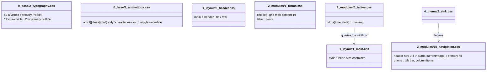
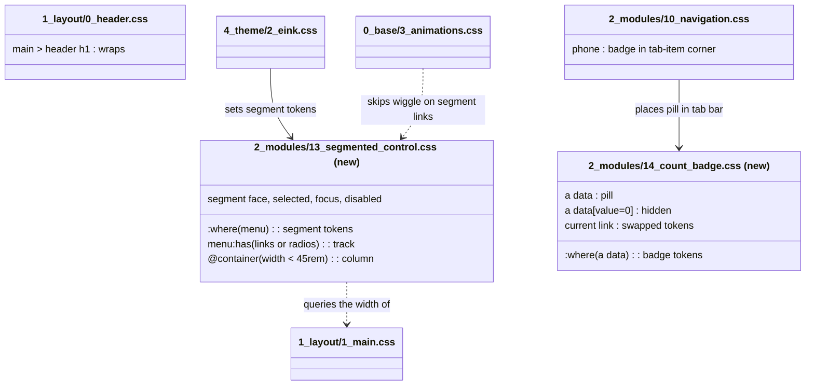

# Plan: Segmented control, count badges and title-bar heading wrap

From `intent.md` (2026-10-25). Status: accepted.

Context for the executor: mvpa.css is a classless CSS framework (read `CLAUDE.md`/`AGENTS.md`). The partials under `app/assets/stylesheets/mvpa/` are the source of truth. `app/assets/stylesheets/mvpa/mvpa.css` is a hand-flattened copy that must get every change too. `demo.html` links each partial and states the file count. Tests are Minitest source assertions (`test/css_source_helper.rb`: `each_source` runs one assertion on a partial and on `mvpa.css`) plus Nokogiri checks of `demo.html`. No JavaScript ships for this change.

## Design

### Domain terms

From `GLOSSARY.md`, used as defined: **Segmented control**, **View switch**, **Form choice**, **Count badge**. The avoided words "tabs", "toggle", "tag" and "counter" are not used. `intent.md`'s Problem says "a broken toggle" about journal_administration's existing role control; that names the old control, not a new concept, so it needs no new term.

Plan-local words (not glossary terms, not added to `GLOSSARY.md`): **track** is the tinted `<menu>` behind the segments; **segment** is one `menu > li` with its `<a>` or `<label>` face; **selected segment** is the segment whose link has `aria-current` (not `"false"`) or whose radio is `:checked`.

### Diagrams

Before (no rule styles `<menu>`; `<data>` is styled only in a table cell; `main > header h1` can widen the page):

After:

### Signatures

CSS, not Ruby: each touched partial with its one-line summary, then the selectors it gains and their key declarations. Two strict gates decide which `<menu>` is a segmented control; write them out in full in the CSS (no preprocessor):
- `L` (view switch) = `menu:has(> li > a):not(:has(> li > :not(a)))` — every item's element children are links. A menu with one link and one button does not match.
- `R` (form choice) = `menu:has(> li > label > input[type="radio"]):not(:has(> li > :not(label), > li > label > input:not([type="radio"])))` — every item is a label, and no label holds a non-radio input.

`2_modules/13_segmented_control.css` (new) — a `<menu>` of links or of radios renders as joined segments on a track.
- `:where(L, R)` (0,0,0) — token defaults: `--segment-track: color-mix(in oklch, var(--color-bg), var(--color-fg) 12%)`, `--segment-fg: var(--color-fg)`, `--segment-selected-bg: var(--color-bg-lightest)`, `--segment-selected-fg: var(--color-fg-darkest)`, `--segment-edge: transparent`, `--segment-shadow: var(--shadow-1)`.
- `L, R` — track: `display: flex; gap: 2px; padding: 2px; margin-inline: 0; list-style: none; inline-size: fit-content; max-inline-size: 100%; border: 1px solid var(--segment-edge); border-radius: var(--radius); background-color: var(--segment-track)`. No `overflow: hidden`, so focus rings are not clipped.
- `fieldset > R` — `grid-column: 1 / -1; justify-self: start`, so the track spans the fieldset's two-column grid (`1_forms.css`).
- `L > li, R > li` — `display: flex; flex: 1 1 auto; margin: 0`.
- Segment face, one rule: `L > li > a:any-link` (0,1,7) and `R > li > label` (0,2,9). Declarations: `display: flex; flex: 1; align-items: center; justify-content: center; position: relative; min-block-size: var(--touch-target); padding-inline: var(--inline-space); margin: 0; border: 1px solid transparent; border-radius: calc(var(--radius) - 2px); color: var(--segment-fg); background-color: transparent; text-decoration: none; font-weight: 500; white-space: nowrap; cursor: pointer`. `:any-link` lifts the link face above `a:visited` (0,1,1) and `header nav a:visited` (0,1,3); the label face beats `label` (0,0,1).
- `L > li > a:any-link:hover` (0,2,7) — `color: var(--segment-fg); background-color: color-mix(in oklch, var(--segment-track), var(--color-bg-lightest) 50%); box-shadow: none; transform: none`.
- Selected segment, one rule: `L > li > a:any-link[aria-current]:not([aria-current="false"])` (0,3,7) and `R > li > label:has(> input[type="radio"]:checked)` (0,4,10). Declarations: `background-color: var(--segment-selected-bg); color: var(--segment-selected-fg); border-color: var(--segment-edge); box-shadow: var(--segment-shadow); font-weight: 600`. Raised and plain: no `--color-primary`. The weight change means selection is not shown by colour alone.
- `menu > li > label > input[type="radio"]` (0,1,4, beats `input[type="radio"]` 0,1,1) — the dot is visually hidden but focusable and submits natively: `position: absolute; inline-size: 1px; block-size: 1px; margin: 0; opacity: 0; clip-path: inset(50%)`. Never `display: none` or `visibility: hidden`.
- `R > li > label:has(> input[type="radio"]:focus-visible)` — `outline: 2px solid var(--color-primary); outline-offset: 2px`. Links already get the ring from `*:focus-visible`.
- `R > li > label:has(> input[type="radio"]:disabled)` (0,4,10), after the selected rule so it wins by order — `color: var(--color-fg-lighter); cursor: not-allowed`. The native `disabled` attribute stops the click.
- Dark hairline, same pattern as `1_forms.css`: `[data-theme="solunized-dark"] menu, [data-theme="solunized-black"] menu` and, inside `@media (prefers-color-scheme: dark)`, `:root:not([data-theme]) menu` — custom properties only: `--segment-shadow: none; --segment-edge: color-mix(in oklch, var(--color-fg) 14%, transparent)`. A token on a non-segmented menu does nothing.
- `@container (width < 45rem) { L, R { flex-direction: column; inline-size: 100%; } }` — one segment per line, full width.

Not supported: a view switch inside `main > header nav`. There `main > header nav a:not([role="button"]):visited` (0,2,4) outranks the link face (0,1,7). README says to place a view switch in the page content.

`2_modules/14_count_badge.css` (new) — a `<data value>` inside a link renders as a count pill.
- `:where(a data)` (0,0,0) — `--badge-bg: var(--color-primary); --badge-fg: oklch(100% 0 0)`. White text in every theme, as a literal colour (no white token exists), settled by Etienne on 2026-10-25.
- `a data` (0,0,2) — `display: inline-block; min-inline-size: 1.6em; padding-inline: 0.5em; margin-inline-start: var(--inline-space-half); border-radius: 999px; background-color: var(--badge-bg); color: var(--badge-fg); font-size: var(--text-x-small); font-weight: 600; line-height: var(--line-height-normal); text-align: center; white-space: nowrap; font-variant-numeric: tabular-nums`. `inline-block` stops the link's underline from reaching the pill.
- `a[aria-current]:not([aria-current="false"]) data` (0,2,2) — `--badge-bg: oklch(100% 0 0); --badge-fg: var(--color-primary)`: a white pill with primary text.
- `menu > li > a data` — keeps the normal primary pill, also on a selected segment: reset `--badge-bg: var(--color-primary); --badge-fg: oklch(100% 0 0)` with a selector that outranks the inversion rule (for example `menu > li > a[aria-current]:not([aria-current="false"]) data`).
- `a data[value="0"]` (0,1,2) — `display: none`.

`1_layout/0_header.css` — gains `main > header h1 { min-inline-size: 0; overflow-wrap: anywhere; }`. No `hyphens`.

`2_modules/10_navigation.css` — inside the existing `@media (max-width: 768px)` block: `header nav > ul > li > a { position: relative; }` and `header nav > ul > li > a > data { position: absolute; inset-block-start: 0.25rem; inset-inline-end: 0.25rem; margin: 0; font-size: var(--text-xx-small); }`, so a badge on a tab-bar item sits in its corner instead of adding a third line to a fixed-height item.

`0_base/3_animations.css` — the three link-wiggle selectors `a:not([class]):not(body > header nav a)` become `a:not([class]):not(body > header nav a, menu > li > a)` (base, `::after`, `:hover::after`). Without it a segment link grows an underline on hover.

`4_theme/2_eink.css` — tokens only, one rule per theme: `[data-theme="eink-light"] menu { --segment-track: oklch(87% 0 0); --segment-edge: black; --segment-shadow: none; }` and `[data-theme="eink-dark"] menu { --segment-track: oklch(13% 0 0); --segment-edge: white; --segment-shadow: none; }`. The badge needs no e-ink rule: its tokens already give ink and paper.

`mvpa.css` — every block above, copied by hand into the matching place: the two new partials after the Dialog section and before the Solunized colours; the other additions next to their partial's existing rules.

Not checked: mvpa.css is a CSS-only gem with no Ruby classes to type; Steep and rbs_rails do not apply.

### Complexity

Not affected: no database, no requests, no JavaScript. Each `:has()` uses child combinators only and is anchored at `menu` or `label`, which keeps the subject scoped; no cost bound is claimed. Highest new specificity is (0,4,10) on the selected and disabled radio segment; theme token rules are (0,1,1) and beat the `:where()` defaults in any load order.

### Invariants

- A `<menu>` that is not all links or all radio labels gets no segmented look: every track and face selector carries gate `L` or `R`, and a rule on an ungated `menu` sets custom properties only. → `test/segmented_control_test.rb`.
- The selected segment is raised, never filled: its rule never names `--color-primary`. → `test/segmented_control_test.rb`.
- The radio stays in the form and the tab order: no `display: none` or `visibility: hidden` on it. → `test/segmented_control_test.rb`.
- A `<data>` outside a link keeps its look: every selector in `14_count_badge.css` starts with `a`, and `td :is(time, data)` is unchanged. → `test/count_badge_test.rb`, `test/responsive_tables_test.rb`.
- A zero badge never shows: `a data[value="0"] { display: none }` (0,1,2) outranks `a data` (0,0,2). → `test/count_badge_test.rb`.
- E-ink stays flat: the e-ink `menu` rules set only `--segment-*` tokens, with `--segment-shadow: none`, and `2_eink.css` gains no `\d+%)` fill. → `test/eink_theme_test.rb`.
- `mvpa.css` holds every new rule: each new assertion runs through `each_source`.

### Alternatives

1. **Least change** — everything in `10_navigation.css`, e-ink overrides repeated per selector, no new partial, `demo.html` count unchanged. Rejected: the form choice and the badge would live in the navigation partial, where a reader does not look, and e-ink overrides fight the segment rules on specificity.
2. **One partial per concept, with a global `--color-edge` colour token** in `0_colors.css`. Rejected: it adds a second mechanism for the dark hairline next to the existing in-module `[data-theme]` + `:root:not([data-theme])` twins.
3. **Chosen: one partial per concept, with component-scoped tokens.** `13_segmented_control.css` and `14_count_badge.css` own their concept; colours flow through `--segment-*`/`--badge-*` tokens set under `:where()`, like `--button-*`; themes change tokens only. Cost: two more files for `demo.html`, README and apps to link, and heavier selectors (up to 0,3,5) than the button rules.

## Design decisions

- **Badge text is white in every theme (settled by Etienne, 2026-10-25).** The plan proposed `--color-bg` because no light text reaches 4.5:1 on the dark-theme blue (white 3.19 on solunized-dark and solunized-black). Etienne chose white everywhere and accepts that contrast in the dark themes. The inverted pill on a current link is white with primary text.
- **Inside a segmented control the badge keeps the normal primary pill (settled by Etienne, 2026-10-25),** also on the selected segment. Only an `aria-current` link outside a `<menu>` inverts the pill, because the inverted pill's edge is faint on the raised segment.
- **Selected segment gets `font-weight: 600`** in every theme, so selection is not shown by colour or shadow alone (e-ink has no shadow).
- **Disabled segment is dimmed with `--color-fg-lighter`, not `opacity`**, so e-ink shows no see-through fill.
- **The phone tab bar places a badge in the item's corner.** The tab item is a fixed-height column; a third line would overflow it. Intent names the sidebar; the tab bar is the same nav on a phone.
- **Segment links need an `href`** (`:any-link`). A Rails `link_to_unless_current` renders no `<a>` for the current item; apps must render the current segment as a link with `aria-current="page"`. Stated in README.
- **Demo title-bar heading becomes "Hypotheekrenteaftrekberekening".** The rule only targets the real `main > header h1`, so the demo's own title bar must carry the long word; the sidebar heading still says "MVPA.css".
- **CHANGELOG date is the day the implement stage writes the entry**, as `## YYYY-MM-DD`.
- **A form choice needs a real radio group.** All radios of one choice share a non-empty `name`, have distinct `value`s, sit in one `<form>`, and one is `checked`. Native arrow keys and submission depend on that; CSS cannot create a group. Demo markup: `<form method="get"><fieldset><legend>Rol</legend><menu><li><label><input type="radio" name="role" value="lid"> Lid</label></li><li><label><input type="radio" name="role" value="beheerder" checked> Beheerder</label></li></menu></fieldset><button>Opslaan</button></form>`; the disabled example uses `name="locked_role"`, "Lid" checked and `disabled` on "Beheerder". README shows the same markup.
- Checked against `intent.md`'s `## Decisions`: menu of links = view switch, menu of radios = form choice, one look, 45rem container stack, raised plain selection, `<data value>` badge with zero hidden, primary pill, no tile styles, title-bar rule moved here. The only conflict is the badge text colour above, against the In scope wording "light text".

## Integration points

- Rails engine (`lib/`) and Propshaft serve `mvpa.css`; Sprockets/importmap users link partials. No engine change: the engine registers the folder, not a file list.
- journal_administration and other pinned apps: their existing `<menu>` of links or radios and `<data>` in links change look after the bump. CHANGELOG `### Upgrading` tells them what to do. No app is changed here.
- Native form submission and keyboard behaviour of radios: unchanged, because the radio stays a real, focusable input.

## Files that change

- `app/assets/stylesheets/mvpa/2_modules/13_segmented_control.css` — new, the segmented control.
- `app/assets/stylesheets/mvpa/2_modules/14_count_badge.css` — new, the count badge.
- `app/assets/stylesheets/mvpa/1_layout/0_header.css` — title-bar heading wrap.
- `app/assets/stylesheets/mvpa/2_modules/10_navigation.css` — tab-bar badge placement.
- `app/assets/stylesheets/mvpa/0_base/3_animations.css` — wiggle exclusion for segment links.
- `app/assets/stylesheets/mvpa/4_theme/2_eink.css` — segment tokens for both e-ink themes.
- `app/assets/stylesheets/mvpa/mvpa.css` — the same changes, flattened.
- `demo.html` — two new `<link>` tags after `12_dialog.css`, count 23 → 25 in both sentences; a "🎛️ Segmented control" article (period view switch "Deze maand" `aria-current="page"` through "Vorig jaar"; "Alle"/"Zonder categorie" with no `aria-current`; fieldset "Rol" with "Lid"/"Beheerder", "Beheerder" checked, in a GET form with a submit button, markup as under Design decisions; a second fieldset with "Beheerder" disabled); a "🔢 Count badges" article (a landing-tile link with `<data value="5">5</data>`, a link with `<data value="1234">1234</data>`, a link with `<data value="0">0</data>`, and a pointer to the tables' `<data>` cells); sidebar entries for both articles; sidebar badges: current "🏠 Introduction" `<data value="3">3</data>`, "📋 Forms" `<data value="12">12</data>`, "📈 Progress" `<data value="0">0</data>`; title-bar `<h1>` becomes "Hypotheekrenteaftrekberekening".
- `README.md` — the two new partials in the standalone `<link>` list and the File Structure tree; new `### Segmented control` (view switch and form choice markup, `href` + `aria-current` note, keep a view switch outside `main > header nav`) and `### Count badges` (markup, zero hidden, app formats the number) sections under Components; one line on the title-bar heading wrap.
- `CHANGELOG.md` — new dated entry, headings `### Added`, `### Changed`, `### Upgrading`. The `### Upgrading` list, in this order:
  1. Add `13_segmented_control.css` and `14_count_badge.css` to your stylesheet links, after `12_dialog.css`. The gem and `mvpa.css` include them already.
  2. To show a period filter as a segmented control, replace the `<select>` and its submitting script with a `<menu>` of `<li><a href="…">` links, and put `aria-current="page"` on the current period's link.
  3. To show radios as a segmented control, wrap each radio as `<menu><li><label><input type="radio" name="…" value="…"> Label</label></li></menu>` inside a `<fieldset>` with a `<legend>`, with one shared `name`.
  4. Put a count beside a link as `<data value="12">12</data>` inside the `<a>`. Render it at zero too; `value="0"` hides it.
  5. Check every existing `<menu>` of links or radios, and every `<data>` inside a link, for the new look.
  6. Remove your own `main > header h1` rule that sets `min-inline-size` or `overflow-wrap`, such as in `title_bar.css`.
  7. Keep a view switch out of `main > header nav`; place it in the page content.
- `test/segmented_control_test.rb`, `test/count_badge_test.rb`, `test/demo_segmented_control_and_badges_test.rb` — new.
- `test/title_bar_row_test.rb`, `test/eink_theme_test.rb`, `test/mobile_navigation_test.rb`, `test/readme_test.rb`, `test/changelog_upgrading_test.rb`, `test/elevation_depth_system_test.rb` — extended or updated as listed under Proof.

## Order of work

1. Write `test/demo_segmented_control_and_badges_test.rb` `test_the_demo_period_view_switch_has_five_links_with_deze_maand_current` (walking skeleton), run it, watch it fail on the missing markup.
2. Add the two `<link>` tags, the count change and the "Segmented control" article to `demo.html`; the skeleton passes.
3. Write `test/segmented_control_test.rb`; watch it fail; create `13_segmented_control.css`; copy into `mvpa.css`; green.
4. Update the wiggle exclusion in `3_animations.css` and `mvpa.css`, and the exact-string assertion in `test/elevation_depth_system_test.rb`, with its test-first assertion in `segmented_control_test.rb`.
5. Add the e-ink token rules with their `eink_theme_test.rb` cases first.
6. Write `test/count_badge_test.rb`; create `14_count_badge.css`; copy into `mvpa.css`; add the tab-bar rule with its `mobile_navigation_test.rb` case.
7. Add the "Count badges" article and sidebar badges to `demo.html` with their demo tests first.
8. Title-bar heading: `title_bar_row_test.rb` case first, then `0_header.css`, `mvpa.css` and the demo `<h1>`.
9. README sections with `readme_test.rb` cases first.
10. CHANGELOG entry; first pin the two "latest entry" tests in `changelog_upgrading_test.rb` to `2026-10-19`, then add the new latest-entry tests, then the entry.
11. Run `bundle exec rake test`, `bundle exec rubocop`, `npm run lint:css`, `npm run lint:browsers`, `yamllint --strict .`, and lint the bundle, which the config ignores: `npx stylelint --stdin-filename bundle-check.css < app/assets/stylesheets/mvpa/mvpa.css`.
12. Run every `check:` line under Proof in the browser matrix: Chrome, Firefox and Safari on macOS, and iOS Safari in the Xcode Simulator. Record the evidence per browser. A browser that is not available is recorded as unverified, never as passed.

## Risks

- Apps that already use a `<menu>` of links or radios, or a `<data>` in a link, change look on bump. Accepted by intent; covered by CHANGELOG step 5.
- A view switch inside `main > header nav` is not supported: `main > header nav a:not([role="button"]):visited` (0,2,4) outranks the link face (0,1,7). README and CHANGELOG step 7 say to place it in the page content.
- Source-string tests cannot prove the cascade, `fit-content` sizing, container sizing, `:has()` focus reflection, arrow keys or contrast; the browser matrix in step 12 covers those, and an unavailable browser stays marked unverified.
- README still says Firefox 113+ while `.browserslistrc` says 121; that mismatch predates this change and goes in a separate branch (playbook rule 21).
- A `<menu>` with no container ancestor (the sidebar, a top-layer `<dialog>`) never stacks; a dialog's menu queries `main`'s width.
- Long labels with `nowrap` at 45rem or wider can overflow the track; five Dutch period labels fit.
- `:has()` and `clip-path: inset()` must pass `stylelint-no-unsupported-browser-features`; `:has()` already does (`2_details.css`).
- `mvpa.css` drift: every rule must be copied; `each_source` catches a missed rule only where a test asserts it.
- Rejected: a classed variant, a JS roving-tab-index controller, and `opacity` for disabled segments.

Out of scope (from `intent.md`): sheets and any `<dialog>` change; dialog-opening scripts; journal_administration changes; a custom confirm dialog; landing-tile styles; number formatting such as "99+"; a `<menu>` of buttons or other content; `<data>` outside a link.

## Proof

- Five-period `<menu>` shows one row of joined segments, "Deze maand" raised → `test/demo_segmented_control_and_badges_test.rb` `test_the_demo_period_view_switch_has_five_links_with_deze_maand_current`; `test/segmented_control_test.rb` `test_a_menu_of_links_is_a_flex_track`, `test_the_current_link_is_the_raised_segment`; check: open `demo.html` at 1280px wide, see one row with "Deze maand" raised.
- Clicking "Vorig jaar" follows its link, no script runs → `test/demo_segmented_control_and_badges_test.rb` `test_the_segmented_controls_carry_no_script_hooks`; check: click "Vorig jaar" in `demo.html`, the URL hash changes.
- Narrower than 45rem the periods stack full width; at 45rem or wider one row → `test/segmented_control_test.rb` `test_below_45rem_the_track_stacks_full_width`; check: resize the window so `main` is 44rem and 46rem wide (DevTools), see column then row.
- "Alle"/"Zonder categorie" without `aria-current` shows both plain → `test/demo_segmented_control_and_badges_test.rb` `test_the_demo_filter_view_switch_has_no_current_link`; `test/segmented_control_test.rb` `test_a_segment_face_is_plain_by_default`.
- Fieldset "Rol" looks the same, "Beheerder" raised, no dot → `test/demo_segmented_control_and_badges_test.rb` `test_the_demo_role_form_choice_has_beheerder_checked`, `test_the_demo_role_choice_is_one_named_radio_group_in_a_get_form` (shared `name="role"`, distinct values, one `checked`, `method="get"`, a submit button); `test/segmented_control_test.rb` `test_a_menu_of_radios_is_a_track_too`, `test_the_checked_radio_label_is_the_raised_segment`, `test_the_radio_dot_is_visually_hidden_but_stays_focusable`, `test_a_menu_in_a_fieldset_spans_its_grid`.
- Tabbing shows a focus ring; arrows move the choice; saving sends the checked role → `test/segmented_control_test.rb` `test_a_focused_radio_rings_its_segment`; check: in `demo.html` Tab into "Rol", see the ring, press ← and →, see the raised segment move; submit the form and see `role=…` in the URL query.
- Disabled "Beheerder" is dimmed and not selectable → `test/demo_segmented_control_and_badges_test.rb` `test_the_demo_has_a_disabled_beheerder_choice`; `test/segmented_control_test.rb` `test_a_disabled_radio_dims_its_segment`; check: click it in `demo.html`, the choice does not change.
- Sidebar link with `<data value="12">12</data>` shows a primary pill after the label → `test/count_badge_test.rb` `test_data_in_a_link_is_a_primary_pill`; `test/demo_segmented_control_and_badges_test.rb` `test_the_sidebar_shows_badges_including_on_the_current_link`.
- The badge on the current link inverts and stays readable → `test/count_badge_test.rb` `test_the_badge_inverts_on_a_current_link` and `test_a_badge_in_a_segmented_control_stays_primary`; check: look at "🏠 Introduction" in every theme.
- `<data value="0">0</data>` shows no pill → `test/count_badge_test.rb` `test_a_zero_badge_is_hidden`; `test/demo_segmented_control_and_badges_test.rb` `test_the_demo_has_a_zero_badge`.
- `<data value="1234">` stays on one line in a wider pill → `test/count_badge_test.rb` `test_a_long_number_stays_on_one_line_with_tabular_figures`; `test/demo_segmented_control_and_badges_test.rb` `test_the_demo_has_a_four_digit_badge`.
- `<data value="5000">` in a table cell looks as before → `test/count_badge_test.rb` `test_every_badge_selector_needs_a_link_ancestor`; `test/responsive_tables_test.rb` `test_time_and_data_in_a_cell_never_wrap` (unchanged).
- A landing-tile link with `<data value="5">5</data>` shows the same pill → `test/demo_segmented_control_and_badges_test.rb` `test_the_demo_has_a_landing_tile_link_with_a_badge`.
- "Hypotheekrenteaftrekberekening" wraps at 320px, no sideways scroll → `test/title_bar_row_test.rb` `test_the_title_bar_heading_wraps_instead_of_widening_the_page`; `test/demo_segmented_control_and_badges_test.rb` `test_the_demo_title_bar_heading_is_one_long_word`; check: DevTools device width 320px, `document.documentElement.scrollWidth <= innerWidth`.
- Segmented control and badge read in every Solunized and e-ink theme → `test/segmented_control_test.rb` `test_dark_themes_swap_the_shadow_for_a_hairline`; `test/eink_theme_test.rb` `test_segmented_controls_stay_flat_on_the_eink_themes`; check: switch `demo.html` through solunized-light, -dark, -white, -black, system dark, eink-light and eink-dark; see track, raised segment, focus ring, pill and inverted pill each time.
- `demo.html` shows every criterion, tests and linters pass, `mvpa.css` matches → `test/demo_stylesheet_links_test.rb` (unchanged, 25 files); `each_source` in every new test; check: `bundle exec rake test && bundle exec rubocop && npm run lint:css && npm run lint:browsers && yamllint --strict . && npx stylelint --stdin-filename bundle-check.css < app/assets/stylesheets/mvpa/mvpa.css`.
- Every browser `check:` above runs in Chrome, Firefox and Safari on macOS and iOS Safari in the Simulator → check: evidence recorded per browser; an unavailable browser is recorded as unverified.
- CHANGELOG `### Upgrading` covers `<select>` → `<menu>`, `<menu><li><label>`, `<data value>`, checking existing `<menu>`/`<data>`, removing the `main > header h1` rule → `test/changelog_upgrading_test.rb` `test_the_latest_entry_tells_apps_how_to_adopt_segmented_controls_and_badges`, `test_the_latest_entry_lists_what_was_added_and_changed_and_ends_with_upgrading`.
- Invariant: a `<menu>` of other content, or a mix of links and buttons, gets no segmented look, enforced by the strict gates `L` and `R` → `test/segmented_control_test.rb` `test_no_rule_styles_a_bare_menu`, `test_a_mixed_menu_is_not_a_segmented_control` (every track and face selector holds `:not(:has(> li > :not(a)))` or the radio equivalent).
- Invariant: the selected segment is never filled with primary, enforced by the selected rule → `test/segmented_control_test.rb` `test_the_raised_segment_is_not_filled`.
- Invariant: e-ink segment rules set tokens only and drop the shadow, enforced in `2_eink.css` → `test/eink_theme_test.rb` `test_segmented_controls_stay_flat_on_the_eink_themes`.

Per changed file, the unit tests expected:
- `13_segmented_control.css`: `test_a_menu_of_links_is_a_flex_track`, `test_a_menu_of_radios_is_a_track_too`, `test_no_rule_styles_a_bare_menu`, `test_a_mixed_menu_is_not_a_segmented_control`, `test_segment_items_carry_no_margins`, `test_a_segment_face_is_plain_by_default`, `test_a_segment_link_outranks_visited_and_hover_link_colours`, `test_the_current_link_is_the_raised_segment`, `test_the_checked_radio_label_is_the_raised_segment`, `test_the_raised_segment_is_not_filled`, `test_the_radio_dot_is_visually_hidden_but_stays_focusable`, `test_a_focused_radio_rings_its_segment`, `test_a_disabled_radio_dims_its_segment`, `test_a_menu_in_a_fieldset_spans_its_grid`, `test_below_45rem_the_track_stacks_full_width`, `test_dark_themes_swap_the_shadow_for_a_hairline`, `test_the_track_never_clips_a_focus_ring`.
- `14_count_badge.css`: `test_data_in_a_link_is_a_primary_pill`, `test_a_long_number_stays_on_one_line_with_tabular_figures`, `test_a_zero_badge_is_hidden`, `test_the_badge_inverts_on_a_current_link`, `test_every_badge_selector_needs_a_link_ancestor`.
- `0_header.css`: `test_the_title_bar_heading_wraps_instead_of_widening_the_page` (also refutes `hyphens`).
- `10_navigation.css`: `test_a_tab_bar_badge_sits_in_the_item_corner` in `mobile_navigation_test.rb`.
- `3_animations.css`: `test_segment_links_get_no_wiggle_underline` in `segmented_control_test.rb`; the exact selector string in `elevation_depth_system_test.rb` updated to the new `:not(...)` list.
- `2_eink.css`: `test_segmented_controls_stay_flat_on_the_eink_themes`; the existing gradient and `\d+%)` checks still pass.
- `demo.html`: the `demo_segmented_control_and_badges_test.rb` tests named above.
- `README.md`: `test_readme_shows_view_switch_and_form_choice_markup`, `test_readme_shows_the_count_badge_markup`.
- `CHANGELOG.md`: the two latest-entry tests above; the existing pull-down-menu tests pinned to `2026-10-19`.

Test setup: source-string assertions through `CssSourceHelper` (`partial`, `bundle`, `rule_body`, `each_source`); Nokogiri on `demo.html` and plain string checks on `README.md`/`CHANGELOG.md`. No fixtures, no browser in the suite; browser behaviour is proven by the `check:` lines.

---
Domain skills applied: rails-ui (interaction-design reference), software-design, glossary, diagrams.

## Critique

### Round 1 (codex exec -p terra)

- The `:has()` gates are too broad: a menu with one link and one button still matches, and `:where(menu)` is a bare menu rule. → fixed (strict gates L and R that refuse any item that is not a link or a radio label; tokens moved onto the gated menus; new test_a_mixed_menu_is_not_a_segmented_control)
- The radio markup does not require a shared `name`, distinct values, a form and a submit, which native arrow keys and submission need. → fixed (exact demo and README markup under Design decisions; new test_the_demo_role_choice_is_one_named_radio_group_in_a_get_form)
- The badge colour contradicts intent's "light text" while the plan claimed no conflict. → fixed (contrast computed for every Solunized theme; the conflict is named under Design decisions and raised as a decision in the report)
- Specificity claims are wrong: the selected radio is the highest selector, and the link face loses to the title-bar visited-link rule at 0,2,4. → fixed (numbers recomputed for the strict gates; a view switch in the title-bar nav is declared unsupported in Signatures, Risks, README and CHANGELOG step 7)
- The flattened bundle is not linted, because the stylelint config ignores `mvpa.css`. → fixed (step 11 and Proof lint the bundle through stdin with a stdin filename, verified to run)
- Browser proof is insufficient for Chrome, Firefox, Safari and iOS Safari. → fixed (step 12 and Proof define the browser matrix; an unavailable browser is recorded as unverified)
- The Upgrading steps are named only by topic. → fixed (the seven Upgrading steps are written out under Files that change)
- README says Firefox 113+ where `.browserslistrc` says 121. → dismissed: the mismatch predates this change and is unrelated to it, so playbook rule 21 sends it to a separate branch; it is listed under Risks.
- The diagrams use the inheritance arrow for a container query, and Complexity promises a cost bound the specification does not guarantee. → fixed (dependency arrows labelled with the verb; the cost bound is removed)
