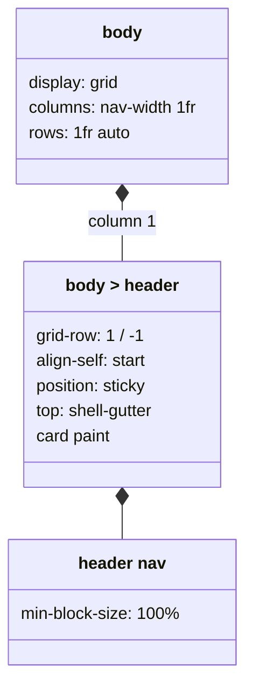
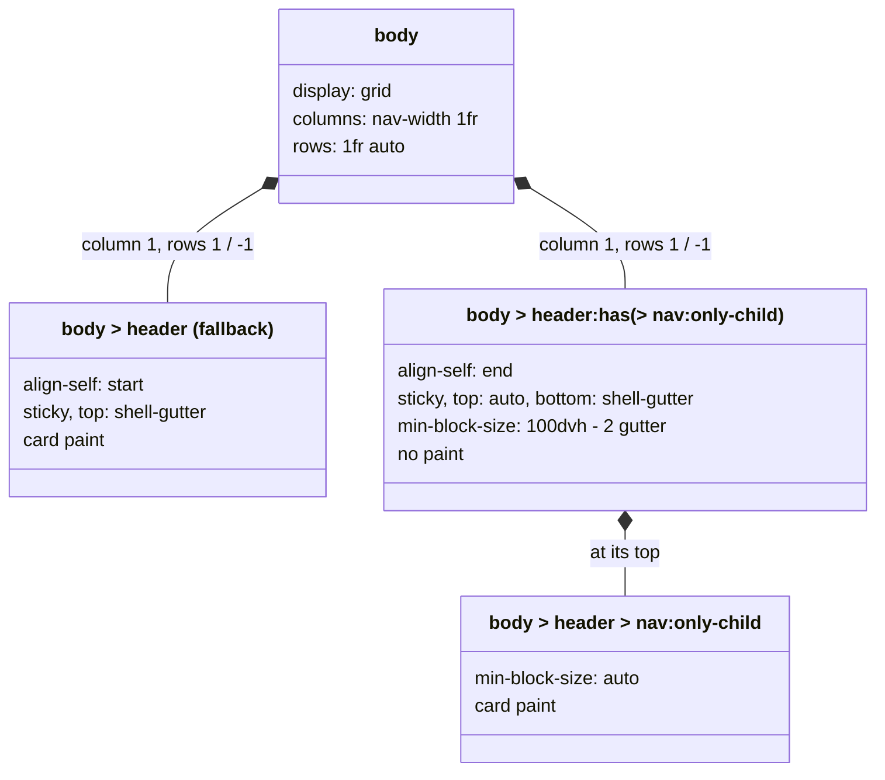
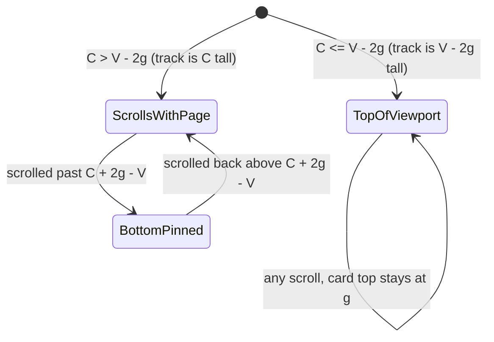

# Plan: Desktop sidebar fits its own content

From `intent.md` (2026-10-26). Status: accepted.

## Context

mvpa.css is a classless CSS framework, shipped as a Rails gem. The per-layer partials under `app/assets/stylesheets/mvpa/` are the source of truth. `app/assets/stylesheets/mvpa/mvpa.css` is a flattened copy that is kept in sync by hand. Tests are Minitest text checks over the CSS, HTML and Markdown files (`test/*_test.rb`); there is no browser test runner. Browser floor (`.browserslistrc`): Chrome >= 111, Firefox >= 121, Safari >= 16.4, enforced by stylelint `no-unsupported-browser-features`.

Branch `sidebar-height-fits-content` holds one commit, `565f728`, on the old base `3122fd2`. It removes the `min-block-size: calc(100dvh - 2 * var(--shell-gutter))` floor from the desktop `body > header` rule (and the mobile `min-block-size: unset`), and replaces the static test with `test_sidebar_is_only_as_tall_as_its_own_content`. `origin/main` has moved on since (tables, pull-down menu, npm, `AGENTS.md`, `test/css_source_helper.rb`). The branch must be rebased on `origin/main` first.

After `565f728`, a short nav gives a short card. One case stays broken: a sidebar taller than the viewport, beside a long `main`. It sticks with `top: var(--shell-gutter)`, so its lower links stay below the viewport until the page end. CSS cannot read an element's own height into its sticky inset, so `body > header` alone cannot be "top-pinned when it fits, bottom-pinned when it does not". This plan splits the two jobs over two boxes: `body > header` becomes an invisible, viewport-tall sticky track, and its `<nav>` paints the card.

## Design

### Domain terms

No `GLOSSARY.md` exists in this repository. Terms used in this plan:

- **Sidebar**: the desktop `body > header` column that holds the shell `<nav>` (intent term).
- **Bottom bar**: `body > header` at 768px and narrower (intent term).
- **Shell gutter**: the `--shell-gutter` token, the space around the sidebar (existing).
- **Card**: the painted sidebar surface: background, radius, shadow and the theme borders.
- **Sidebar track** (new): on desktop, a `body > header` whose only element child is its `<nav>`. It is invisible, at least `100dvh - 2 * --shell-gutter` tall, and sticks by its bottom edge. The card sits at its top.
- **Nav-only header** (new): `body > header:has(> nav:only-child)`, the markup that `README.md` and `demo.html` document.

### Diagrams

Before (main plus `565f728`):



After (desktop, 769px and wider):



Sticky states of the sidebar track. C is the nav height, V the viewport height, g the gutter.



### Signatures

CSS rules, per file. The base is `origin/main` plus the rebased `565f728`.

`app/assets/stylesheets/mvpa/1_layout/0_header.css` — app shell grid and sidebar position. The base `body > header` rule, the dark/black rule and the `@media (max-width: 768px)` block stay as they are (no `min-block-size` anywhere). Add this block after the dark/black rule and before the mobile block:

```css
/* Nav-only header: the header is an invisible track at least as tall as the
   viewport and sticks by its bottom edge; the nav paints the card. A short nav
   stays at the top. A tall nav scrolls with the page until its last link is in
   view, then stays. Desktop only, so the mobile bar is untouched. */
@media (min-width: 769px) {
  body > header:has(> nav:only-child) {
    align-self: end;
    top: auto;
    bottom: var(--shell-gutter);
    min-block-size: calc(100dvh - 2 * var(--shell-gutter));
    border: none;
    border-radius: 0;
    box-shadow: none;
    background-color: transparent;
  }

  body > header > nav:only-child {
    min-block-size: auto;
    border-radius: var(--radius-large);
    box-shadow: var(--shadow-3), var(--shadow-1);
    background-color: var(--color-bg-lighter);
  }

  [data-theme="solunized-dark"] body > header > nav:only-child,
  [data-theme="solunized-black"] body > header > nav:only-child {
    box-shadow: none;
    border: 1px solid color-mix(in oklch, var(--color-fg) 14%, transparent);
  }
}
```

`app/assets/stylesheets/mvpa/4_theme/2_eink.css` — in each existing `@media (min-width: 769px)` block, add a nav rule after the header rule. The header rule stays first, because `test_the_eink_header_border_does_not_fight_the_mobile_flush_bar` matches it at the start of the block.

```css
@media (min-width: 769px) {
  [data-theme="eink-light"] body > header {
    border: 1px solid black;
  }

  [data-theme="eink-light"] body > header > nav:only-child {
    box-shadow: none;
    border: 1px solid black;
  }
}
```

The `eink-dark` block takes the same shape with `white`.

`app/assets/stylesheets/mvpa/mvpa.css` — the same three blocks, copied verbatim into the same positions.

Not checked: this change has no Ruby production code, so Steep does not apply.

### Complexity

- Three new rules in `0_header.css`, two in `2_eink.css`, mirrored in `mvpa.css`. No JavaScript, no markup change, no extra layout pass.
- `:has(> nav:only-child)` checks only the direct children of one element. Style invalidation happens only when the header's children change.
- No queries: this is a stylesheet.

### Invariants

1. The base `body > header {` rule has no `min-block-size`. Enforced in `0_header.css` and `mvpa.css`.
2. The track rule sets `align-self: end`, `top: auto`, `bottom: var(--shell-gutter)` and `min-block-size: calc(100dvh - 2 * var(--shell-gutter))`, and paints nothing. `top: auto` is required: with both insets set, a box taller than the viewport obeys `top`, and the tall-sidebar fix is lost.
3. The nav card sets `min-block-size: auto` and carries the card paint, with the values the header has.
4. Every `:has(> nav:only-child)` and `> nav:only-child` rule sits inside `@media (min-width: 769px)`.
5. Each theme that gives the desktop header a border (solunized-dark, solunized-black, eink-light, eink-dark) also has a `body > header > nav:only-child` rule with `box-shadow: none` and the same border.
6. No sidebar rule sets `overflow: auto`, `overflow-y: auto` or `overflow-y: scroll`.
7. `mvpa.css` contains every new rule verbatim.

### Alternatives

1. **Sidebar track, card on the nav (chosen).** Pure CSS. Meets all five criteria for a nav-only header. Costs: the card paint lives in two places (the header as fallback, the nav for nav-only headers), and a header with more than the nav keeps the `565f728` behaviour.
2. **JavaScript-measured sticky top (rejected).** Keep the paint on `body > header`, set `top: min(var(--shell-gutter), 100dvh - var(--shell-gutter) - var(--sidebar-block-size, 0px))`, and ship a new `app/javascript/mvpa/sidebar_reach.js` module with a `ResizeObserver` that writes `--sidebar-block-size`. Rejected: every app must add an import before the tall-sidebar case works, a CSS framework gains a layout script, and Turbo restoration visits can show one frame of the fallback.
3. **Smallest change: `565f728` only (rejected).** Rebase and stop. Rejected: a tall sidebar beside a long main still hides its last links until the page end, which fails acceptance criterion 3. Flipping `top` to `bottom` instead breaks criterion 2 for every short sidebar; `align-self: end` with `bottom` on the painted header puts a short card at the viewport bottom.

Scroll-driven animations, anchor positioning and scroll-state queries would allow other designs, but are below the browser floor.

## Design decisions

- Pure CSS over JavaScript: the fix reaches every app that uses the documented markup on its next SHA bump, with no import to add.
- The `:has(> nav:only-child)` gate keeps a header with other children (a logo, a form, a `<script>`) on the `565f728` card, so its content stays inside the card. For such a header, criteria 1, 2, 4 and 5 hold; criterion 3 holds only at the page end. Recorded as a risk, documented in `README.md` and the changelog. Etienne accepted this gap on 2026-10-26 over a JavaScript `ResizeObserver` fallback: pure CSS only, no import for apps.
- `crass` goes from 1.0.7 to 1.0.8 in this branch (GHSA-pq4g-8rxf-4g29), as its own commit. Etienne chose this on 2026-10-26 over a separate fix branch, because the pre-push Bundler Audit blocked the push.
- A tall nav-only sidebar pins its bottom after scrolling and does not stick both ways: after the reader scrolls down, its first links return near the page top. The criteria do not ask for more; both-way sticking needs JavaScript.
- The sticky geometry was probed during planning in headless Chrome (1280×800, viewport 713px, nav 2603px tall, the track rules over main's `mvpa.css` without the floor). Tall nav with a long main, scrolled to the middle: without the track the nav bottom sits at 2613px (last link hidden); with the track it sits at 703px (last link one gutter above the viewport bottom). Short nav with a long main: the nav top stays at 10px at every scroll position, with and without the track. Tall nav with a short main: identical with and without the track, last link at 703px at the page end. Firefox and Safari were not probed; step 10 checks them by hand.
- `view-transition-name: header` stays on `body > header`. The track contains the whole card, so the named snapshot shows the card and its shadow; for short navs the track has the same size on every page. Step 10 checks a real page transition.
- No conflict with `intent.md`'s `## Decisions`: the card is exactly as tall as its content, `565f728` is reused and rebased on main, a tall nav scrolls with the page with no internal scrollbar.
- Changelog: a dated entry with `### Fixed`, `### Changed` and `### Upgrading`, because an app that styles `body > header` itself must act. The two changelog tests that read "the latest entry" move to the `2026-10-19` entry by date, as commit `48180c1` did for `2026-10-13`.

## Integration points

- Every app that pins mvpa.css and shows the sidebar on desktop.
- `2_modules/10_navigation.css`: `header nav { min-block-size: 100% }` stays for the bottom bar; the nav card rule overrides it on desktop with `auto` (specificity 0,1,3 over 0,0,2).
- `2_modules/11_turbo-transitions.css`: `view-transition-name: header` now names the track. The snapshot holds the card; the transparent part stays transparent. Not changed.
- `4_theme/2_eink.css` and the solunized dark/black rule: the desktop header borders move to the nav card for nav-only headers. The track rule (0,1,3) beats the theme header rules (0,1,2), so the track shows no border.
- `demo.html`: its `body > header` holds only the `<nav>`, so the demo shows the result without a markup change.

## Files that change

- `app/assets/stylesheets/mvpa/1_layout/0_header.css` — rebased `565f728` (no floor), plus the desktop sidebar track block.
- `app/assets/stylesheets/mvpa/4_theme/2_eink.css` — a nav card border rule in each desktop eink block.
- `app/assets/stylesheets/mvpa/mvpa.css` — the same changes, verbatim.
- `test/elevation_depth_system_test.rb` — rebased `565f728` test, written with `refute_includes` as main's tests are.
- `test/sidebar_track_test.rb` (new) — static checks of the track, the card, the theme borders, the desktop-only gate and the changelog/README text, over the partials and `mvpa.css`. Uses `test/css_source_helper.rb`.
- `test/changelog_upgrading_test.rb` — the two `latest_entry` tests read the `2026-10-19` entry by a date constant; new tests read the new latest entry.
- `CHANGELOG.md` — a `## 2026-10-26` entry (use the delivery date if it differs).
- `README.md` — one bullet in `### Navigation`: on desktop a header that holds only its `<nav>` is an invisible track, the nav paints the card, and a sidebar taller than the window scrolls with the page until its last link shows; a header with other children keeps the card on the header.

## Order of work

1. Rebase on main. The tracked `Gemfile.lock` carries a local, machine-written SHA bump; restore it first (`git checkout -- Gemfile.lock`). Then `git fetch origin && git rebase origin/main`. Resolve conflicts in `0_header.css`, `mvpa.css` and `elevation_depth_system_test.rb` on their own merits: keep main's content, drop both `min-block-size` lines, keep `565f728`'s test and `sidebar_rule` helper.
2. Prove the `565f728` regression test fails before its fix: `git show origin/main:app/assets/stylesheets/mvpa/1_layout/0_header.css > app/assets/stylesheets/mvpa/1_layout/0_header.css`, the same for `mvpa.css`, run `bundle exec ruby -Itest test/elevation_depth_system_test.rb -n test_sidebar_is_only_as_tall_as_its_own_content`, watch it fail, then `git checkout HEAD -- app/assets/stylesheets/mvpa`. Run it again; watch it pass.
3. Write `test/sidebar_track_test.rb` with the acceptance tests for criteria 2 and 3 and the invariant tests from `## Proof`. Run it (`bundle exec ruby -Itest test/sidebar_track_test.rb`); watch every test fail because the rules do not exist.
4. Add the sidebar track block to `0_header.css`. Run the new test file; the partial assertions pass.
5. Add the eink nav card rules to `2_eink.css`. Run the new test file and `test/eink_theme_test.rb`.
6. Mirror steps 4 and 5 into `mvpa.css`. Run the new test file; every test passes.
7. Pin the two `latest_entry` changelog tests to `2026-10-19`; write the new latest-entry tests; watch them fail. Add the `CHANGELOG.md` entry; watch them pass.
8. Write the README test in `test/sidebar_track_test.rb`; watch it fail. Add the README bullet; watch it pass.
9. Run `bundle exec rake test`, `bundle exec rubocop`, `npm run lint:css`, `npm run lint:browsers` and `yamllint --strict .`. Fix every finding in production code.
10. Check by hand in a desktop browser, with a scratch page outside the repository that links the worktree's partials and copies `demo.html`'s shell. Check four cases: three links; three links with a long main; 30 links with a short main; 30 links with a long main, scrolled down. Check one phone-width case. Check one dark and one eink theme. Run the four desktop cases in Chrome, Firefox and Safari. Navigate between two of the `demo/page-transitions/*.html` pages with a short and with a tall sidebar, and check that the card does not jump or lose its shadow during the transition. Record what each case shows as evidence for the review.

Step 10 evidence, run by the coordinator on 2026-10-26 after the rebase on `890d132`, with a scratch probe page (theme, link count, main length and scroll position from the URL; it measures the nav card and the last link):

- Chrome (headless), 1280×800, viewport 713px: 3 links, short main: card 309px, top at 10px. 3 links, long main, scrolled to the middle and to the end: top still at 10px. 30 links (card 1983px), short main, at page end: last link bottom at 679px. 30 links, long main: at the top the card starts at 10px; scrolled to the middle and to the end, the card bottom is at 703px and the last link bottom at 679px. The header never scrolls on its own and has no background or shadow; the nav carries the card.
- Chrome, themes: solunized-dark shows a 1px hairline and no shadow on the nav; eink-light a 1px black border; eink-dark a 1px white border. Tall-nav geometry is the same in each theme.
- Chrome, phone width (500px window, the headless minimum): every measurement is identical to `main`'s `mvpa.css`; the header is the fixed 56px bottom bar.
- Firefox (headless, driven over WebDriver BiDi): all ten desktop and theme cases give the same numbers as Chrome. Firefox's `--screenshot` mode was not usable: it ignores the scroll and drops fixed elements.
- WebKit (iPad Pro 13-inch Simulator, iOS 27 Safari, 1032px wide, so the desktop layout): 3 links, long main, mid-scroll: card top at 10px. 30 links, short main, at page end and with a long main at mid-scroll: card bottom at 1234px in a 1244px viewport, last link visible.
- View transition (Chrome, demo pages served over local HTTP, transition frozen at 150ms): with 3 links and with 30 links, the card stays at (10, 10), 240px wide, with its shadow, while the main content slides; only the current-link highlight cross-fades.
- Unverified: desktop Safari on macOS, because WebDriver needs "Allow remote automation", which is off on this machine.

## Risks

- A header with more than the nav keeps the `565f728` behaviour, so a tall sidebar there shows its last links only at the page end. CSS cannot paint one card across arbitrary siblings inside the browser floor.
- The card paint now lives in two rule sets. A later look change must edit both; invariant 5 and the tests guard the theme half.
- An app whose own stylesheet styles `body > header` on desktop (background, border, shadow) sees that paint on the invisible track, not on the card. The changelog Upgrading steps tell it to move that styling to `body > header > nav`.
- A classic horizontal page scrollbar counts inside `100dvh`, so a short card can sit up to one scrollbar height higher. The desktop layout has no horizontal scroll.
- Widths between 768px and 769px match neither media query; this gap exists today, and the fallback card applies there.
- Rebase conflicts in `mvpa.css` and `0_header.css`, because main also changed those files.
- Static tests cannot prove the sticky geometry; step 10's manual check covers it. Only Chrome was probed during planning. If Firefox or Safari keeps a tall nav pinned at the top, stop and report it; do not switch to JavaScript without a plan revision.
- The view-transition snapshot is now the track, not the painted header. Step 10 checks a real transition.

Out of scope: the bottom bar, the sidebar look (shadow, radius, border, gutter, themes), the nav link styles, both-way sticky behaviour, a JavaScript fallback for headers with more than the nav.

## Proof

- On a desktop viewport, a sidebar with three nav links ends just below the third link → `test/elevation_depth_system_test.rb` `test_sidebar_is_only_as_tall_as_its_own_content`; `test/sidebar_track_test.rb` `test_the_nav_card_is_only_as_tall_as_its_links`; check: step 10, three links.
- On a desktop viewport with a long page, a short sidebar stays in view at the top → `test/sidebar_track_test.rb` `test_a_nav_only_header_is_a_viewport_tall_track_that_sticks_by_its_bottom`; check: step 10, three links with a long main.
- On a desktop viewport, a sidebar with more links than fit shows its last link on page scroll, also with a short main → `test/sidebar_track_test.rb` `test_the_track_drops_the_top_inset_so_a_tall_sidebar_reaches_its_last_link`; check: step 10, 30 links with a short and with a long main.
- The sidebar never shows its own scrollbar → `test/elevation_depth_system_test.rb` `test_sidebar_floats_with_gutter_and_no_internal_scrollbar`; `test/sidebar_track_test.rb` `test_neither_the_track_nor_the_card_scrolls`.
- On a phone-width viewport, the bottom bar looks and behaves as before → `test/mobile_navigation_test.rb` (unchanged); `test/eink_theme_test.rb` mobile tests (unchanged); `test/sidebar_track_test.rb` `test_the_track_and_card_rules_apply_on_desktop_only`; check: step 10, phone width.
- Invariant: the track paints nothing, enforced by the track rule in `0_header.css` → `test/sidebar_track_test.rb` `test_the_track_paints_nothing`.
- Invariant: the nav card carries the header's card paint, enforced by the nav card rule in `0_header.css` → `test/sidebar_track_test.rb` `test_the_nav_card_carries_the_card_paint`.
- Invariant: every theme with a desktop header border also borders the nav card, enforced in `0_header.css` and `2_eink.css` → `test/sidebar_track_test.rb` `test_dark_and_eink_themes_border_the_nav_card`.
- Invariant: `mvpa.css` holds every new rule, enforced by hand → every test in `test/sidebar_track_test.rb` runs over the partial and `mvpa.css` (`each_source`).
- Query count: not applicable, a stylesheet runs no queries.

Per changed file, the unit tests expected, named as behaviour:
- `1_layout/0_header.css` and `mvpa.css`: `test_a_nav_only_header_is_a_viewport_tall_track_that_sticks_by_its_bottom`, `test_the_track_drops_the_top_inset_so_a_tall_sidebar_reaches_its_last_link`, `test_the_track_paints_nothing`, `test_the_nav_card_is_only_as_tall_as_its_links`, `test_the_nav_card_carries_the_card_paint`, `test_the_track_and_card_rules_apply_on_desktop_only`, `test_neither_the_track_nor_the_card_scrolls`, `test_sidebar_is_only_as_tall_as_its_own_content`.
- `4_theme/2_eink.css` and `mvpa.css`: `test_dark_and_eink_themes_border_the_nav_card`.
- `CHANGELOG.md`: `test_the_latest_entry_tells_apps_to_move_their_own_sidebar_paint_to_the_nav` (Upgrading names `body > header > nav`), `test_the_latest_entry_lists_what_was_fixed_and_changed_and_ends_with_upgrading`; the two former latest-entry tests read `2026-10-19`.
- `README.md`: `test_the_readme_says_a_nav_only_header_is_a_track_and_the_nav_paints_the_card`.

Test setup: static text checks only. `test/css_source_helper.rb` (`partial`, `bundle`, `rule_body`, `each_source`) reads the files; a balanced-brace helper, as in `test/mobile_navigation_test.rb`, extracts the `@media (min-width: 769px)` blocks. No fixtures, no browser, no fakes.

---
Domain skills applied: rails-ui (classless CSS, accessibility of the sidebar), software-design (alternatives and invariants), dependencies (none added).

## Critique

### Round 1 (codex exec -p terra)

- The sticky track fails the tall-nav, long-main criterion, because CSS reduces the end inset of an oversized sticky box and the track stays top-pinned until the page end → dismissed: a headless Chrome probe of the exact rules shows the opposite; at mid-scroll the 2603px nav ends at 703px in a 713px viewport with the track and at 2613px without it. The end-inset reduction applies when both insets are set, which is why the track sets `top: auto`.
  - Firefox and Safari were not probed; step 10 now runs the four cases in all three engines, and `## Risks` says to stop and report if one of them pins the nav at the top.
- The `:has(> nav:only-child)` gate leaves headers with other children short of acceptance criterion 3, and the intent names every app → dismissed: the documented markup in `README.md` and `demo.html` is a nav-only header, and no pure-CSS design inside the browser floor can paint one card across arbitrary siblings; the gap for other headers goes to Etienne as a decision in the stage report, with a JavaScript fallback as the alternative.
- Moving the card into the nav changes the view-transition snapshot without proof → fixed (added a design decision that keeps the name on the track and why, a risk line, and a step 10 check of a real transition between `demo/page-transitions` pages with a short and a tall sidebar)
