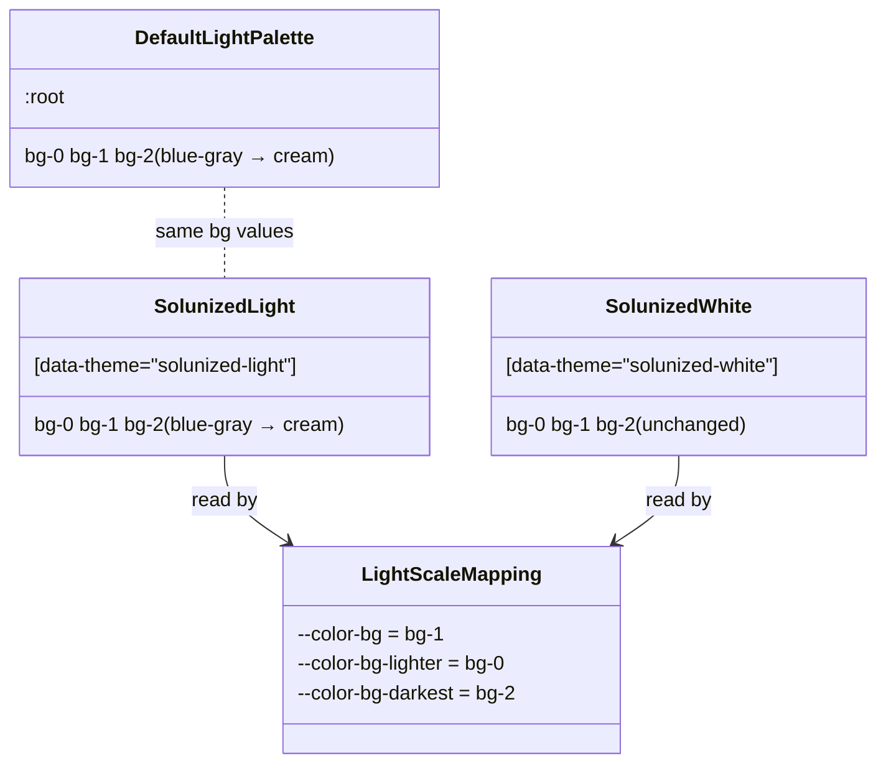

# Plan: Solunized light gets the Solarized cream background

From `intent.md` (2026-10-21). Status: accepted.

## Context

`solunized-light` and `solunized-white` both have a cool blue-gray page background, so they look the same. This change gives `solunized-light` and the default light `:root` palette the Solarized cream background. It also removes the stale "generated by kyiv" comments. It is a bug fix: the regression test comes first and fails before the fix.

## Design

### Domain terms

- **bg scale**: `--color-bg-0` (lightest surface: cards, sidebar), `--color-bg-1` (page canvas), `--color-bg-2` (darkest: borders). Existing term, from the comment in `0_colors.css`.
- **Default light palette**: the first `:root` block in `4_theme/0_colors.css`, used by a light OS with no `data-theme`.
- **Flattened manifest**: `app/assets/stylesheets/mvpa/mvpa.css`, the hand-maintained copy of every partial.
- **Cream**: the Solarized light backgrounds `base3` (`#fdf6e3`) and `base2` (`#eee8d5`), hue near 90° in OKLCH.

No glossary file exists in this repository. No new term conflicts with an agreed one.

### Diagrams

Before and after have the same structure. Only values and comments change.

The new values:

| Token | Old | New | Source |
|---|---|---|---|
| `--color-bg-0` | `oklch(98.98% 0.0025 228.78)` | `oklch(97.35% 0.0261 90.10)` | Solarized `base3` `#fdf6e3` |
| `--color-bg-1` | `oklch(93.79% 0.0095 222.06)` | `oklch(93.06% 0.0260 92.40)` | Solarized `base2` `#eee8d5` |
| `--color-bg-2` | `oklch(86.24% 0.0187 218.40)` | `oklch(86.37% 0.0293 91.67)` | `#d9d2bd`, a darker cream for borders |

Measured WCAG contrast (sRGB relative luminance, computed from these OKLCH values):

| Foreground | on bg-0 | on bg-1 (page) | on bg-2 |
|---|---|---|---|
| `fg-0` (body text) | 8.38 | 7.38 | 5.98 |
| `fg-1` | 13.04 | 11.48 | 9.32 |
| `dim-0` (muted) | 2.69 | 2.37 | 1.92 |

`dim-0` on the old page background was 2.43, so it was already below AA. Foreground colors are out of scope.

### Signatures

Not affected: no Ruby production code changes. The only Ruby is Minitest test code.

Not checked: mvpa.css declined Steep and rbs_rails.

### Complexity

Not affected: CSS custom-property values only, no new rule, no new selector, no runtime path, no queries.

### Invariants

- The default light palette and `solunized-light` have the same `--color-bg-0/1/2` values, in both `0_colors.css` and `mvpa.css`. Enforced by the new test `test/solunized_light_cream_test.rb`.
- In both light palettes, bg-0 is lighter than bg-1, and bg-1 is lighter than bg-2 (OKLCH lightness 97.35% > 93.06% > 86.37%). Enforced by the new test.
- The light scale mapping keeps cards on bg-0, the page on bg-1 and borders on bg-2: `--color-bg-lighter: var(--color-bg-0)`, `--color-bg: var(--color-bg-1)`, `--color-bg-darkest: var(--color-bg-2)` and `--color-border: var(--color-bg-darkest)`. Enforced by the new test, in both files.
- `solunized-white` keeps its old bg values. Enforced by the new test.
- No shipped file mentions kyiv or the old "generated … do not edit directly" marker. Enforced by the new test for the two stylesheets, and by `git grep -i kyiv -- . ':!docs/changes'` for the whole repository. `docs/changes/` is excluded because `intent.md` and `plan.md` must name the word; `deliver` removes that folder before the pull request opens.

### Alternatives

1. **Edit the values in place (chosen).** Change three values in two blocks in each of the two files, delete the kyiv comments, and add a test that pins the values. It is the smallest diff and keeps the bg scale structure, as `intent.md` requires.
2. **One shared light rule (rejected).** Replace the duplicated blocks with one rule, `:root, :root[data-theme="solunized-light"]`, so the default and the theme can never drift. Rejected because `intent.md` puts "any change to the structure" out of scope, and because `:root[...]` only matches `<html>`: an app that nests `data-theme="solunized-light"` on an inner element would lose the light palette. The new test gives the same drift protection without the structural change.

## Design decisions

- **Concrete values.** `intent.md` asks for "the Solarized cream" without values. bg-0 and bg-1 are Solarized's own `base3` and `base2`. Solarized has no darker cream, so bg-2 is `#d9d2bd`, chosen at almost the same lightness as the old bg-2 (86.37% vs 86.24%) so borders keep their weight.
- **`test/solunized_color_sync_test.rb` changes.** It pins the old light bg-0 value and says the file is "generated … do not edit directly". That is false after this change and the test would fail. Its comment is rewritten to say the values are hand-maintained, its two test names lose "match_the_generator", and its bg-0 assertion uses the new value. This replaces an obsolete expectation; it does not weaken a test.
- **`test/changelog_upgrading_test.rb` changes.** Two tests read "the latest entry", which becomes the new 2026-10-21 entry. They are pinned to the 2026-10-19 entry by date, as the earlier change did for the 2026-10-13 entry (`BUTTONS`). Their names change from `latest_entry` to `menu_entry`.
- **Changelog section.** The entry has one `### Fixed` subsection and no `### Upgrading`, per `AGENTS.md` ("a colour fix"). The kyiv comment removal is internal and gets no changelog line.
- **Banner line.** The banner `Solunized themes — generated by kyiv` becomes `Solunized themes`. The four `/* Generated by kyiv — do not edit directly */` lines are deleted, with the blank line after each, so each theme comment sits directly above its blank line and rule as before.
- **Muted text.** `dim-0` (`--color-fg-lighter`: blockquotes, footers, small help text) is 2.37:1 on the cream page, against 2.43:1 on the old page. Both are below AA. `intent.md` puts foreground colors out of scope and its criterion names body text, so this plan keeps `dim-0`. Whether to fix muted text in a follow-up change is Etienne's decision.
- No conflict with `intent.md`'s `## Decisions`.

## Integration points

- Apps that pin mvpa.css by git SHA see the new cream on their next bump. They need no code change.
- `demo.html` links the partials, so it shows the change with no edit.

## Files that change

- `test/solunized_light_cream_test.rb` — new regression test (see Proof).
- `test/solunized_color_sync_test.rb` — new bg-0 value, comment and test names without the generator claim.
- `test/changelog_upgrading_test.rb` — pin the two "latest entry" tests to `2026-10-19`; add a test for the new entry.
- `app/assets/stylesheets/mvpa/4_theme/0_colors.css` — new bg-0/1/2 in the first `:root` block (lines 14–16) and in `[data-theme="solunized-light"]` (lines 90–92); remove the kyiv banner text (line 83) and the four kyiv comment lines (87, 118, 149, 180).
- `app/assets/stylesheets/mvpa/mvpa.css` — the same edits at lines 2032–2034, 2108–2110, 2101, 2105, 2136, 2167 and 2198.
- `CHANGELOG.md` — new `## 2026-10-21` entry on top.

## Order of work

1. Write `test/solunized_light_cream_test.rb`. Run `bundle exec ruby -Itest test/solunized_light_cream_test.rb` and watch it fail on the blue-gray values and the kyiv comments.
2. Commit the failing test on its own.
3. Edit `4_theme/0_colors.css`: the new bg values in both light blocks, the kyiv lines removed.
4. Apply the same edits to `mvpa.css`.
5. Update `test/solunized_color_sync_test.rb` to the new bg-0 value and drop the generator claim. Run it and the new test; both pass.
6. Pin the two "latest entry" tests in `test/changelog_upgrading_test.rb` to `2026-10-19`, and add the test for the new entry. Run the file and watch only the new test fail.
7. Add the `## 2026-10-21` entry to `CHANGELOG.md`. Run the changelog test file; it passes.
8. Run `git grep -i kyiv -- . ':!docs/changes'`; it prints nothing.
9. Run the full suite, the CI checks (`bundle exec rake test`, `npm run lint:css`, `npm run lint:browsers`, `yamllint --strict .`, `gem build mvpa-css.gemspec`) and the project's Ruby linter `bundle exec rubocop`, which CI does not run.
10. Open `demo.html` with `data-theme="solunized-light"`, then `solunized-white`, and with no `data-theme` on a light OS. Take a screenshot of each. Record that light and default are cream, white is unchanged, cards are lighter than the page and borders are darker.

Out of scope: the white, dark and black themes; the foreground, accent and `br-` colors; the eink theme; the bg scale structure; README wording about the themes.

## Risks

- `mvpa.css` and `0_colors.css` drift on values. The new test reads both files, so a drift fails it.
- The new date may be wrong if the change lands on a later day. Use the date the entry is written; the changelog tests read it by heading, so a later rename means updating the constant.
- `dim-0` muted text stays below AA on the new cream (2.37 on the page). It was 2.43 before, so this is no regression, and foregrounds are out of scope.
- The OKLCH values come from a hex conversion. Rounding to two and four decimals shifts them by less than one sRGB step; the screenshots in step 10 confirm the look.

## Proof

- With `data-theme="solunized-light"`, the page background is a visibly yellowish cream and no longer blue-gray → `test/solunized_light_cream_test.rb` `test_solunized_light_has_the_solarized_cream_backgrounds`, plus `test_solunized_light_page_background_has_a_yellow_hue` (bg-1 hue between 60 and 110, chroma above 0.015), plus the step 10 screenshot.
- With `data-theme="solunized-white"`, the page background is unchanged → `test/solunized_light_cream_test.rb` `test_solunized_white_keeps_its_neutral_backgrounds`.
- A light OS with no `data-theme` shows the same cream as `solunized-light` → `test/solunized_light_cream_test.rb` `test_default_light_palette_matches_solunized_light`.
- Cards and the sidebar are lighter than the page, and borders are darker than the page → `test/solunized_light_cream_test.rb` `test_cards_are_lighter_and_borders_darker_than_the_page` (bg lightness order) and `test_light_mapping_puts_cards_on_bg_0_and_borders_on_bg_2` (scale mapping and `--color-border`).
- Body text on the cream page keeps WCAG AA contrast → `test/solunized_light_cream_test.rb` `test_body_text_on_the_cream_page_meets_wcag_aa` (computes the contrast of `fg-0` on `bg-1` from the OKLCH values and asserts at least 4.5).
- No file mentions kyiv → `test/solunized_light_cream_test.rb` `test_the_stylesheets_carry_no_generator_marker` (refutes `/generated by/i` and `/do not edit directly/i`, so the test file itself never names the word), plus check: `git grep -i kyiv -- . ':!docs/changes'` prints nothing.
- The Minitest suite and all linters in CI pass, including the manifest sync test → check: `bundle exec rake test && npm run lint:css && npm run lint:browsers && yamllint --strict . && gem build mvpa-css.gemspec`, plus `bundle exec rubocop` for the touched Ruby test files.
- Invariant: both light palettes have the same bg values in both files, enforced by the hand-edited stylesheets → `test/solunized_light_cream_test.rb` `test_default_light_palette_matches_solunized_light` (runs over the partial and the bundle).

Per changed file, the unit tests expected, named as behaviour:
- `test/solunized_light_cream_test.rb`: every test above runs over both `4_theme/0_colors.css` and `mvpa.css` through `CssSourceHelper#each_source`, with the source name in each failure message.
- `test/solunized_color_sync_test.rb`: `test_solunized_dark_foregrounds_keep_their_values`, `test_solunized_light_background_and_foregrounds_keep_their_values`.
- `test/changelog_upgrading_test.rb`: `test_the_menu_entry_tells_apps_how_to_adopt_the_menu_and_responsive_tables`, `test_the_menu_entry_lists_what_was_added_and_changed_and_ends_with_upgrading`, `test_the_cream_entry_is_a_fix_with_no_upgrading_steps` (headings equal `["### Fixed"]`).

Test setup: no fixtures. The new test starts with `require "minitest/autorun"` and `require_relative "css_source_helper"`, then includes `CssSourceHelper`, as `test/details_menu_test.rb` does. It finds the default light palette as the first `rule_bodies(css, ":root")` body that declares `--color-bg-0`, and theme blocks with `rule_body(css, '[data-theme="solunized-light"]')`. It parses `oklch(L% C H)` values with a regex. The contrast test converts OKLCH to linear sRGB with the standard OKLab matrices in a private helper, then uses the WCAG relative-luminance formula.

---
Domain skills applied: software-design, rails-ui (contrast, theming), diagrams.

## Critique

### Round 1 (codex exec -p terra)

- A repository-wide `git grep -i kyiv` cannot pass, because `intent.md`, `plan.md` and the planned test name contain the word → fixed (the check excludes `docs/changes/`, which `deliver` removes; the test is renamed `test_the_stylesheets_carry_no_generator_marker` and refutes the marker text instead of the word)
- The test setup omits `require_relative "css_source_helper"`, so step 1 would fail on `NameError` instead of on assertions → fixed (Test setup names both requires)
- `dim-0` muted text is 2.37:1 on cream, below AA, and the plan accepts it without naming the conflict with "readable contrast" → fixed (a Design decisions entry records it; intent scopes foregrounds out and its criterion names body text; the follow-up is left to Etienne)
- "Every CI linter" is wrong, because CI runs no RuboCop job → fixed (step 9 and the Proof line list the CI checks, add `gem build`, and name RuboCop as a project check outside CI)
- The palette test does not prove that cards, sidebar and borders use the ordered tokens → fixed (new invariant and test `test_light_mapping_puts_cards_on_bg_0_and_borders_on_bg_2` assert the light scale mapping and `--color-border` in both files)

Reproduction: committed
