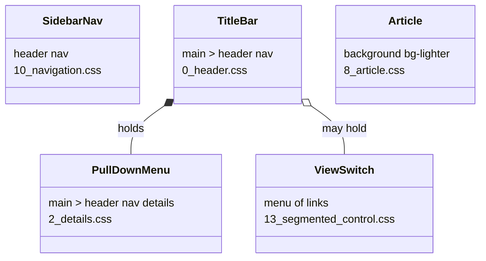
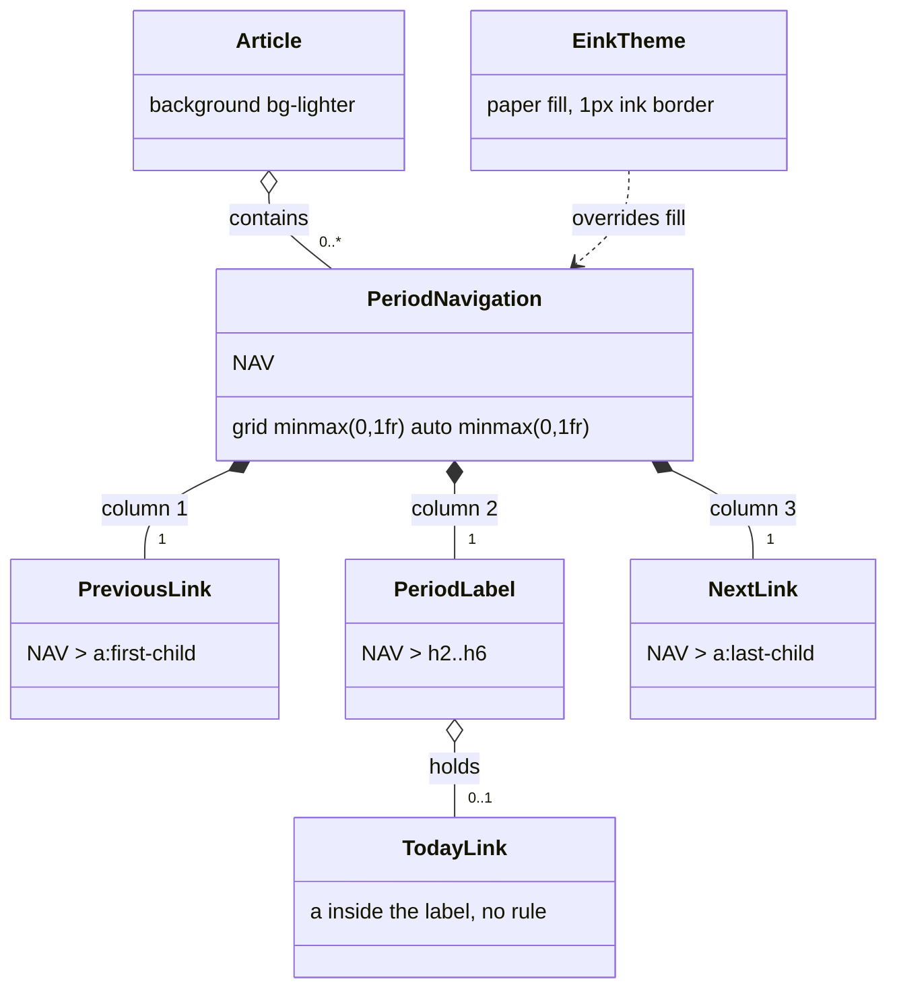

# Plan: Period navigation (previous / current / next)

From `intent.md` (2026-10-26). Status: accepted.

Revised on 2026-10-26 against `origin/main` at `890d132` (PR #45, segmented control and count badges). That merge took the `13_` partial number, raised the demo file count to 25, added a `2026-10-25` CHANGELOG entry and created `GLOSSARY.md`. The design is unchanged; file names, counts, positions and the changelog pin follow `main`.

## Design

### Domain terms

`GLOSSARY.md` exists on `main` (count badge, form choice, segmented control, view switch). None of its terms or avoided words clashes with the intent. These terms are new:

- **Period navigation** — a `<nav>` outside any `<header>` whose element children are exactly a link, a heading (`h2`–`h6`) and a link. Avoid: week navigation, pager.
- **Period label** — the heading in the middle of a period navigation. It names the period: "Week 43, 2026", "October 2026", "26 Oct 2026", "2026".
- **Today link** — an optional `<a>` inside the period label that goes back to the current period.
- **Previous link** — the first child of a period navigation.
- **Next link** — the last child of a period navigation.
- **Sidebar nav** (`body > header nav`), **title bar** (`main > header nav`), **pull-down menu** (`main > header nav details`) — as in the intent. None of them changes.

A **view switch** (a `<menu>` of links, such as "Deze maand · Vorige maand") also picks a period, but from a fixed list. A period navigation steps one period back or forward. The two never share markup: one is a `<menu>`, the other a `<nav>` with no list.

### Diagrams

Before: no rule styles a `<nav>` outside a `<header>`. The touched surfaces today:



After: the period navigation and its parts. `NAV` is the recognition selector under Signatures.



### Signatures

This change ships CSS only. The "signatures" are the selectors and their declarations.

`NAV` stands for the one recognition selector, written out in full in every rule (CSS nesting is outside the browserslist floor of Safari 16.4):

```css
nav:not(header nav):has(> a:first-child + :is(h2, h3, h4, h5, h6) + a:last-child)
```

- `:not(header nav)` keeps the sidebar nav, the title bar, the pull-down menu and every `section > header > nav` out.
- `> a:first-child + heading + a:last-child` needs exactly three element children in that order. A table-of-contents nav (`h2 + ul`), a nav with a list, and a nav that holds a `<menu>` never match.
- Specificity is (0,2,6). It beats the base `a` and `h2` rules of `0_base/2_typography.css`.

New partial `app/assets/stylesheets/mvpa/2_modules/15_period_navigation.css` — styles a period navigation from its structure alone:

```css
NAV {
  display: grid;
  grid-template-columns: minmax(0, 1fr) auto minmax(0, 1fr);
  align-items: center;
  column-gap: var(--inline-space-double);
  margin-block-end: var(--block-space);
  padding: var(--block-space);
  border-radius: var(--radius-small);
  background-color: var(--color-bg-lighter);
  overflow-wrap: anywhere;
}

article NAV {
  background-color: var(--color-bg);
}

NAV > a:first-child {
  justify-self: start;
}

NAV > a:last-child {
  justify-self: end;
  text-align: end;
}

NAV > :is(h2, h3, h4, h5, h6) {
  margin: 0;
  text-align: center;
}

@media (max-width: 768px) {
  NAV {
    grid-template-columns: minmax(0, 1fr);
    justify-items: center;
    row-gap: var(--block-space-half);
  }

  NAV > a:first-child,
  NAV > a:last-child {
    justify-self: center;
    text-align: center;
  }

  NAV > :is(h2, h3, h4, h5, h6) {
    font-size: var(--text-medium);
  }
}
```

The Today link gets no rule. It flows inline in the period label, and the label stays one grid item, so the bar keeps its three parts. The links keep the base link look, including the hover underline wiggle of `0_base/3_animations.css`; that rule's exclusions do not name a period navigation, and none is needed.

`app/assets/stylesheets/mvpa/4_theme/2_eink.css` — one rule in each e-ink section, after that section's `article` rule, with literal ink values like its neighbours:

```css
[data-theme="eink-light"] NAV {
  background-color: white;
  border: 1px solid black;
}

[data-theme="eink-dark"] NAV {
  background-color: black;
  border: 1px solid white;
}
```

Specificity (0,3,6) beats `article NAV` (0,2,7), so one e-ink rule covers both surfaces.

Not checked: mvpa.css changes no Ruby production code here, so Steep has nothing to check.

### Complexity

- No queries; this is a stylesheet.
- Selector cost: `:has(> …)` reads only the direct children of each `<nav>`, O(children). `:not(header nav)` walks the ancestors, O(depth). Both run only for `<nav>` elements, a handful per page.
- Size: eight rules in the partial (five for desktop, three in the phone media query), two in `2_eink.css`, each mirrored once in `mvpa.css`.

### Invariants

- A `<nav>` inside any `<header>` never gets a period navigation rule. Enforced by `:not(header nav)` in `NAV`. Proved by `test/period_navigation_test.rb` and by the existing `test/title_bar_row_test.rb`, `test/details_menu_test.rb`, `test/mobile_navigation_test.rb`, `test/demo_responsive_test.rb` and `test/segmented_control_test.rb`, which stay green with no edits.
- A `<nav>` whose element children are not exactly link, heading, link never matches. Enforced by the `:first-child + … + :last-child` chain in `NAV`.
- The period label sits in the exact centre of the bar on desktop, whatever the link widths. Enforced by the two equal `minmax(0, 1fr)` side tracks.
- The bar's fill differs from the surface under it. On the page canvas (`--color-bg`) the bar is `--color-bg-lighter`; inside an `article` (`--color-bg-lighter`) it is `--color-bg`. On e-ink it is paper with a 1px ink border.
- The period navigation uses no class. Enforced by the partial's selectors.
- `15_period_navigation.css`, `2_eink.css` and `mvpa.css` hold the same period navigation rules. Enforced by `each_source` in the new test.

### Alternatives

- **A. Closest copy of Clocky (rejected).** `nav:has(> a + h2 + a)` in `10_navigation.css`, flex with `flex: 1` on the `h2`, fill `--color-bg`. Fewest lines and no new partial. Rejected: the label is off-centre when the links differ in width, `h2` only, no header exclusion (a title bar holding link, `h2`, link would match), no tint on the page canvas, and grey fill on e-ink against the e-ink convention.
- **B. Robust recognition with `rel="prev"` / `rel="next"` (partly taken).** The chosen grid, surface fills, header exclusion and e-ink rules come from B. Its `rel` requirement is rejected: the intent's decision is to move Clocky's week navigation in as it is, and Clocky's links carry no `rel`. The exact three-child chain already gives the safety `rel` would add.
- **C. Chosen.** B without `rel`, with A's token mapping (`--block-space`, `--radius-small`, `--block-space-half`, `--text-medium`).

## Design decisions

- **New partial, not `10_navigation.css`.** The intent lists "a stylesheet partial". `10_navigation.css` describes the app tabs; the period navigation is a separate control. Cost: `demo.html` goes from 25 to 26 files.
- **File name `15_period_navigation.css`.** `13_` and `14_` are taken on `main`. Underscore like the newest partials (`13_segmented_control.css`, `14_count_badge.css`, `7_definition_list.css`); only `11_turbo-transitions.css` uses a hyphen.
- **Label is any of `h2`–`h6`.** Clocky uses `h2`. A deeper section needs a deeper heading. `h1` stays the page title.
- **Exactly centred label (grid), not Clocky's `flex: 1`.** The acceptance criterion says "centred". With equal link widths the look matches Clocky.
- **Fill depends on the surface.** Clocky's `--color-bg-lighter` equals mvpa.css's `article` fill, so it is invisible inside an article, where both Clocky pages put it. The bar takes `--color-bg` inside an article and `--color-bg-lighter` on the canvas.
- **Token mapping.** Clocky's `padding: 1rem` → `--block-space`; `border-radius: 4px` → `--radius-small`; phone `gap: .5rem` → `--block-space-half`; `margin-bottom: 1.5rem` → `--block-space` (no 1.5rem token); phone `font-size: 1.2rem` → `--text-medium` (1.1rem, the nearest token).
- **No rule for the Today link.** Clocky has none; it inherits the heading's text style and the base link colour.
- **Phone breakpoint `max-width: 768px`.** The breakpoint every other partial uses.
- **E-ink as literal values, not custom properties.** The `article` rules it sits beside use literal `white`/`black`. The segmented control's `--segment-*` properties exist because its partial reads them; this partial has nothing to parameterise.
- **Glossary terms land after the rebase.** The branch predates `GLOSSARY.md`; writing it here would add a file that collides with `main`'s on rebase. The implement stage adds the terms in step 2 of Order of work.
- No conflict with `intent.md`'s `## Decisions`.

## Integration points

- Clocky's `update-appkit-and-mvpa-css` change consumes this after merge: it drops `class="week-navigation"` and its CSS. Clocky pins a merged SHA only, so this change merges first.
- The Rails engine serves every file under `app/assets/stylesheets/mvpa/`; no engine change.
- `mvpa.css` is the Propshaft single import; it must carry the new rules.

## Files that change

- `app/assets/stylesheets/mvpa/2_modules/15_period_navigation.css` — new partial with the rules under Signatures, headed by a comment block like its neighbours.
- `app/assets/stylesheets/mvpa/4_theme/2_eink.css` — the two e-ink rules, each after its section's `[data-theme="eink-…"] article` rule.
- `app/assets/stylesheets/mvpa/mvpa.css` — the partial's text after the Count badge section, before the Solunized colour definitions; the e-ink rules after each bundled `[data-theme="eink-…"] article` rule.
- `demo.html` — a `<link>` for `15_period_navigation.css` after `14_count_badge.css`; "25 files organized in SMACSS structure" → "26 files …" and "Import all 25 CSS files" → "Import all 26 CSS files"; a sidebar link `<li><a href="#period-navigation">🗓️ Period navigation</a></li>` in the Components group after Count badges; a new `<article id="period-navigation">` after `#count-badges`, before the Lists section, with an `<h2>` and four `<section>`s, each with an `<h3>`: a week with a Today link, a month, a day, a year. The period labels in the demo are `<h4>`.
- `README.md` — a `### Period navigation` section after `### Count badges` and before `### Page Transitions`, with the literal markup (`<nav>`, `<a href="…">← Previous week</a>`, `<h2>Week 43, 2026 <a href="…">Today</a></h2>`, `<a href="…">Next week →</a>`) and three bullets: heading `h2`–`h6`, nothing else as a direct child, never inside a `<header>`. Add `15_period_navigation.css` to the standalone `<link>` list after `14_count_badge.css` and to the file-structure tree.
- `GLOSSARY.md` — the five new terms under Domain terms (Period navigation, Period label, Today link, Previous link, Next link), alphabetical with the existing ones.
- `CHANGELOG.md` — a new top entry dated the day of implementation, with `### Added` (period navigation) and `### Upgrading` last. If an entry for that date already exists, add to it as `CLAUDE.md`'s Changelog rules say. Steps:
  1. Remove `class="week-navigation"` from the `<nav>`.
  2. Keep exactly three direct children: the previous `<a>`, a heading `<h2>`–`<h6>` with the period label, the next `<a>`.
  3. Put a secondary link such as `Today` inside the heading.
  4. Keep the `<nav>` outside any `<header>`.
  5. Delete your `.week-navigation` rules, including the ones in `@media (max-width: 768px)`.
  6. Standalone pages only: add `15_period_navigation.css` to your stylesheet links after `14_count_badge.css`. The gem and `mvpa.css` include it already.
- `test/period_navigation_test.rb` — new, CSS source tests.
- `test/demo_period_navigation_test.rb` — new, demo structure tests with Nokogiri.
- `test/readme_test.rb` — two new tests.
- `test/changelog_upgrading_test.rb` — add `BADGES = "2026-10-25"`; pin the two tests that read the latest entry to it (read through `entry(BADGES)`, renamed `test_the_badges_entry_tells_apps_how_to_adopt_segmented_controls_and_badges` and `test_the_badges_entry_lists_what_was_added_and_changed_and_ends_with_upgrading`, dropping its `refute_equal`), as the `MENU` pin did for `2026-10-19`; add two tests for the new latest entry, the second with `refute_equal entry(BADGES), latest_entry`.

## Order of work

1. Rebase the branch onto `origin/main` with the `sync` skill (the branch holds only the docs commit, so no conflicts). If untracked `test/period_navigation_test.rb` or `test/demo_period_navigation_test.rb` exist from an earlier run on the pre-revision plan, rebase with them left in place, then change their partial path from `13_period-navigation.css` to `15_period_navigation.css` and check them against the Proof list below before use.
2. Add the five glossary terms to `GLOSSARY.md`; commit as `docs: glossary terms for week-navigation`.
3. Write `test/demo_period_navigation_test.rb` `test_the_demo_shows_a_week_navigation_with_a_today_link`, run it (`bundle exec ruby -Itest test/demo_period_navigation_test.rb`), watch it fail.
4. Write `test/period_navigation_test.rb` (all tests listed under Proof), run it, watch it fail.
5. Create `15_period_navigation.css`; run the test file until the partial-side assertions pass.
6. Add the e-ink rules to `2_eink.css`.
7. Copy the partial and the e-ink rules into `mvpa.css`; run `test/period_navigation_test.rb` green.
8. Write `test_the_demo_links_the_period_navigation_partial_right_after_the_count_badge`, watch it fail, then update `demo.html` (link, both counts, sidebar link, article); run `test/demo_period_navigation_test.rb`, `test/demo_stylesheet_links_test.rb` and `test/demo_subsection_structure_test.rb` green.
9. Add the two README tests, watch them fail, then add the README section, link and tree entry; run `test/readme_test.rb` green.
10. Pin the two latest-entry changelog tests to `2026-10-25`; add the two new tests; watch them fail; write the CHANGELOG entry; run `test/changelog_upgrading_test.rb` green.
11. Run the full suite (`bundle exec rake test`), `bundle exec rubocop`, `npm run lint:css`, `npm run lint:browsers`, `yamllint --strict .`.
12. Manual check in a browser on `demo.html` (see Proof): desktop and 375px width, all six themes, sidebar nav, title bar, pull-down menu and segmented controls unchanged.

## Risks

- **The branch is behind `main`.** Planned against `890d132`; step 1 rebases first. If `main` moves again before implementation and touches the same files, re-check the file number, the demo counts and the latest CHANGELOG date before writing code.
- **A missing link loses the look.** A period navigation that leaves out its next link (no future weeks) has two children and gets no style. Out of scope; Clocky always renders both links. A later change can accept `<a>` without `href` as a placeholder.
- **A period navigation inside a `<header>` is never styled.** That is the price of keeping header navs safe. The README and the Upgrading steps say so.
- **The long selector is repeated** in about a dozen places across the partial, `2_eink.css` and `mvpa.css`. The tests look each rule up by the exact `NAV` string, so a drifted copy fails.
- **Stylelint and the browser-feature plugin.** `:not()` with a complex argument and `:has()` are within the browserslist floor (`3_animations.css` already uses both). If the plugin flags `:not(header nav)`, stop and report; never add a disable comment or edit the lint config.
- **Clocky look moves slightly:** label exactly centred, 1rem bottom margin instead of 1.5rem, 1.1rem phone label instead of 1.2rem, darker band inside an article.
- **Rejected:** the `rel` requirement (changes Clocky's markup beyond dropping the class), a rule in `10_navigation.css` (mixes two controls), a `color-mix` tint (not a plain token; the surface-dependent fill is simpler).

Out of scope: any Clocky change, a day strip, a calendar, a date picker, styling `input[type="week"]` or other date inputs, generating labels or dates, JavaScript, and any change to the sidebar nav, the title bar, the pull-down menu or the segmented control.

## Proof

- Previous link, centred label and next link on one tinted bar, no class → `test/demo_period_navigation_test.rb` `test_the_demo_shows_a_week_navigation_with_a_today_link`; `test/period_navigation_test.rb` `test_a_period_navigation_is_a_three_column_bar`, `test_the_period_label_sits_in_the_centre_column`, `test_the_previous_and_next_links_sit_at_the_ends`, `test_the_partial_uses_no_class`; check: open `demo.html`, the week example shows one bar, previous at the start, label centred, next at the end.
- Month, day and year labels look the same → `test/demo_period_navigation_test.rb` `test_the_demo_shows_month_day_and_year_navigations_with_the_same_markup`; check: the four demo examples share one look.
- A Today link sits next to the label, the bar keeps three parts → `test/demo_period_navigation_test.rb` `test_the_today_link_sits_inside_the_period_label`; check: in `demo.html` the Today link shows beside "Week 43, 2026" inside the bar.
- On a phone the parts stack in a column, label centred, no sideways scroll → `test/period_navigation_test.rb` `test_on_a_phone_the_parts_stack_centred_in_one_column`, `test_a_long_label_wraps_instead_of_scrolling`; check: `demo.html` at 375px wide, the three parts stack centred and `document.documentElement.scrollWidth <= document.documentElement.clientWidth`.
- The bar reads in all six themes → `test/period_navigation_test.rb` `test_the_bar_is_tinted_against_the_surface_under_it`, `test_eink_themes_draw_the_bar_as_paper_with_an_ink_border`; check: switch `demo.html` through Solunized light, dark, white, black, eink-light, eink-dark; the bar and its links read in each.
- Sidebar nav, title bar and pull-down menu look the same → `test/period_navigation_test.rb` `test_no_period_navigation_rule_reaches_a_header_nav`; the existing `test/title_bar_row_test.rb`, `test/details_menu_test.rb`, `test/mobile_navigation_test.rb`, `test/demo_responsive_test.rb`, `test/segmented_control_test.rb` pass with no edits; check: `git diff origin/main -- app/assets/stylesheets/mvpa/2_modules/10_navigation.css app/assets/stylesheets/mvpa/1_layout/0_header.css app/assets/stylesheets/mvpa/2_modules/2_details.css app/assets/stylesheets/mvpa/2_modules/13_segmented_control.css` is empty, and the four look the same in `demo.html` on desktop and at 375px.
- `demo.html` shows a period navigation, `README.md` shows its markup → `test/demo_period_navigation_test.rb` `test_the_demo_shows_a_week_navigation_with_a_today_link`; `test/readme_test.rb` `test_readme_shows_the_period_navigation_markup`; `test/demo_stylesheet_links_test.rb` (26 files).
- Both documents link the new partial in load order → `test/demo_period_navigation_test.rb` `test_the_demo_links_the_period_navigation_partial_right_after_the_count_badge`; `test/readme_test.rb` `test_readme_links_the_period_navigation_partial_right_after_the_count_badge`. The existing link tests only check the links already present, so they pass without the new one.
- The CHANGELOG entry tells an app how to replace its week-navigation class → `test/changelog_upgrading_test.rb` `test_the_latest_entry_tells_apps_how_to_replace_their_week_navigation_class`, `test_the_latest_entry_lists_what_was_added_and_ends_with_upgrading`.
- Invariant: a header nav never matches, enforced by `:not(header nav)` in `NAV` → `test/period_navigation_test.rb` `test_no_period_navigation_rule_reaches_a_header_nav`.
- Invariant: only link, heading, link matches, enforced by the child chain in `NAV` → `test/period_navigation_test.rb` `test_the_recognition_selector_needs_exactly_link_heading_link`.
- Invariant: partial, e-ink and bundle hold the same rules, enforced by `each_source` → `test/period_navigation_test.rb` (every test runs on the partial and `mvpa.css`) and `test_eink_themes_draw_the_bar_as_paper_with_an_ink_border` (runs on `2_eink.css` and `mvpa.css`).
- Query count: not affected; no database.

Per changed file, the unit tests expected, named as behaviour:
- `15_period_navigation.css` (and its `mvpa.css` copy): `a period navigation is a three-column bar`, `the period label sits in the centre column`, `the previous and next links sit at the ends`, `the bar is tinted against the surface under it`, `on a phone the parts stack centred in one column`, `a long label wraps instead of scrolling`, `the recognition selector needs exactly link heading link`, `no period navigation rule reaches a header nav`, `the partial uses no class`.
- `2_eink.css` (and its `mvpa.css` copies): `eink themes draw the bar as paper with an ink border`.
- `demo.html`: `the demo links the period navigation partial right after the count badge` (the `<link>` for `15_period_navigation.css` is the next stylesheet link after `14_count_badge.css`), `the demo shows a week navigation with a Today link`, `the demo shows month, day and year navigations with the same markup` (labels `October 2026`, `26 Oct 2026`, `2026`), `the Today link sits inside the period label`.
- `README.md`: `the README shows the period navigation markup` (literal `<nav>`, `<h2>Week 43, 2026 <a href=`, no `class=` in the snippet); `the README links the period navigation partial right after the count badge` (in the standalone `<link>` list, and `15_period_navigation.css` follows `14_count_badge.css` in the file-structure tree).
- `CHANGELOG.md`: `the latest entry tells apps how to replace their week-navigation class` (contains `class="week-navigation"`, `<h2>`, `<header>`, `@media (max-width: 768px)`, `15_period_navigation.css`, a `1. ` list); `the latest entry lists what was added and ends with upgrading` (headings `### Added`, `### Upgrading`; not the `2026-10-25` entry).
- `GLOSSARY.md`: no test; check: `grep -c "Period navigation\|Period label\|Today link\|Previous link\|Next link" GLOSSARY.md` prints 5.

Test setup: CSS tests use `CssSourceHelper` (`each_source`, `rule_body`) with a `NAV` constant holding the exact selector string; the phone rule is read from the `@media (max-width: 768px)` block of each source. Demo tests parse `demo.html` with Nokogiri and find `nav` elements with no `header` ancestor whose element children are `a`, `h2`–`h6`, `a`, in Ruby rather than with `:has()`. No fixtures, no faked boundaries.

---
Domain skills applied: software-design, glossary, diagrams.

## Critique

### Round 1 (codex exec -p terra)

- The day label `26 Oct 2026` from the intent has no demo example or test → fixed (demo.html gets a fourth day example; the demo test and Proof line now cover month, day and year)
- `test/mvpa_manifest_sync_test.rb` does not check module partials against `mvpa.css` → dismissed: the plan never relies on that test for this; every new CSS test runs through `each_source` on the partial and `mvpa.css`, and the e-ink test runs on `2_eink.css` and `mvpa.css`, as the Invariants and Proof sections state
- The size claim of six partial rules is wrong; there are eight → fixed (Complexity now says eight rules: five for desktop, three in the phone media query)

### Round 2 (codex exec -p terra)

- The demo and README link proof does not detect a missing link: the existing link tests only check links already present, so leaving out `15_period_navigation.css` still passes → fixed (a demo test and a README test now assert the new link right after `14_count_badge.css`, in Proof, the per-file unit tests and Order of work steps 8 and 9)
